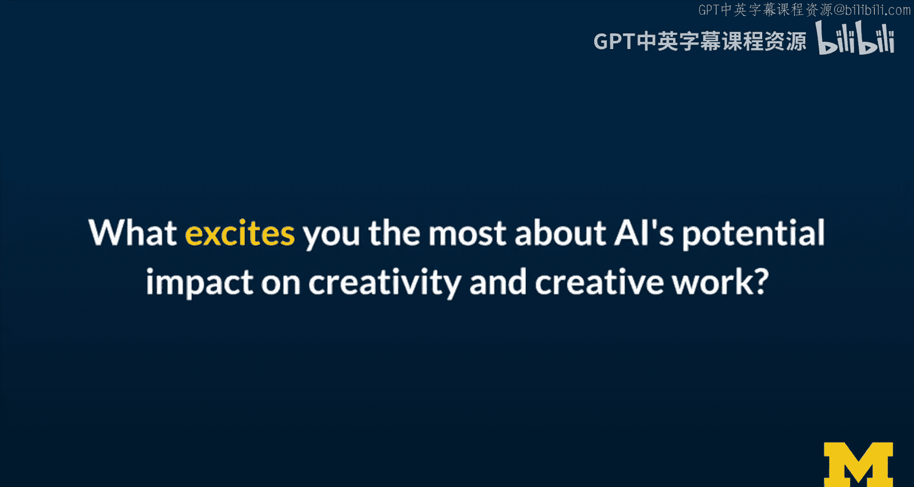
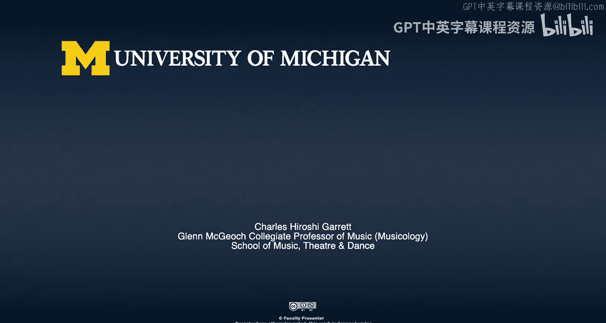

# AI用于创意工作：P08：领域之声：查尔斯·浩石·加勒特 🎤

在本节课中，我们将学习查尔斯·浩石·加勒特教授如何探索AI工具，以辅助其作为教授的创意工作。我们将了解他如何利用AI分析自己的写作、发现创作习惯，并寻求改进沟通的方法。

---

我目前正在探索各种旨在辅助我作为教授的创意工作的AI工具。

这些都是近期出现的工具，承诺能帮助我进行研究和写作。

我最感兴趣的是它们帮助我更深入地了解自己、我的创作习惯、我的思维倾向以及我的创作弱点或局限性的潜力。

例如，我现在可以训练一个AI聊天机器人，让它学习我已发表的著作。

然后，我可以向这个聊天机器人提问关于我的工作：关于我取得了什么成就、我忽略了什么，以及我接下来可以做什么。

我还可以从AI写作工具那里获得关于如何改进书面沟通、如何更清晰有效地写作的建议。

我目前还没有答案，但我希望AI能帮助我更多地了解我是谁、我做了什么，以及我未来如何拓展我的创意工作。

---

本节课中，我们一起学习了查尔斯·浩石·加勒特教授探索AI工具辅助创意工作的实践。他通过训练AI学习自己的著作来进行自我反思，并利用AI工具获取改进写作的建议，旨在更深入地了解自身并拓展未来的创作可能性。