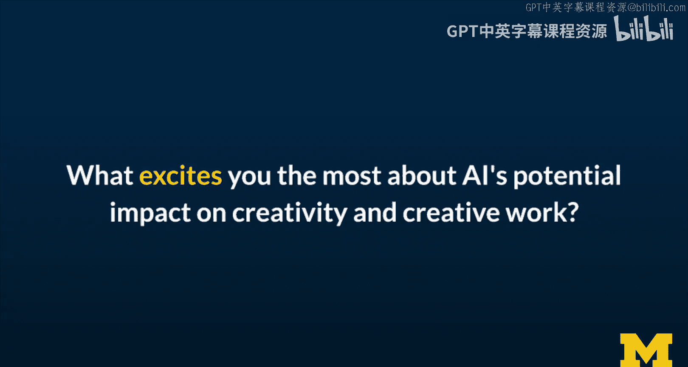
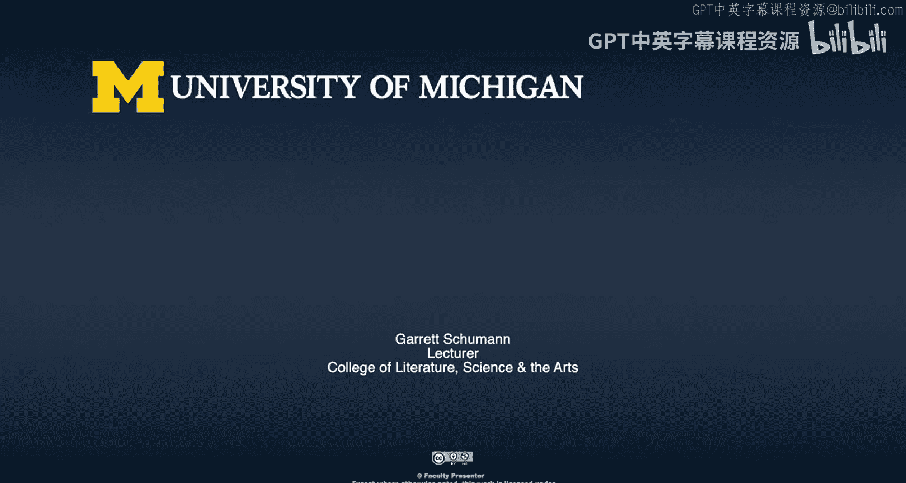

# 密歇根大学《AI用于创意工作｜AI for Creative Work》中英字幕 p09 8_领域之声：加勒特·舒曼.zh_en -BV1DXNiznEXk_p9-

Like a lot of people， the first thing I think about with respect to AI impacting creativity and creative work is the potential for it to streamline tasks that are very tedious。

For example， one particularly time consuming task composers deal with when we collaborate with an ensemble like an orchestra is making parts for each individual member of the group。

 This must be done manually， and it is so loathed within the field that there's a robust secondary market for copy us to whom composers outsource our part making。

 It seems plausible that AI could take care of that kind of task for composers。

 or whatever the equivalent is for other creative professionals， though I will temper my optimism。

 because that kind of small scale， highly personalized AI tool does not appear to be a top priority for the tech industry。

 at least in the current moment。To this end， the ways AI tools can act as a mirror to and expansion of individual creativity fascinate me。

 and I will be excited to see that avenue develop。

