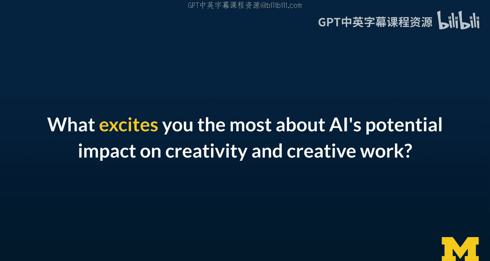
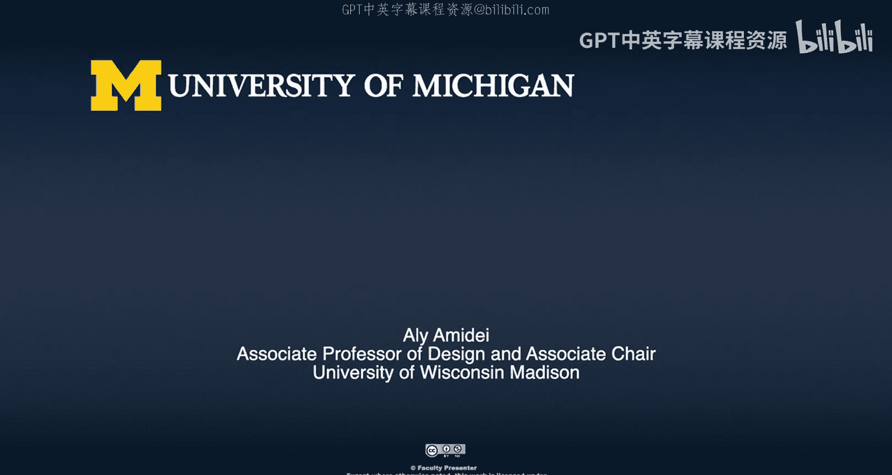

# AI用于创意工作：P10：领域之声：艾丽·阿米迪 🎨

在本节课中，我们将学习艺术家艾丽·阿米迪分享的关于人工智能如何影响其创意实践的观点。她将阐述AI如何帮助她进行快速、低风险的创意原型设计，从而促进实验并减少对艺术实践的负面影响。

---

到目前为止，人工智能通过允许我进行大胆而冒险的尝试，影响了我的创造力。

本质上，它帮助我快速、低成本地构建想法原型，以验证概念。

这可以促进实验，减少对我的艺术实践和项目流程的负面影响。

---

本节课中，我们一起学习了艾丽·阿米迪的观点，她认为AI工具能够帮助创意工作者快速验证想法，降低试错成本，从而更自由地进行艺术探索和实验。