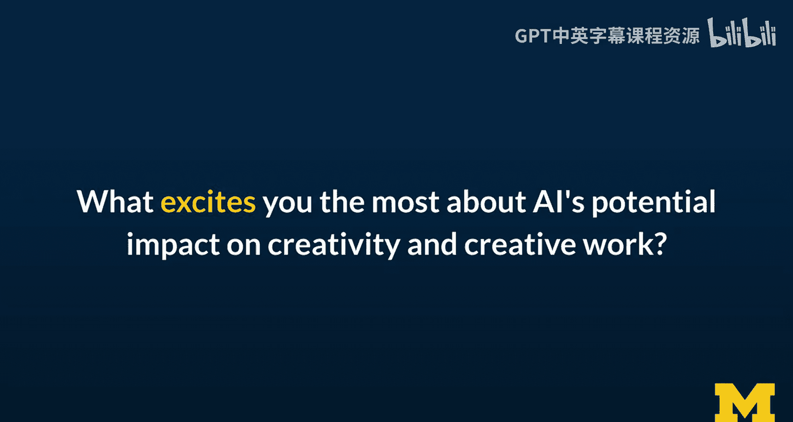
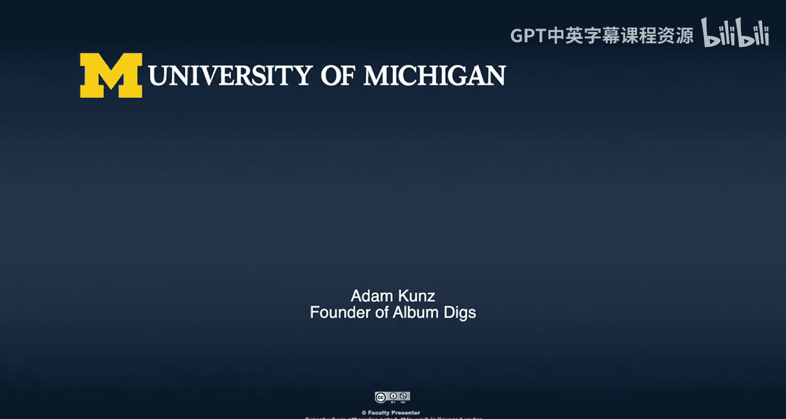

# 密歇根大学《AI用于创意工作｜AI for Creative Work》中英字幕 p11 10_领域之声：亚当·昆兹.zh_en -BV1DXNiznEXk_p11-

This is really about the fidelity of the content we can create I think the bar has been raised on so many industries for what the base level of work that can be done is so if you take for example when computers originally came along I think there was a lot of places where we thought that it would simply displace work and it actually raised the bar on what people could output when Excel came along accountants jobs weren't eliminated they instead could do much better work when you take something like design and photography when people brought up when Photoshop first came out it was like this might ruin a lot of photographer's work know it allowed people to make content that was far better than what they were creating before and more people get involved in the space same from music I think originally people thought music is only if it's played on instruments if it's done on a computer it's not real music and there was a lot of critic。

of that and then you had bands like Daf pun come along and they were able to just far exceed what was being created by going to a whole new genre so I think what really happens here when you have something like AI is people use it to create a higher level of content but they also use it to create new forms of content。

 new forms of expression， so it'll be really exciting to see what people are able to create using AI。

