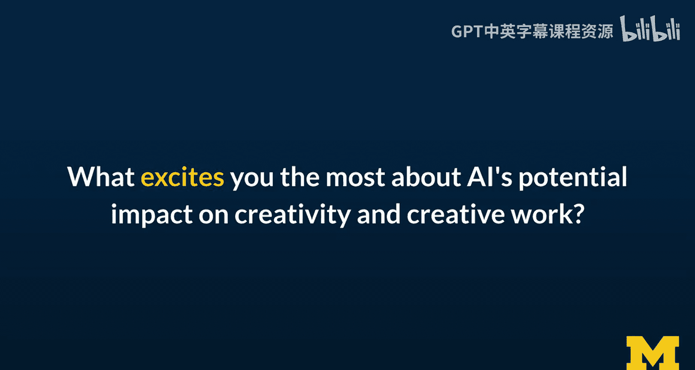
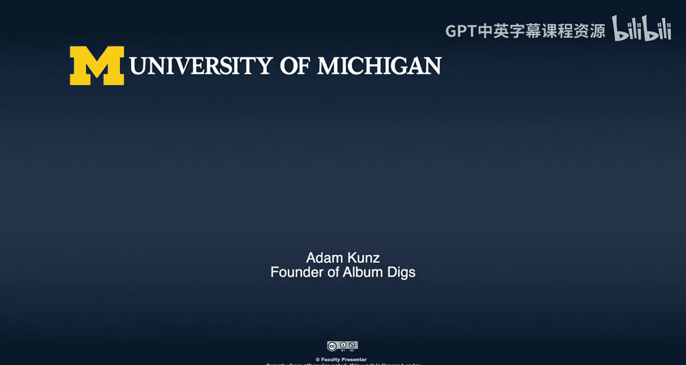

# 密歇根大学《AI用于创意工作》：P11：领域之声：亚当·昆兹

## 概述
在本节课中，我们将探讨人工智能如何提升创意工作的基准水平，并催生全新的内容形式。我们将通过历史技术变革的类比，来理解AI对设计、摄影、音乐等领域产生的深远影响。

## 内容保真度与行业基准的提升
上一节我们讨论了AI的潜力，本节中我们来看看AI如何实质性地提升创意产出的质量。这实质上关乎我们所能创造内容的**保真度**。我认为，许多行业的基准水平已经被提高了，即能够完成的基础工作的标准线被抬升了。

为了理解这一点，我们可以回顾历史。当计算机最初普及时，许多人认为它只会取代人类的工作。然而，实际情况是，它提升了人们能够产出的成果水平。

以下是几个历史技术变革提升行业基准的例子：

*   **电子表格软件**：当Excel出现时，会计师的工作并未被消除。相反，他们能够完成质量**更高**的工作。
*   **图像处理软件**：以设计和摄影为例。当Photoshop首次面世时，有人担心这会毁掉许多摄影师的工作。但事实上，它使人们能够创造出远比过去**更优质**的内容，并且让更多人能够参与到这个领域中来。
*   **数字音乐**：音乐领域也是如此。最初，人们认为只有用乐器演奏的才是音乐，用电脑制作的不是“真正的音乐”，并对此有很多批评。

## AI催生全新的内容与表达形式
然而，AI的影响不止于提升现有工作的质量。正如历史上颠覆性的工具一样，它还能催生全新的内容类别。

当像Daft Punk这样的乐队出现时，他们通过进入一个全新的音乐流派，能够创造出远超当时常规水平的作品。我认为，当AI这样的工具出现时，真正发生的是：人们不仅用它来创造**更高质量**的内容，更用它来创造**全新形式**的内容和**全新形式**的表达。

因此，看到人们能够利用AI创造出什么，将是一件非常令人兴奋的事情。

## 总结
本节课中我们一起学习了，人工智能如同历史上的重大技术革新（如Excel、Photoshop、数字音乐制作），其核心作用在于**提升创意工作的基准水平**，并更关键地在于**催生前所未有的内容与表达形式**。它不仅是效率工具，更是拓展创意疆域的新媒介。