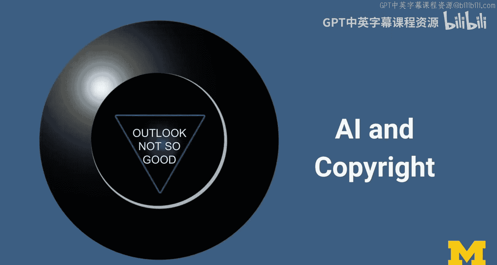
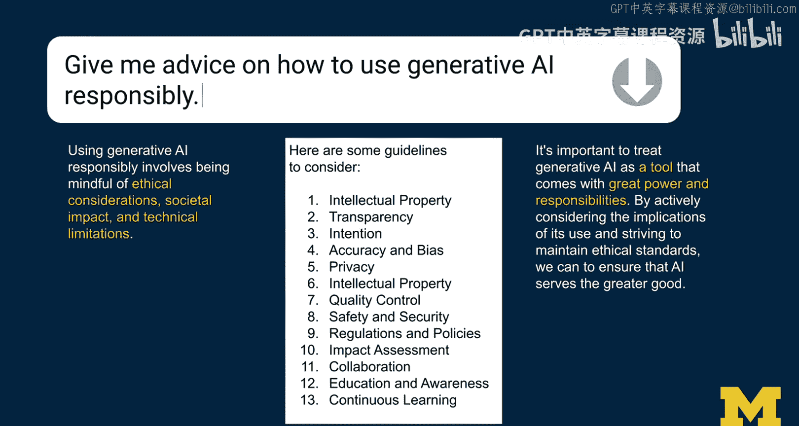
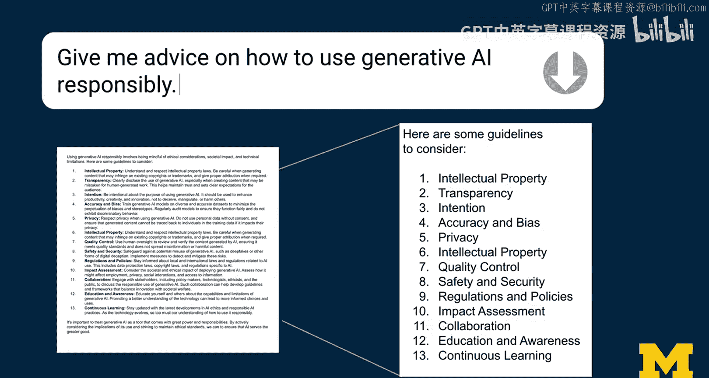
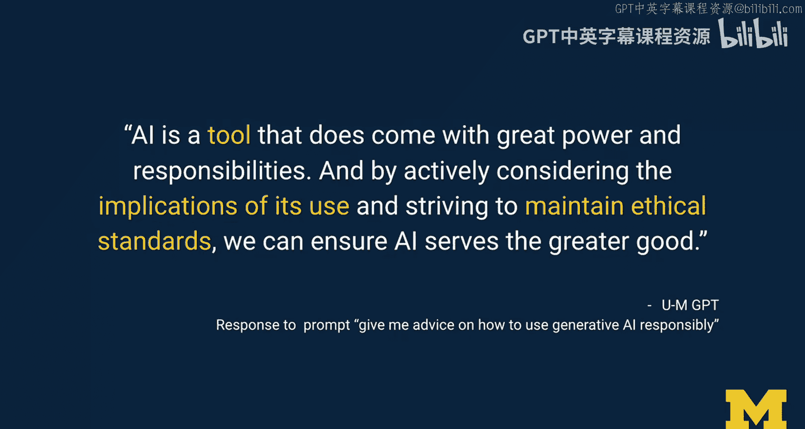

# AI用于创意工作：13：生成式AI的负责任使用 😊

在本节课中，我们将要学习如何负责任地使用生成式人工智能。我们将探讨在拥抱这项强大技术的同时，需要保持的审慎态度，并学习如何识别潜在的风险与伦理问题。

生成式AI发展如此迅速，很容易让人产生一种印象，即AI可以毫不费力地解决任何问题，可以准确回答任何问题，并且只需按一下按钮即可完成。

置身于AI革命之中也意味着许多人感到紧迫，需要赶紧使用AI，开始将AI融入日常生活，以免落后。这种完全沉浸在AI世界中的感觉可能令人兴奋，但有时也令人疲惫。它非常激动人心，但有时也令人恐惧。

如果你正在学习这门课程，你很可能是对AI的工作原理以及它如何帮助你变得更有创意感兴趣。这是本课程的两个关键目标。但我们同时也想鼓励你花时间了解AI能做什么，并认识到它不能做什么（至少目前还不能）。

就像第一次学习骑自行车或烘焙蛋糕一样，重要的是不要急于求成。你不仅要确保生成式AI能为你提供正确的结果，还要首先确认生成式AI是完成这项工作的合适工具。

我们鼓励你从容地对待生成式AI，这样你才能发现它的能力，并仔细思考AI对于你计划完成的每项任务、每个项目是否合适，或者可能并不合适。

---

当涉及到伦理、可持续性、安全性和知识产权等问题时，始终值得思考AI是否是合适的解决方案。

以下是关于AI，你可以经常问自己的三类问题。

---

**第一类：可持续性与效率**
是否值得让AI去执行一个我自己可以轻松处理的任务？考虑到AI数据中心已经占全球用电量的1%以上。如果你关心地球，答案很可能是否定的。即使是简单的网络搜索，其资源消耗也远低于向聊天机器人查询基本信息。

**第二类：隐私与安全**
如果我想要使用的生成式AI应用无法确保隐私和机密数据管理，那么将其用于专有工作项目是否安全？如果你想保护你的公司和客户，那就别指望它。

**第三类：知识产权与法律风险**
我的项目团队是否应该订阅一个因侵犯版权而备受争议、并忙于应对知识产权诉讼的AI软件包？采用该软件包的前景并不乐观。

---

正如采用AI有许多吸引人的理由一样，在投身其中之前，你也可以学会识别一些明显的危险信号。有趣的是，AI聊天机器人通常能够帮助你回答这类问题，因为它们在这些问题上受过相当好的训练。

在这里，我向密歇根大学的生成式AI工具UMGPT咨询了关于如何负责任地使用生成式AI的建议。UMGPT是一个专门为密歇根大学使用而定制的生成式AI程序，它借鉴了流行的生成式AI语言模型，包括OpenAI的GPT-4。以下是密歇根聊天机器人的回应。

---

我们可以看到这个聊天机器人的强大之处，它立即识别出十几种你可以探索如何更负责任地使用生成式AI的方法。

---

当你审视这些建议时，许多有趣的问题会浮现在脑海中。
*   你使用生成式AI可能会如何影响你工作组或公司中的其他员工？
*   你认为你使用AI可能会如何影响你所在领域或其他领域的就业？
*   你如何才能更好地了解生成式AI的能力和局限性？

---

你甚至可以询问你的聊天机器人，它上次接受训练是什么时候，它是否在特定学科有特殊专长，以及它是否记住并从你所有的提示和交流中学习，或者它是否对你的所有聊天对话保密。

UMGPT有用的回应以一个值得强调的重要观察作为结尾：AI是一种确实伴随着巨大力量和责任的工具，通过积极考虑其使用的影响并努力维护道德标准，我们可以确保AI服务于更大的利益。

---

在下一模块中，我们将更深入地探讨在工作场所创造性地使用AI时两个特别重要的领域：第一，与AI相关的法律问题；第二，使用AI带来的声誉风险。😊

---

本节课中，我们一起学习了在热情拥抱生成式AI的同时保持审慎的重要性。我们探讨了在涉及伦理、可持续性、安全和知识产权时评估AI适用性的必要性，并学习了通过提问来识别潜在风险的方法。最后，我们了解到，负责任地使用AI意味着积极考虑其影响，并确保这项强大的技术能够服务于更大的利益。