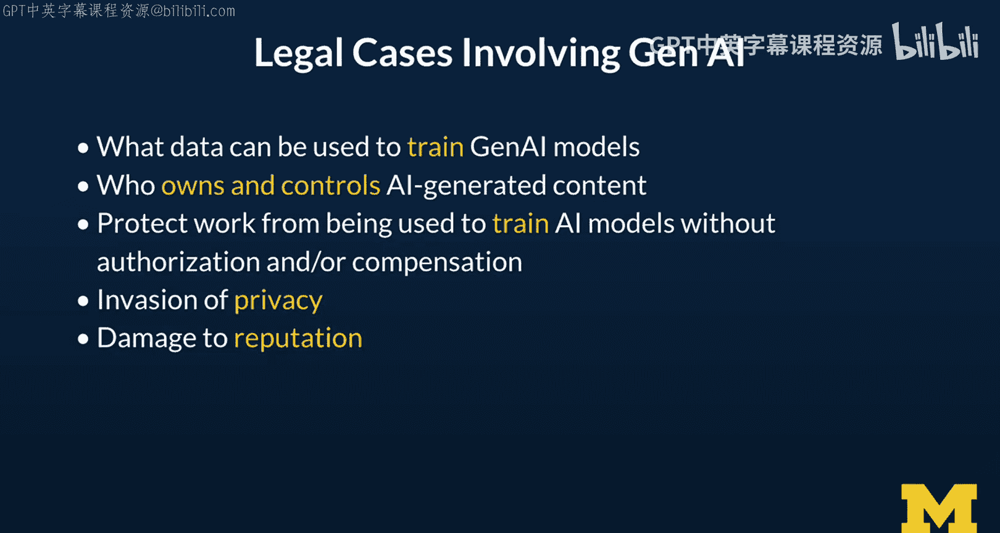
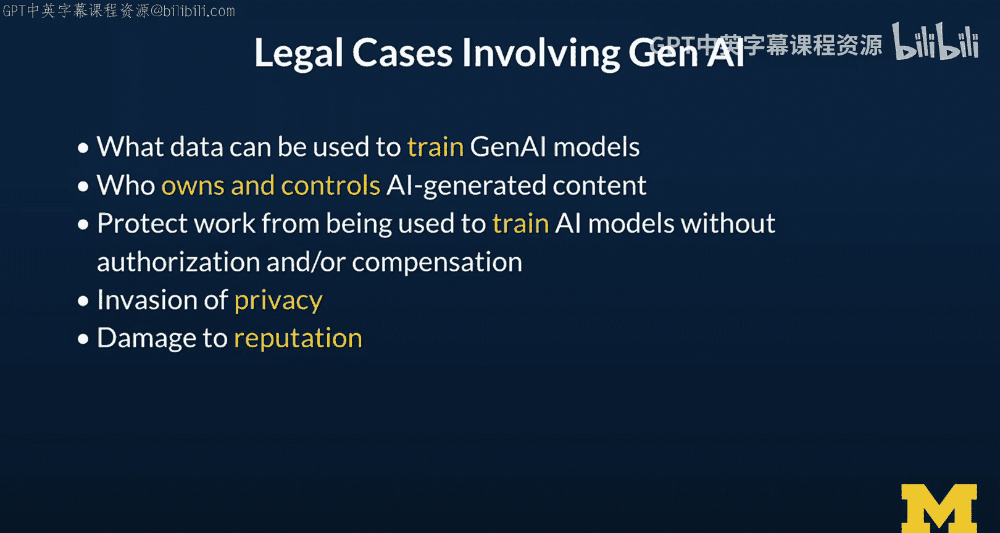
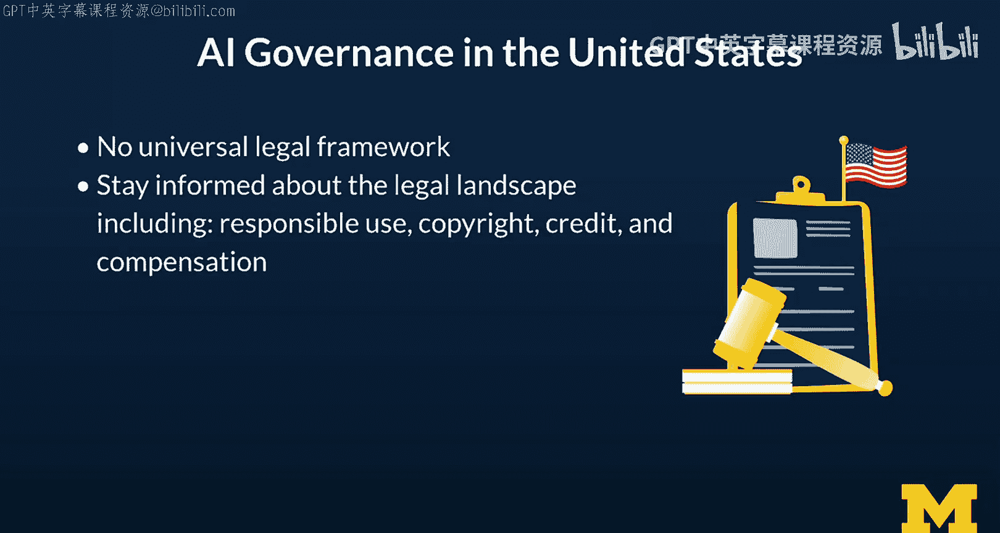
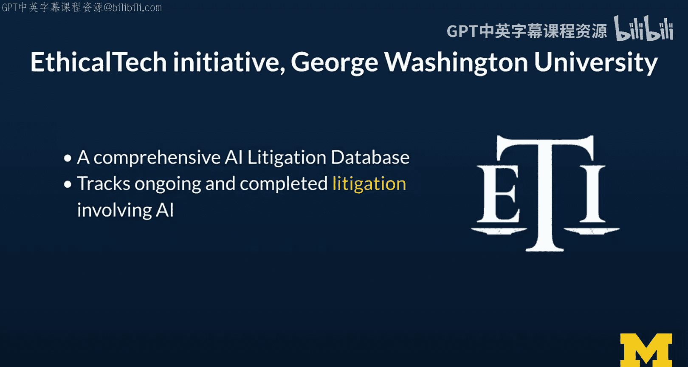
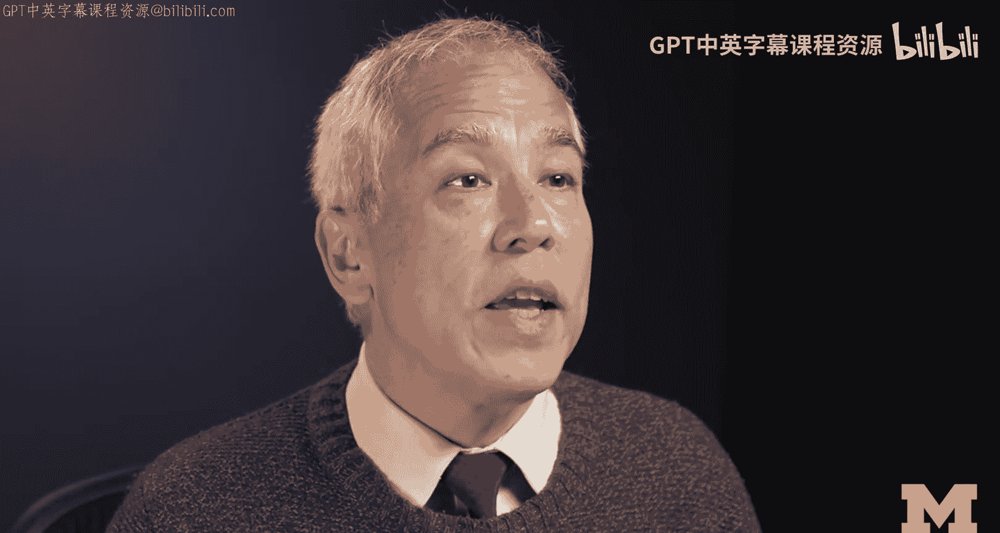
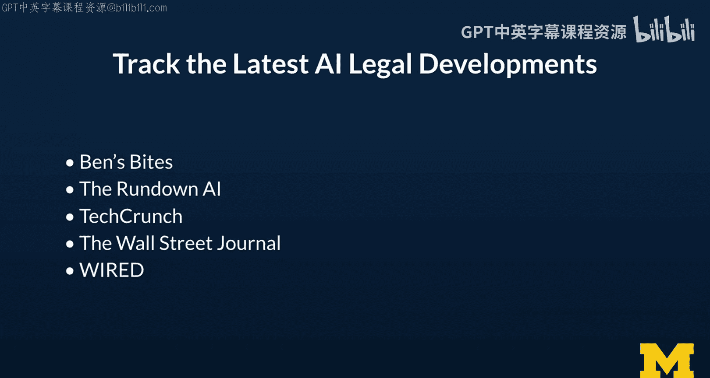
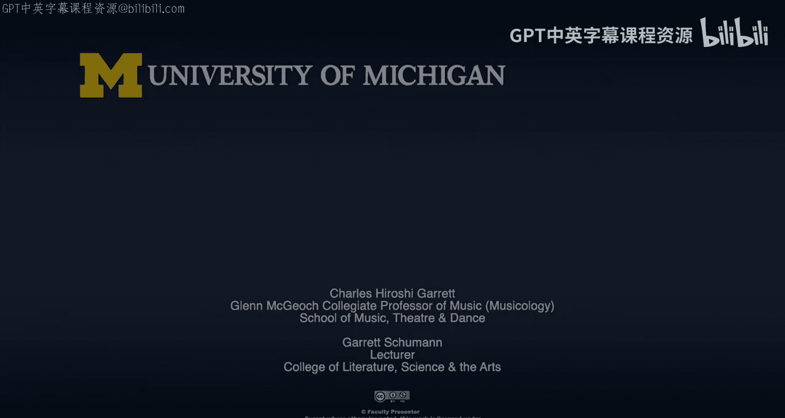

# 密歇根大学《AI用于创意工作｜AI for Creative Work》中英字幕 p14 2_人工智能与法律考量.zh_en -BV1DXNiznEXk_p14-

As AI gains greater traction， policy makers and legislators around the world are grappling with how to regulate it to minimize possible harms without sacrificing potential benefits。

Since different governments are taking different approaches。

 it's important to follow the news as it affects where you live and work。

Many legal issues remain unsettled when it comes to AI and creativity and big questions surrounding intellectual property。

 copyright， authorship， licensing rights and remuneration still need to be ironed out。

Animated debates within US legal circles revolve around AI ownership Work created solely by generative AI are not currently protected by US copyright law。

 Even if the AI entity is trained on human sources and produced in response to human prompts。

 because the term author is not extended to machines or gen AI programs。

 Creative work produced through collaboration between a human and an AI program also has inspired legal disputes。

 As a result， various stakeholders impacted by AI are involved in ongoing lawsuits。

 grievances and class action suits。Legal cases have been brought by large enterprises。

 as well as individuals to determine what data can be used to train Gen AI models and who owns and controls AI generated content。

Getty images， for instance， has sued the company that developed stable diffusion for using Getty's image database without permission。

 And the New York Times has sued Open AI and Microsoft for allegedly using millions of times newspaper articles to train their gen AI software。

Class action suits have been launched by musicians， visual artists。

 writers and actors to protect their work from being used to train AI models without authorization and or compensation。

Lawsuits have even been brought by individuals who believe Gen AI companies have unfairly invaded their privacy or unlawfully damaged their reputations。

Because many cases remain unsettled， the AI industry has started to become more proactive in addressing industry demands for legally cleared data training sets。

 stronger licensing policies， legal indemnification mechanisms and fair royalty schemes that reward those parties whose work is used to train gen AI models。

Far more attention to date has been paid to sorting out how existing laws in the US apply to AI technologies。

 rather than to enacting new AI regulations， but various competing AI initiatives。

 laws and policies are now advancing at the federal， state and municipal levels。

 including antitrust investigations launched by the federal government into the roles played by leading AI tech companies。

At the moment in the United States， there is no universal legal framework。

 which means that users of Gen AI and Los Angeles may need to abide by different rules than AI users based in New York。

 No matter their location， Any who seeks to use Gen AI as part of a creative practice。

 needs to stay informed about the AI legal landscape。

 especially when it comes to issues of responsible use， copyright， credit and compensation。

Creative workers in Europe have received more guidance than their US counterparts。 In March 2024。

 the European Parliament formally adopted the E U Artificial Intelligence Act。

 a landmark piece of legislation governing AI。

The AI Act， as it is commonly known， establishes a shared legal framework for AI within the European Union。

 seeks to regulate the providers of AI systems and also assigns individual applications of AI to risk categories。

 unacceptable， high， limited or minimal that are subject to legal regulations。

 The AI Act has many adherents。 So it's possible that some of its contours eventually will shape AI law in the United States。

Every year， the Stanford University Institute for Humancented Artificial Intelligence produces an AI In。

 a comprehensive report that includes detailed coverage of AI policy and governance。

 including a timeline of significant AI policymaking events。

 as well as updates on global AI legislative efforts。

 reading through the latest annual Stanford AI index is a great way to get up to speed。

 with AI legal developments in the United States and beyond keepinging up with recent AI legal developments can be challenging because of the sheer volume of cases。

 but a variety of public and private resources are available to help。😊。

The ethicalical Tech I and interdisciplinary partnership hosted by George Washington University maintains a comprehensive AI litigation database that tracks ongoing and completed litigation involving AI。

Various public organizations， professional associations and tech friendly private law firms also maintain specialized litigation trackers related to copyright protection。

 data privacy， liability and other pressing AI issues。Since youve enrolled in this course。

 you likely know about various online courses， workshops and certifications that can help you learn all about AI。

Websites dedicated AI， including Ben Spites and the rundown AI and tech friendly news outlets like Tech Cruunch。

 the Wall Street Journal and Wired also can help you keep track of the latest AI legal developments。

