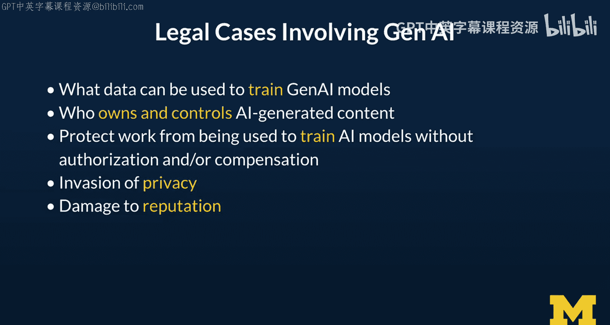
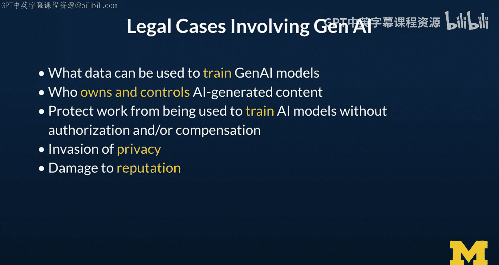
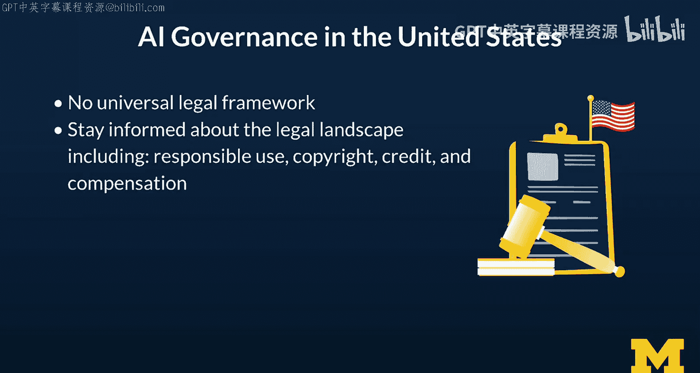
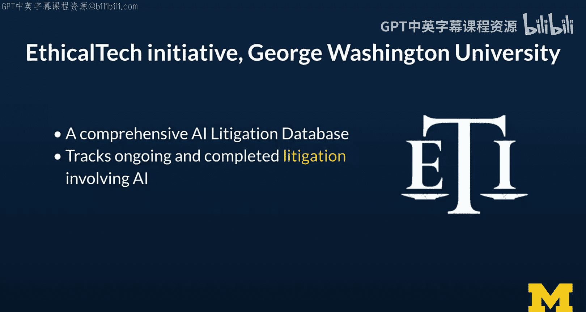
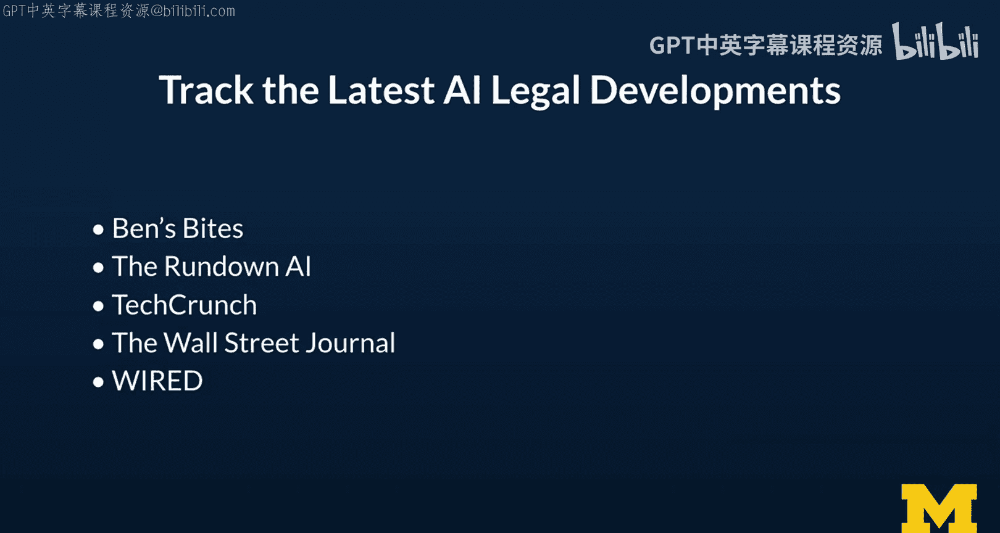
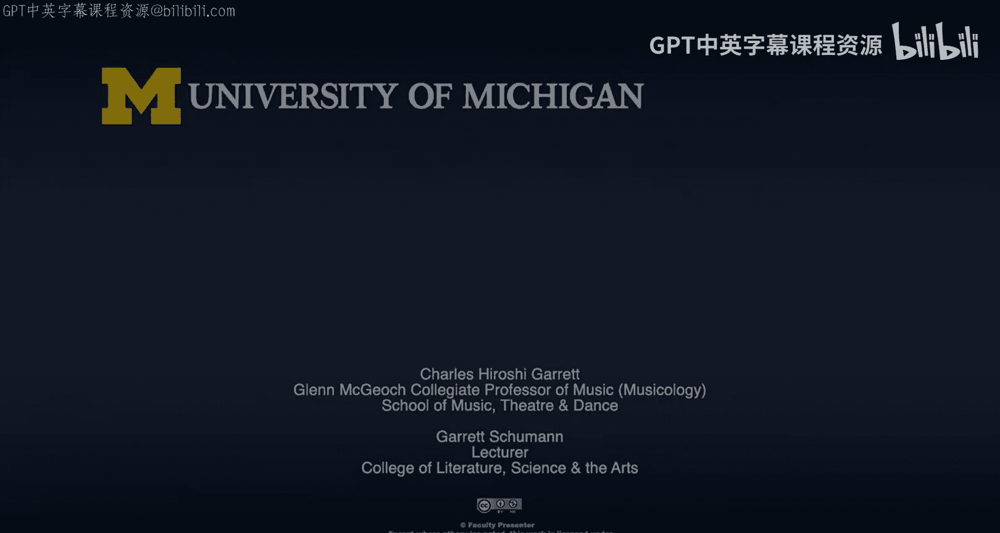

# AI用于创意工作：2：人工智能与法律考量 🧑⚖️

在本节课中，我们将要学习人工智能在创意领域应用时所面临的法律与政策环境。随着AI技术的普及，全球各地的立法者正努力在规避潜在危害与保留技术红利之间寻找平衡。本节课将概述当前的法律争议、关键案例以及如何获取最新的法律动态信息。

## 全球政策与立法现状 🌍

随着人工智能的影响力日益增强，世界各地的政策制定者和立法者正在努力思考如何对其进行监管，以最小化可能的危害，同时不牺牲其潜在益处。

由于不同政府采取了不同的监管路径，关注影响你生活和工作所在地的相关新闻变得非常重要。

## 知识产权与法律争议的核心 🔑

在人工智能与创意领域，许多法律问题尚未解决。围绕知识产权、版权、作者身份、许可权和报酬的重大问题仍需厘清。

美国法律界激烈的辩论围绕AI作品的所有权展开。目前，完全由生成式AI创作的作品不受美国版权法保护。即使该AI实体是基于人类资料训练，并且是对人类提示的回应，因为“作者”这一术语并未延伸至机器或生成式AI程序。

人类与AI程序合作产生的创意作品也引发了法律纠纷。因此，受AI影响的各方利益相关者卷入了持续进行的诉讼、申诉和集体诉讼中。

大型企业以及个人都已提起法律案件，旨在确定哪些数据可用于训练生成式AI模型，以及谁拥有和控制AI生成的内容。

以下是几个关键案例：
*   **盖蒂图片社**起诉了开发Stable Diffusion的公司，指控其在未经许可的情况下使用了盖蒂的图片数据库。
*   **《纽约时报》**起诉了OpenAI和微软，指控其使用数百万篇报纸文章来训练其生成式AI软件。

## 创作者维权与行业应对 🎨

音乐家、视觉艺术家、作家和演员已发起集体诉讼，以保护他们的作品在未经授权和/或未获补偿的情况下被用于训练AI模型。

甚至有个体提起诉讼，他们认为生成式AI公司不公平地侵犯了他们的隐私或非法损害了他们的声誉。

由于许多案件悬而未决，AI行业已开始更积极地应对行业需求，包括提供法律上清晰的数据训练集、更强的许可政策、法律赔偿机制，以及公平的版税方案，以奖励那些其作品被用于训练生成式AI模型的各方。

## 美国法律框架与地方差异 🇺🇸

迄今为止，更多的注意力集中在厘清美国现有法律如何适用于AI技术上，而非颁布新的AI法规。然而，各种相互竞争的AI倡议、法律和政策正在联邦、州和市级层面推进，包括联邦政府对领先AI科技公司所扮演角色发起的反垄断调查。

目前在美国，没有统一的法律框架。这意味着洛杉矶的生成式AI用户可能需要遵守与纽约的AI用户不同的规则。无论身处何地，任何寻求在创意实践中使用生成式AI的人，都需要随时了解AI法律环境，特别是在负责任使用、版权、署名和补偿等问题上。

## 欧盟的先行立法 🇪🇺

欧洲的创意工作者比他们的美国同行获得了更多指导。2024年3月，欧洲议会正式通过了《欧盟人工智能法案》，这是一项具有里程碑意义的AI治理立法。

通常被称为《AI法案》的这项立法，为欧盟内部建立了一个共享的AI法律框架，旨在监管AI系统的提供者，并将AI的个体应用分配到不同的风险类别（不可接受、高、有限或最小），这些类别受法律监管约束。

《AI法案》拥有许多支持者。因此，其部分轮廓最终可能影响美国的AI法律。

## 如何跟进法律动态 📚

每年，斯坦福大学以人为本人工智能研究所都会发布一份全面的《AI指数报告》，其中包含对AI政策与治理的详细报道，包括重大AI政策制定事件的时间线，以及全球AI立法工作的更新。阅读最新的斯坦福AI年度指数报告是快速了解美国及全球AI法律发展的好方法。

由于案件数量庞大，跟上最新的AI法律发展可能具有挑战性，但有各种公共和私人资源可以提供帮助。

以下是获取信息的几种途径：
*   **乔治华盛顿大学**主办的跨学科合作项目“伦理科技”维护着一个全面的AI诉讼数据库，追踪涉及AI的正在进行和已完成的诉讼。
*   各种公共组织、专业协会和精通科技的私人律师事务所也维护着与版权保护、数据隐私、责任等紧迫AI问题相关的专门诉讼追踪器。
*   既然你参加了本课程，你可能已经知道各种在线课程、研讨会和认证可以帮助你全面了解AI。
*   专注于AI的网站，包括Ben’s Bites和The Rundown AI，以及像TechCrunch、《华尔街日报》和《连线》这样精通科技的新闻媒体，也能帮助你跟踪最新的AI法律发展。

---

本节课中我们一起学习了人工智能在创意应用中的法律考量。我们探讨了全球立法现状、围绕知识产权和版权的核心争议、相关的法律案例，以及美国与欧盟不同的监管路径。最后，我们介绍了如何通过专业报告、数据库和媒体资源来持续跟进这个快速变化的领域。理解这些法律背景对于负责任且合规地使用AI进行创意工作至关重要。