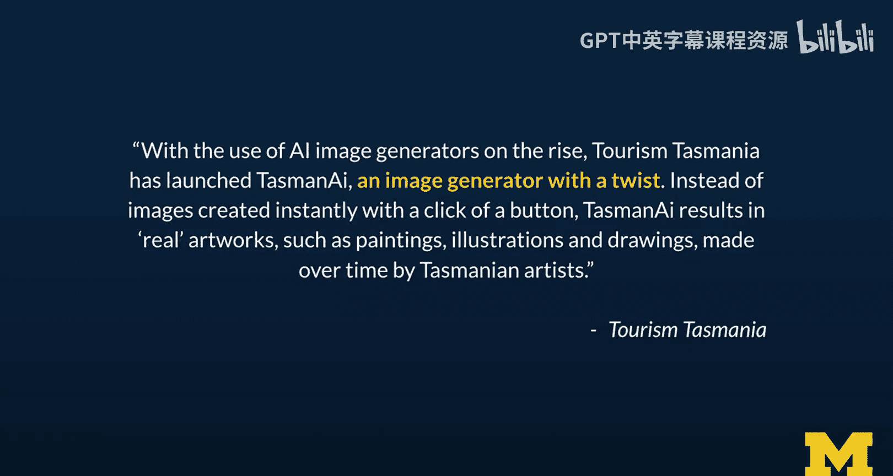
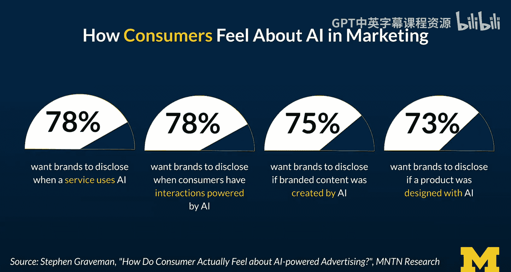
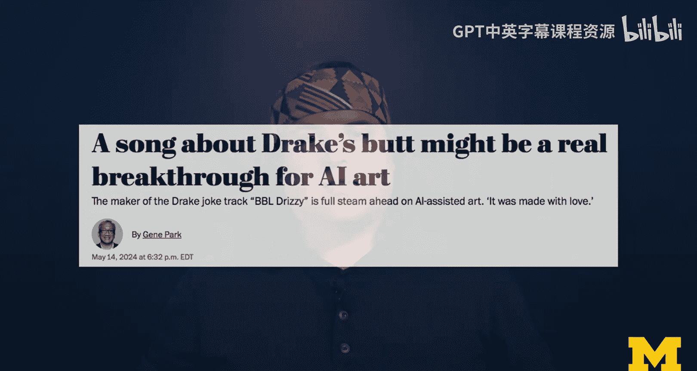
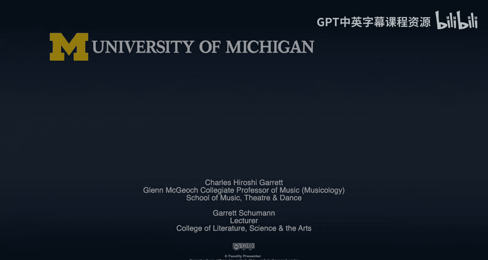

# 密歇根大学《AI用于创意工作｜AI for Creative Work》中英字幕 p15 3_声誉风险管理概述.zh_en -BV1DXNiznEXk_p15-

This video will analyze and discuss strategies related to reputational risks that can present themselves when people and institutions use Gen AI。

 Such reputational vulnerability is particularly pertinent to anyone whose creative work faces the public。

 but the considerations I introduce can help you negotiate similar concerns within your workplace or between you and your customer base。

As the impact of generative AI has spread， it has become very clear that the general public。

 as well as specific target audiences， can express strong。

 negative responses to Gen AI when its application is observed or even suspected in a creative project。

 Concerns over the authenticity of computer generated art and media have a long history。

 But this kind of reputational risk seems even more prevalent in response to today's AI technology。

Certain forms of artificial intelligence， from algorithmic audio mastering and music and sound design to procedural generation in film and video game production have been a regular part of creative work for multiple decades。

 But those pieces of software typically operate in the background of creative projects。

 thanks to the marketing strategies employed by today's AI industry。

 We now see much more public scrutiny directed at the software itself。For example。

 Sports Illustrated magazine earned negative headlines in November 2023 when it experimented with publishing AI generated articles and multiple films released in the beginning of 2024 drew the Ire of audiences for using AI generated visuals。

This negative reception of Gen AI has become so common that a recent advertising campaign from tourism。

 Tasmania capitalize on the sentiment that AI produced media is not authentically creative。

With the use of AI image generators on the rise， Tourism Tasmania has launched Tasman AI。

 an image generator with a twist。 instead of images created instantly with a click of a button。

 Tasman AI results in real artworks such as paintings。

 illustrations and drawings made over time by Tasmanian artists。

It is important to acknowledge this public sensitivity about Jen AI and understand where it comes from in order to use the technology responsibly and successfully。

According to surveys conducted by MNTN Research in 2023。

 transparency plays a decisive role in the way consumers feel about the application of AI and marketing。

78% want brands to disclose when a service uses AI。

78% want brands to disclose when consumers have interactions powered by AI。

75% want brands to disclose if branded content was created by AI。

 and 73% want brands to disclose if a product was designed with AI。

In addition to transparency， creative workers can avoid drawing criticism when they use Gen Ai by producing intentional and persuasive creative works。

 This lesson is clear in earlier generations of creative artificial intelligence software。

 For example， Director Peter Jackson employed the procedural generation tool massive in his Lord of the Rings trilogy from the early 2000s to produce crowds and scenes depicting large battles。

 The same tool also has since become a staple and video game production。 In both cases。

 the specificity of the technology's application to achieve visual elements that would not be practicable using other methods makes its use more acceptable to audiences。

Moreover， these AI tools enhance the creative product by making it more exciting。

 which persuades viewers and players that the technology is a justified component of the creative process。

😊，We can see something similar regarding AI generated music in the 2024 rap battle between popular musicians。

 Kendrick Lamar and Drake。Early in their feud， a seemingly leaked track by Drake showed up online。

 but audiences were confused as to whether Drake produced it himself or if it was AI generated。

 as Sky News reported in April 2024， Drake's failure to communicate clearly about the song and his decision to post other AI generated content himself created challenges for listeners and fans trying to make sense of this mysterious track。

Drake isn't helping the current confusion。 He hasn't claimed the track。

 but he has been posting about it on Instagram。 He even posted an AI deep fake of rap producer Metro Boman in a clip from the 2002 film Drline。

 In this episode， the potential that the song was AI generated。

 carried a negative connotation for Drake's audience。

Some listeners even posted online that they hoped the track was crafted with AI because they thought it was a bad song。

Drake's lack of transparency did not provide important reassurances to his fans。

A later song in the musicians back and forth， Kendrick Lamar's B。

 B L Dizzy produced a different reception to AI generated music。Released on May 5。

 Kendrick and his producer， Metro Boman， treated B，B L Dizzy with transparency。In contrast to Drake。

 Lamar and Metro quickly revealed that the song's main vocal melody was created using Jan AI software。

 They also helped create a positive reception to the song by waivaving their copyright claims to the music。

 which allowed listeners to remix the track without repercussions。

This strategy worked out successfully because listeners were not sidetracked by the confusion that met Drake's earlier release。

 They were able to enjoy the song and their ability to play around with the music through remixes produced a welcome sense of shared ownership and investment。

😊。

We have seen many different examples of consumer and audience concerns regarding AI generated material。

 One way to interpret these feelings is that they reflect a desire by consumers not to have AI technology fully imposed on their experiences。

 This is why transparency matters。 People are less upset about Gen AI when they know it will be part of their experience with the outcomes of creative work。

As we see in Drake's case， his failure to be clear about his potential association with AI generated music harmed his reputation。

Using Gen AI intentionally and specifically can obviate negative consumer responses by avoiding that feeling of imposition。

 If you are thoughtful， deliberate and have a clear reason to use AI in your creative work。

 It is more likely your audience and or customer base will feel comfortable with your decision。

