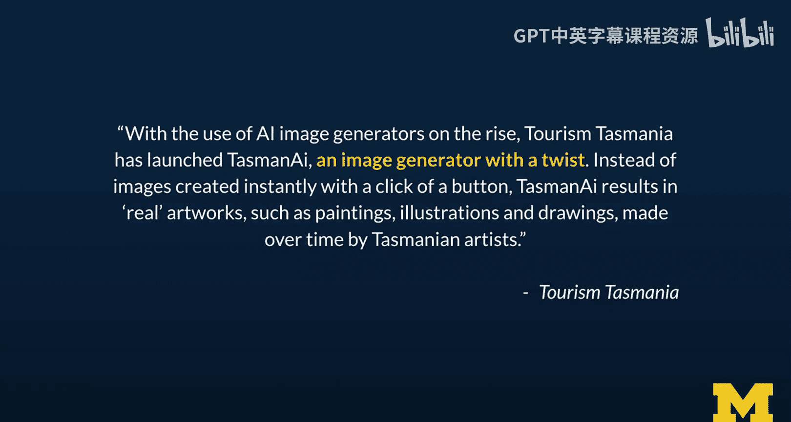
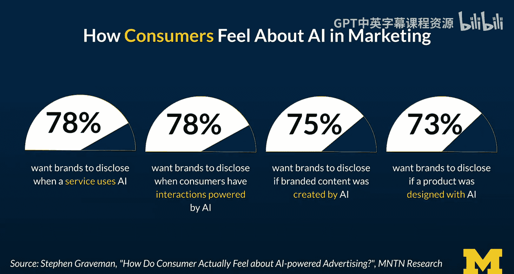
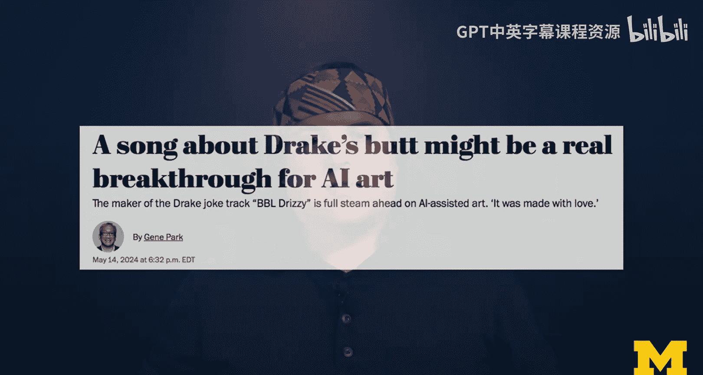
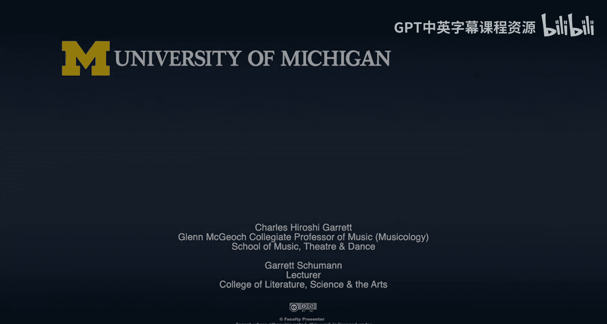

# AI用于创意工作：3：声誉风险管理概述 🛡️

在本节课中，我们将要学习当个人和机构使用生成式人工智能时，可能出现的声誉风险，并分析与讨论相关的应对策略。

这种声誉上的脆弱性，对于那些其创意工作需要面对公众的人来说尤为相关。不过，我所介绍的这些考量，也能帮助你在工作场所内部，或在你与客户群体之间，处理类似的担忧。

随着生成式人工智能影响的扩大，情况已经变得非常清晰：当在创意项目中观察到甚至只是怀疑使用了生成式人工智能时，公众以及特定的目标受众，都可能对其表达出强烈且负面的反应。

---

## 公众对AI的负面反应

对计算机生成的艺术和媒体真实性的担忧由来已久。但这类声誉风险，在应对当今的人工智能技术时似乎更为普遍。

某些形式的人工智能，从算法音频母带处理、音乐与声音设计，到电影和电子游戏制作中的程序化生成，几十年来一直是创意工作的常规组成部分。但这些软件通常在创意项目的幕后运作。

由于当今人工智能行业采用的营销策略，我们现在看到公众对软件本身的审视要严格得多。

例如，《体育画报》杂志在2023年11月因尝试发布AI生成的文章而招致负面新闻头条。同样，2024年初上映的多部电影因使用AI生成的视觉效果而引发了观众的不满。

这种对生成式人工智能的负面接受度已变得如此普遍，以至于塔斯马尼亚旅游局最近的一项广告活动，就利用了“AI制作的媒体并非真正具有创意”这种情绪。

随着AI图像生成器的使用日益增多，塔斯马尼亚旅游局推出了“塔斯曼AI”。这是一个有特殊之处的图像生成器：它生成的并非点击按钮即可瞬间创建的图像，而是由塔斯马尼亚艺术家们花费时间创作的真实艺术品，如绘画、插图和素描。

---

## 透明度的重要性

为了负责任且成功地使用这项技术，承认公众对生成式人工智能的这种敏感性并理解其根源至关重要。

根据MNTN Research在2023年进行的调查，透明度在消费者对AI应用于营销的感受中起着决定性作用。

以下是该调查的关键发现：

*   78%的消费者希望品牌在使用AI提供服务时予以披露。
*   78%的消费者希望品牌在消费者与AI驱动的服务互动时予以披露。
*   75%的消费者希望品牌在品牌内容由AI创建时予以披露。
*   73%的消费者希望品牌在产品由AI设计时予以披露。

---

## 有意图与有说服力的应用

除了透明度，创意工作者在使用生成式人工智能时，还可以通过创作有意图且有说服力的创意作品来避免招致批评。

这一经验在更早期的创意人工智能软件中就已得到印证。例如，导演彼得·杰克逊在21世纪初的《指环王》三部曲中，使用了程序化生成工具“Massive”来制作人群和描绘大型战斗的场景。此后，同样的工具也成为了电子游戏制作中的标配。

在这两种情况下，该技术被专门用于实现其他方法难以实现的视觉效果，这使得其应用更容易被观众所接受。此外，这些AI工具通过让创意产品更具吸引力而增强了它，从而说服观众和玩家相信该技术是创意过程中一个合理的组成部分。

---

## 案例对比：Drake与Kendrick Lamar

我们可以在2024年流行音乐人肯德里克·拉马尔与德雷克之间的说唱对决中，看到关于AI生成音乐的类似情况。

在他们争执的早期，一首据称是德雷克泄露的歌曲出现在网上，但听众们搞不清这究竟是德雷克自己制作的还是AI生成的。正如天空新闻在2024年4月报道的那样，德雷克未能就这首歌进行清晰沟通，并且他自己也发布了其他AI生成的内容，这给试图理解这首神秘歌曲的听众和粉丝带来了困扰。

德雷克没有澄清当前的困惑。他没有认领这首歌，但一直在Instagram上发布相关内容。他甚至发布了一段AI深度伪造说唱制作人Metro Boomin的视频，素材取自2002年的电影《8英里》。在这一事件中，歌曲可能是AI生成的这一可能性，给德雷克的听众带来了负面联想。一些听众甚至在网络上发帖，希望这首歌是AI制作的，因为他们认为这是一首糟糕的歌曲。德雷克缺乏透明度，未能给他的粉丝提供重要的保证。

而在两位音乐人后续的来回交锋中，肯德里克·拉马尔的歌曲《B. B. L Drizzy》则带来了对AI生成音乐的不同反响。这首歌于5月5日发布，肯德里克和他的制作人Metro Boomin以透明的方式处理了《B. B. L Drizzy》。与德雷克形成对比的是，拉马尔和Metro迅速透露，歌曲的主声乐旋律是使用生成式AI软件创作的。他们还通过放弃对这首音乐的版权主张，帮助营造了对这首歌的积极反响，这使得听众可以不受惩罚地混音这首歌曲。

这一策略取得了成功，因为听众没有被德雷克早期发布歌曲时引发的困惑所干扰。他们能够享受这首歌，并且通过混音来把玩音乐的能力，产生了一种受欢迎的共享所有权和参与感。

---

## 总结与核心策略

我们已经看到了许多关于消费者和观众对AI生成材料的担忧的例子。解读这些感受的一种方式是，它们反映了消费者不希望AI技术完全强加于他们体验的愿望。这就是透明度至关重要的原因。当人们知道生成式人工智能将成为他们体验创意工作成果的一部分时，他们对它的不满就会减少。

正如我们在德雷克的案例中所见，他未能明确自己与AI生成音乐的潜在关联，损害了他的声誉。

**有意图且具体地使用生成式人工智能**，可以避免那种被强加的感觉，从而消除消费者的负面反应。如果你经过深思熟虑，并有明确的理由在你的创意工作中使用AI，那么你的观众和/或客户群体就更有可能对你的决定感到放心。

本节课中，我们一起学习了生成式人工智能应用中的声誉风险。核心要点在于：**透明度**和**有意图的应用**是管理此类风险、赢得受众信任的关键。通过清晰沟通和将AI用于增强而非替代创意，你可以更负责任地利用这项强大的技术。