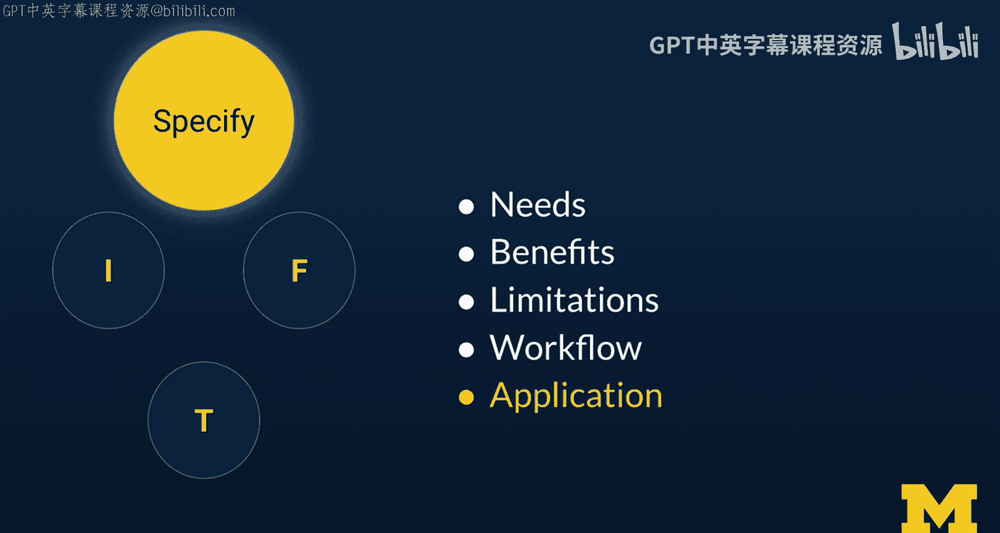
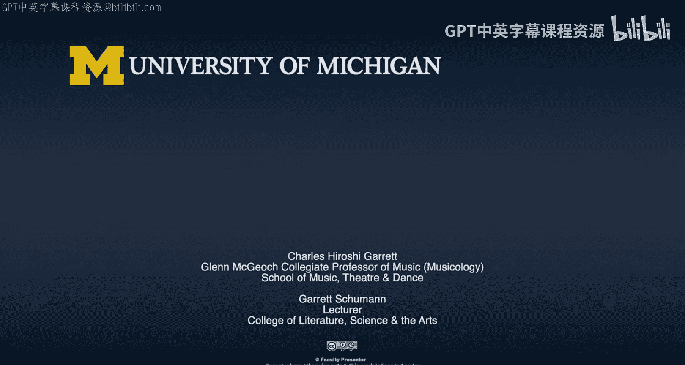

# 密歇根大学《AI用于创意工作｜AI for Creative Work》中英字幕 p17 5_明确参数.zh_en -BV1DXNiznEXk_p17-

I'm a musician， and I'm thinking about bringing AI into my work。

Because I am following the Sift process for evaluating and approaching AI tools。

 I will begin by specifying what I want from the AI and how I will benefit from it。

Let's start simply and say I am interested in finding something that generates musical material to help me come up with ideas for future projects。

 In the previous course in this series， I compared two accessible music generation tools。

 Google music Es and band labb song starter and determine song starter is more appealing to me。

 because among other reasons， I can customize its outputs more easily。😊，In the abstract。

 this quality could mean song starter is the best choice for my current needs。

 but I need to get more specific to make sure I will benefit from bringing it into my work。

Every AI tool has limitations。 Song Starter， despite its other positive qualities。

 only allows me to select a stylistic prompt from a menu it provides。

 I cannot experiment with prompt engineering to create a highly customized input。

It is possible my clients or project needs will not be represented in the options Song starter allows me to choose from。

It is also important for me to consider whether I benefit from incorporating AI music generation into my work in the first place。

 Song starter can provide a spark， but I will still need to do some work to make the most out of the material it generates。

Indeed， I like this about songngstarer because it means I can customize and personalize the final product。

But this aspect of song startutter also means that generally。

 I shouldn't expect this tool to be a huge time saver unless I'm in a specific workflow situation that leaves little room for brainstorming。

 or I have worked so much in a day that I need the boost of outsourcing my inspiration to an AI music generator。

 If my specific situation doesn't afford me time to customize。 I might use a different tool that。

 like Google music effects， quickly produces a ready made track based on a text prompt I input。

It may seem finicky to approach this tool in such a granular way。

 but there are very good reasons to specify。Many enduringly successful AI tools in creative work。

 such as autotune have narrow applications。 They are best suited to accomplish a limited range of tasks。

 They do these well。 and in the case of autotune， deliver the incredible benefit of making it possible for creative workers to do something that otherwise was impossible。

The benefits of songstarer and other Geni tools that produce musical material lay primarily in individual productivity that there is still trade offs to negotiate reflects the complex reality that comes with changing one's workflow to incorporate AI。

