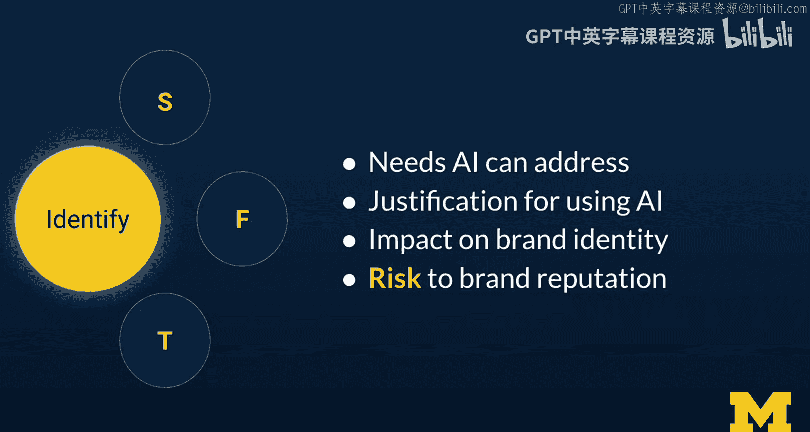

# AI用于创意工作：P18：身份验证 🔍

在本节课中，我们将学习创意流程框架（Cft）中的第二步——“身份验证”。这一步要求我们深入思考使用生成式AI对工作关系和品牌身份可能产生的影响。

上一节我们介绍了“明确需求”步骤，本节中我们来看看如何“身份验证”。这一步的核心在于，你必须清晰地识别出你希望AI解决的需求，以及为何选择AI而非其他方法。随着技术被更广泛地采用，工作者与企业之间对AI工具的价值和必要性可能存在分歧。

## 工作关系的影响 🤝

以下是关于工作关系需要考虑的关键点：

*   **集体决策的重要性**：在企业环境中，关于实施AI的决策必须集体做出。2023年美国演员工会（SAG）和编剧工会（WGA）的罢工就表明，如果缺乏共识，创意工作者可能将AI视为威胁而非工具。
*   **角色的重新定义**：AI一直用于优化和简化繁琐流程。但新技术可能取代或削弱人们在特定领域角色的担忧，并非技术本身固有。我们必须共同决定如何使用这些工具及其对现有工作方式的影响。

## 品牌身份的影响 🏷️

在考虑品牌身份时，同样需要深思熟虑和敏感性。课程早期以音乐人Drake为例，讨论了透明度如何帮助避免消费者和观众的负面反应。该案例也揭示了Drake缺乏品牌意识，或对与AI音乐工具建立长期联系漠不关心，这都加剧了局势的恶化。

以下是评估品牌影响时需注意的方面：

*   **长期关联的考量**：自2023年起，Drake的声音就成为AI合成软件的目标。尽管他本人并未选择参与使用其声音克隆的AI生成歌曲，也不对这些项目负责，但当他选择公开使用该技术时，理解这种长期关联的影响至关重要。
*   **品牌匹配度评估**：使用生成式AI工具需要冷静面对现实。例如，一个从事环境正义倡导的非营利组织，若使用高能耗的生成式AI制作营销图片，其品牌声誉面临的风险，就比一家定位不同的公司要大得多。

你和/或你所在的组织很可能已有维护公共形象的最佳实践。身份验证步骤鼓励你在使用生成式AI之前，清晰地思考人际关系动态和品牌身份，以确保应用这项技术对你共事的人和服务的对象而言是恰当且有充分理由的。

本节课中我们一起学习了“身份验证”步骤。它强调在应用生成式AI之前，必须审慎评估其对团队内部协作关系和外部品牌形象的潜在影响，确保技术的使用是负责任且经过充分论证的。