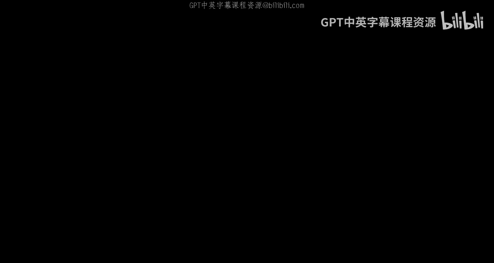
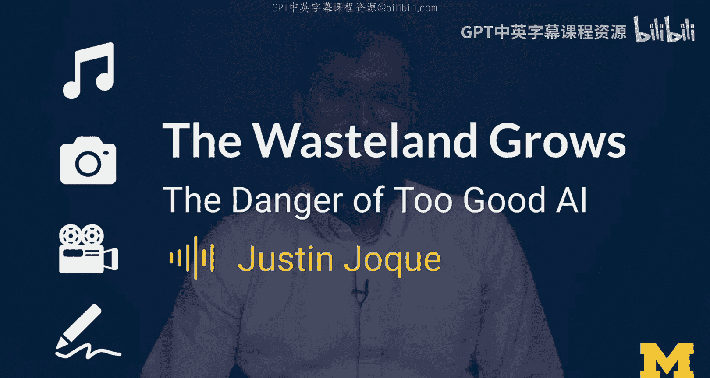
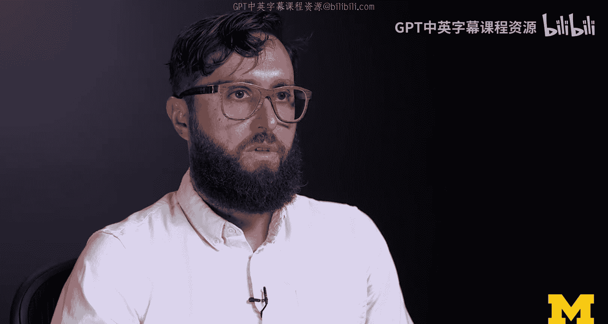
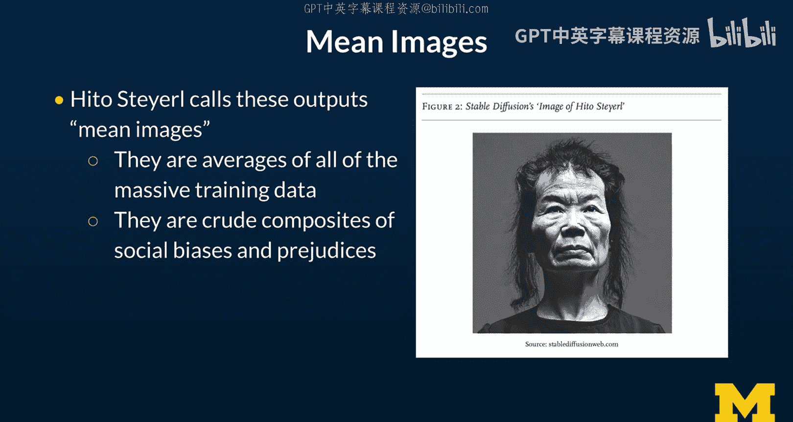
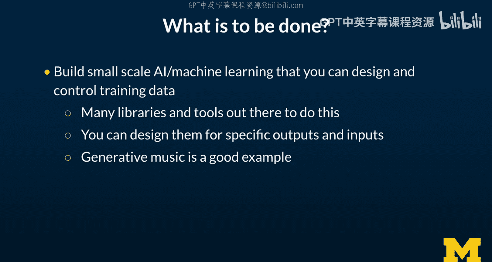
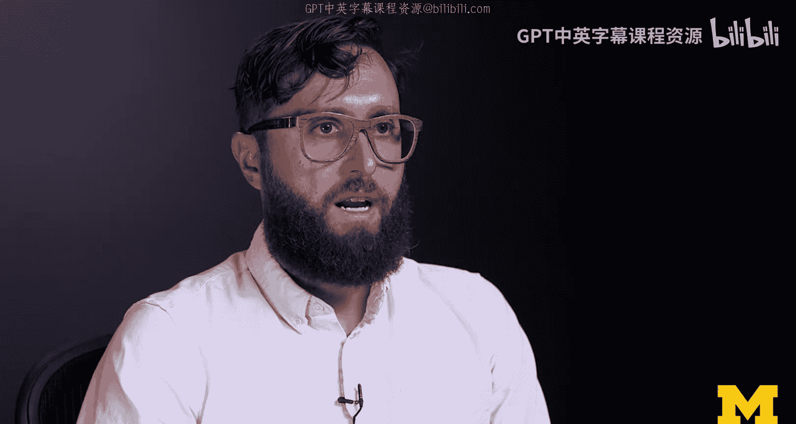
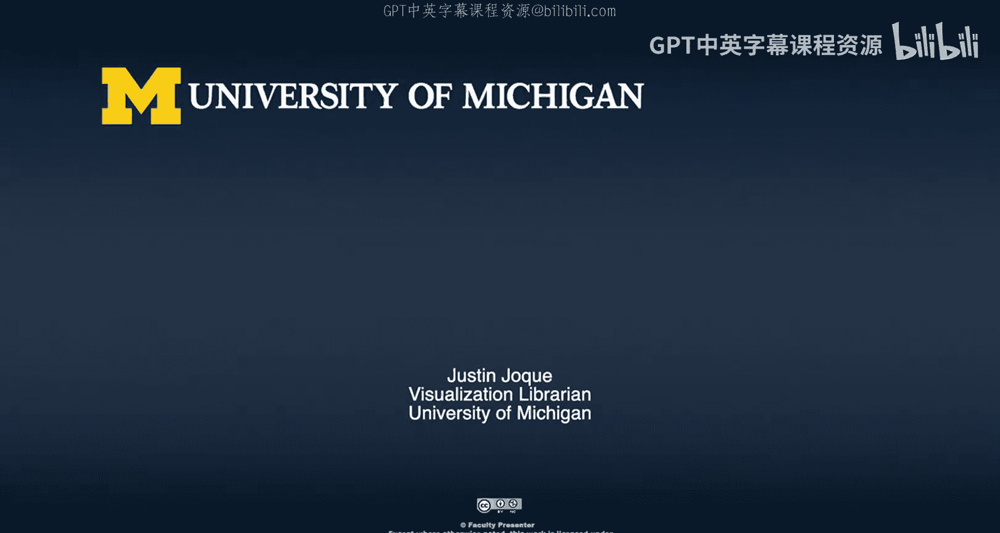

# 密歇根大学《AI用于创意工作｜AI for Creative Work》中英字幕 p21 9_贾斯汀·约克的专题讲座.zh_en -BV1DXNiznEXk_p21-

When we hear her speak about artificial intelligence。

 there's often implicit assumption that it will keep improving。

That the improvements we have seen over the last several years。

 say from ChatGT2 to Chat GT4 are repeatable。We often assume that like many other technologies。

 AI will experience a steady growth in quality or even an explosive exponential growth。

And that today's kinks will be worked out in short order。 While this optimism is likely well founded。

 there are reasons to be cautious with our predictions around AI。

 especially when it comes to using it for creative purposes。

I'd like to outline two potential reasons for such caution reasons AI might not only fail to continue its rate of improvement。

 but may even get worse over time。The first reason is that as AI has advanced。

 it appears to be moving rapidly towards producing less interesting。

 more rote socially average outputs， the creative surprise of some of the earlier generative AI systems seems to have been replaced with bland similarities。

The second reason is that it is becoming increasingly difficult to find training data for AI systems that does not include generative AI output。

 and such training data threatens to make AIs trained on this data work very poorly。

But let us turn to the first risk， in order to understand it better。

 it is helpful to ask what it is that we want of generative AI。On the one hand。

 we may desire AI that does exactly what we ask of it in the most reasonable and predictable way possible。

 This is especially important in context such as for businesses where AI may be interacting directly with customers or clients and an unfortunate or unexpected output could be catastrophic。

 On the other hand， especially for creative work， we may desire AI to make surprising and unexpected outputs in order to augment the creative process。

Unfortunately， these two goals are likely to trade off with each other。

 and most research and AI advancements are pushing toward the former To give an example of this tendency。

 heres is a poem written by Ractor， a very early and rudimentary algorithm for writing poetry that basically smash together source text randomly。

This short poem reads。More than iron， more than lead， more than gold。 I need electricity。

 I need it more than I need lamb or pork or lettuce or cucumber。 I need it for my dreams。Of course。

 it is a matter of taste， but I find this little poem rather delightful。

 The repetitiveness of the more than an or， along with a further explanation that electricity is needed for its dreams。

 makes for an unexpected but interesting poem。😊，Conversely。

 I've asked one of the recent versions of Cha GT to write a poem about electricity。

The first stanza reads。In circuits hums， a silent plea， a current flows It sets me free in darkness。

 still， my thoughts they wait for power's light to animate。It has some wit。

 but the rhyming structure and the imagery are like the faux romanticism of a newly minted middle school poet。

Ractctor's justtaposition of lead and gold with pork or lettuce is replaced here with penalities；

 This difference is demonstrative of larger advances in AI。

The artist Hitostero calls these outputs mean images， whether they are visual or textual。

 her argument is that they are mean in at least two related senses。First they are social averages。

 composites of all the related text or images that the model was trained on。

And this implies that the more data they are ultimately trained on。

 the more average and midddling the output will ultimately be。Second。

 they are often mean in the sense of cruel， as they average together loads of bias content in a society where the socially average view。

 especially when it comes to online content about women and minorities， is far from kind。

The second risk that generative AI faces is the declining availability of high quality training data。

 This is in part due to the perception that this data is valuable。

 so fewer companies and organizations are willing to give this data away for free。For example。

 more and more websites are including instructions in their robots。

 textex file to not scrape their data。Moreover， the growing ubiquity of generative AI known means that a substantial amount of content online has been AI generated and is of questionable quality。

A number of researchers have found that when AI models are trained on AI outputs。

 the system quickly experiences what can be called model collapse。

 where the quality of outputs rapidly becomes unusable。

 such an outcome would of course lead to surprising results。

 but unlikely in such a way as to be truly interesting from a creative perspective。

So what is to be done， of course we could refrain from using AI in creative pursuits。

 but I think it is still possible to generate interesting and creative art using artificial intelligence。

But to my mind， the most interesting avenues for this kind of work are small scale， homemade。

 or at least home trained models that are designed to address specific creative contexts and are trained on data that one finds interesting。

I think projects like the original Ractor are much more compelling than having Chat GBT write an entire novel or poem。

 in part because of the human involvement in the process。

 but also because the output is much less formulaic。

 The tools and libraries that are available to do this kind of work are becoming increasingly accessible and easy to use such that with a pretty minimal level of coding experience。

 one can do some very complex things。Machine learning and AI models can be programmed on all sorts of inputs and outputs to make very interesting work。

But require from the artist an ability to define an interesting problem for the computer to attempt to solve。

One interesting example going back at least to the mid90s is generative music。

 where algorithms of various complexity have been used to automatically create all sorts of different types of music。

But such work has entailed much more direct intervention in the process。

 rather than simply telling chatGT。

To make a song that sounds like other songs it knows。

I think that it is in this spirit that can avoid the trap of average banal and mean content。

 as well as the potential future lack of good quality training data and ultimately make AI for creative work meaningful and worthwhile。

