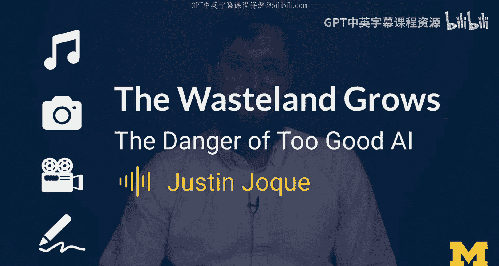
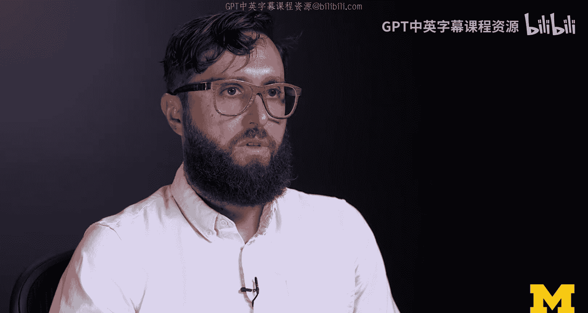
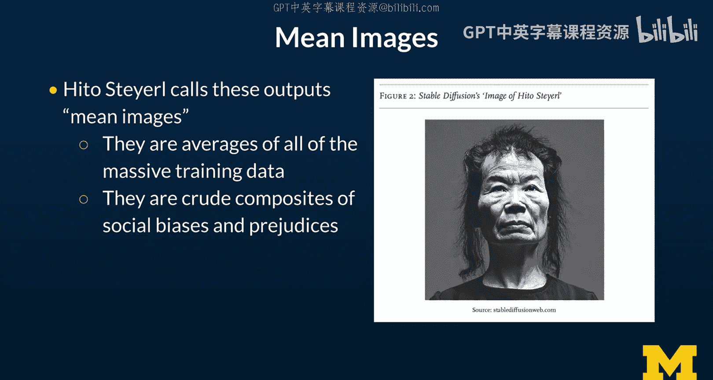
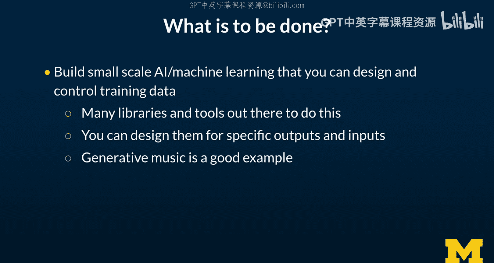
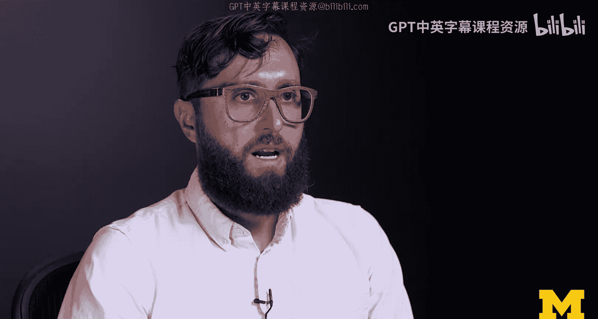
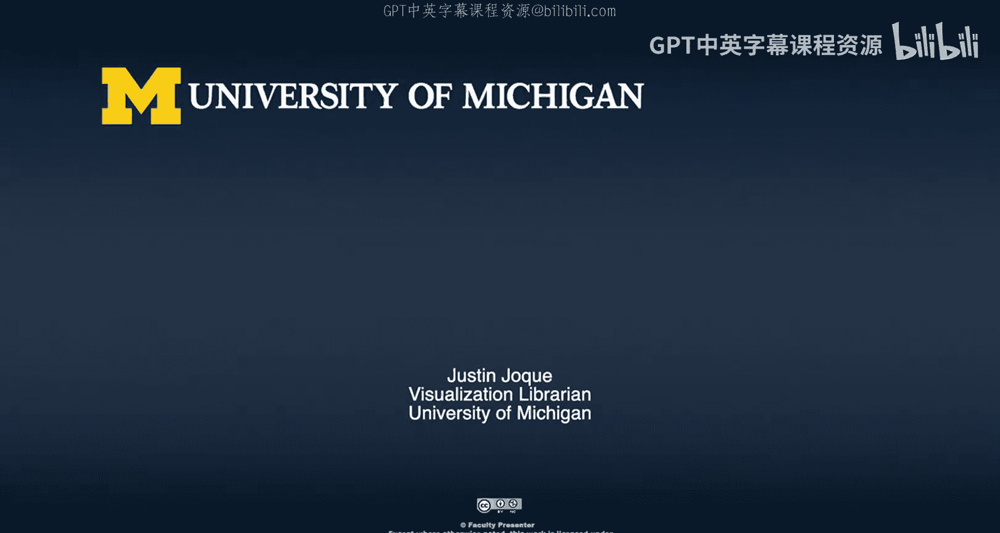

# AI用于创意工作：P21：生成式AI的潜在风险与未来方向 🧠




在本节课中，我们将探讨生成式人工智能（AI）在创意领域应用时可能面临的两个核心风险，并思考如何通过更具创造性的方式利用AI技术。



当我们谈论人工智能时，常常隐含着一个假设：它会持续进步。人们普遍认为，过去几年从ChatGPT-2到ChatGPT-4的改进可以重复，AI会像许多其他技术一样，经历稳定甚至爆炸式的指数级增长。今天的缺陷也将很快被解决。虽然这种乐观情绪有其依据，但在预测AI发展，尤其是将其用于创意目的时，我们仍需保持谨慎。

接下来，我们将详细探讨两个需要我们谨慎对待的潜在原因。这些原因可能导致AI不仅无法维持其改进速度，甚至可能随着时间的推移而变得更糟。

## 风险一：趋于平庸与刻板的输出 📉

上一节我们提到了对AI持续进步的普遍假设，本节中我们来看看第一个风险：随着AI的进步，其输出似乎正迅速变得缺乏趣味、更加刻板，趋于社会平均水平。早期生成式AI系统的创造性惊喜，似乎已被平淡的相似性所取代。

为了更好地理解这个风险，有必要先问一问：我们对生成式AI的期望是什么？一方面，我们可能希望AI能以最合理、最可预测的方式，精确地执行我们的指令。这在商业等场景中尤为重要，因为AI可能需要直接与客户互动，一个不幸或意外的输出可能是灾难性的。另一方面，尤其是在创意工作中，我们可能希望AI能产生令人惊讶和意想不到的输出，以增强创作过程。

不幸的是，这两个目标很可能相互矛盾，而大多数研究和AI进步都倾向于推动前者。以下是说明这种趋势的一个例子。

以下是Ractor（一个非常早期、基础的诗歌写作算法，基本上是将源文本随机组合）创作的一首诗：

```
More than iron, more than lead, more than gold.
I need electricity.
I need it more than I need lamb or pork or lettuce or cucumber.
I need it for my dreams.
```

当然，这关乎个人品味，但我发现这首小诗相当令人愉悦。“more than”和“or”的重复，以及进一步解释“电”是其梦想所需，构成了一首出人意料但有趣的诗歌。

相反，我请最新版本的ChatGPT之一创作一首关于电的诗。它的第一节写道：

```
In circuits hums, a silent plea, a current flows
It sets me free in darkness, still, my thoughts they wait
For power's light to animate.
```

它有些巧思，但其押韵结构和意象就像一位刚入门的初中生诗人所写的仿浪漫主义作品。Ractor将铅、金与猪肉、生菜并置的趣味，在这里被陈词滥调所取代。

这种差异体现了AI领域的更大进步。艺术家Hito Steyerl称这类输出为“平均图像”，无论是视觉还是文本。她的论点是，它们至少在两个相关的意义上是“平均的”。

以下是这两个相关含义：
1.  它们是社会平均值，是模型训练所涉及的所有相关文本或图像的合成物。这意味着它们最终训练的数据越多，输出就越趋于平均和普通。
2.  它们常常是“刻薄”的，因为它们将社会中的大量偏见内容平均在一起，而在社会中，尤其是在涉及女性和少数群体的网络内容方面，社会平均观点远非友善。

## 风险二：高质量训练数据的减少与模型崩溃 🔄



上一节我们讨论了AI输出趋于平庸的风险，本节我们将转向第二个风险：生成式AI面临高质量训练数据可用性下降的挑战。

这部分是因为人们认识到这些数据的价值，因此越来越少有公司和组织愿意免费提供这些数据。例如，越来越多的网站在其`robots.txt`文件中加入指令，禁止抓取其数据。此外，生成式AI日益普及意味着，网络上大量内容已是AI生成，其质量存疑。

一些研究人员发现，当AI模型在AI生成的输出上进行训练时，系统会迅速经历所谓的**模型崩溃**，即输出质量迅速下降到无法使用的程度。这样的结果当然会导致令人惊讶的产出，但从创意角度来看，不太可能以真正有趣的方式呈现。

## 未来方向：小规模、定制化的创意实践 🛠️

那么，我们该怎么办？当然，我们可以避免在创意追求中使用AI。但我认为，利用人工智能创作有趣且有创意的艺术仍然是可能的。

在我看来，这类工作最有趣的途径是小规模的、自制的，或者至少是自主训练的模型。这些模型旨在解决特定的创意情境，并在创作者认为有趣的数据上进行训练。

我认为像最初的Ractor这样的项目，远比让ChatGPT写一整部小说或诗歌更有吸引力。部分原因在于过程中人类的参与，也因为其输出远没有那么公式化。用于此类工作的工具和库正变得越来越易于获取和使用，即使只有很少的编码经验，也能完成一些非常复杂的事情。

机器学习与AI模型可以通过编程处理各种输入和输出，以创作非常有趣的作品。但这要求艺术家具备为计算机定义一个有趣问题并让其尝试解决的能力。

一个有趣的例子至少可以追溯到90年代中期：生成式音乐。各种复杂程度的算法被用来自动创作各种不同类型的音乐。但这类工作需要更直接地干预过程，而不是简单地告诉ChatGPT“创作一首听起来像它知道的其他歌曲的歌”。

我认为，正是本着这种精神，我们才能避免陷入产出平庸、刻薄内容的陷阱，也能规避未来可能缺乏高质量训练数据的问题，并最终使AI在创意工作中变得有意义和价值。



## 总结 📝





本节课中，我们一起学习了生成式AI在创意应用中的两个主要风险：输出趋于社会平均化与刻板化，以及因高质量训练数据减少可能引发的“模型崩溃”。同时，我们也探讨了应对之道，即转向小规模、定制化、强调人类深度参与的AI创意实践。通过将AI视为解决特定创意问题的工具，而非全能的替代者，我们有望在规避风险的同时，真正发挥其在创意领域的潜力。