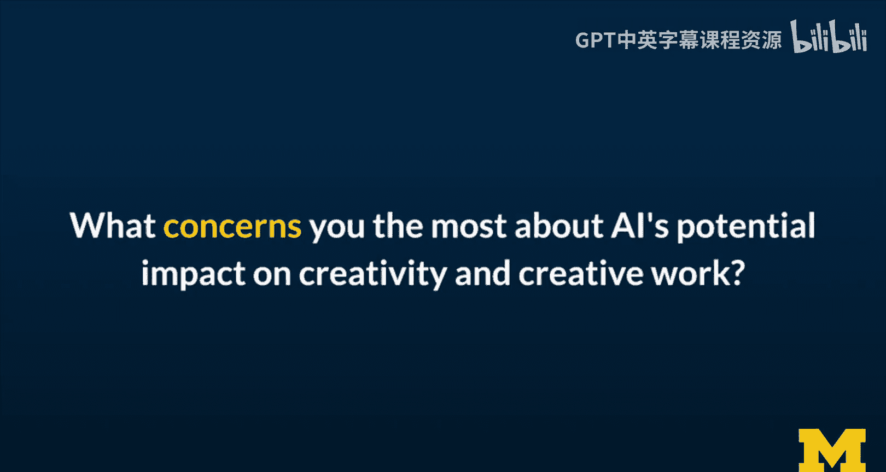
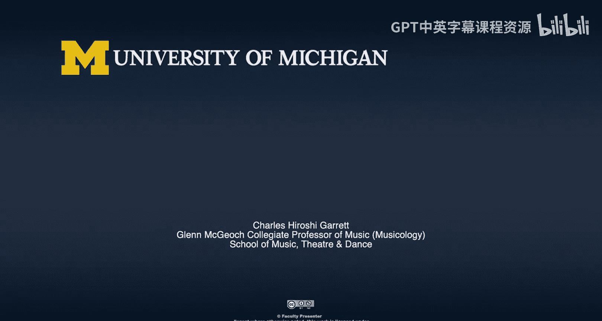

# 密歇根大学《AI用于创意工作｜AI for Creative Work》中英字幕 p24 12_领域之声：查尔斯·浩石·加勒特.zh_en -BV1DXNiznEXk_p24-

Because AI tools are advancing so quickly and because they're designed to make things so much simpler and easier。

 it's already becoming challenging for me to locate AI tools that feel like an assistant。

 a tool or helper。 Instead， I'm increasingly hearing about flashing new AI applications that promise to deliver fully big solutions。

 For instance， they promise to create new music or create visual art for me and not with me。

 as AI progresses， my biggest concern is that the newest technology will become so capable that I will start taking creative shortcuts that I will just push the button and accept readymade results。

 Even if the programs are not exactly what I envisioned。😊。

So my concerns going forward are both about AI。 How capable will it become in the future and about my personal relationship to creativity。

 To what degree will I choose to hold on to and value my own creative impulses。

