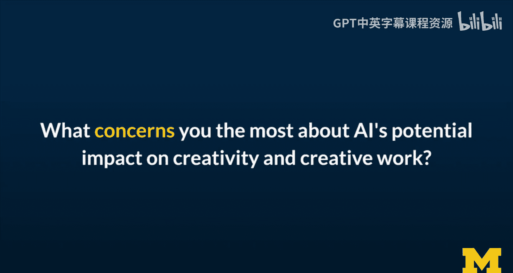
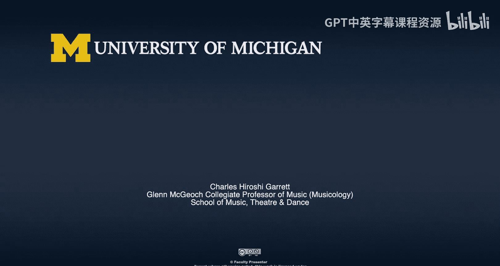

# AI用于创意工作：P24：领域之声：查尔斯·浩石·加勒特 🎨

在本节课中，我们将探讨AI工具快速发展对创意工作者带来的挑战与思考，特别是关于个人创造力与AI辅助之间关系的担忧。

---

因为AI工具发展非常迅速，并且它们的设计旨在让事情变得更简单、更容易，所以对我来说，找到那些感觉像是助手、工具或帮手的AI工具已经变得具有挑战性。相反，我越来越多地听说那些承诺提供完整解决方案的、令人眼花缭乱的新AI应用。

例如，它们承诺为我创作新音乐或视觉艺术，而不是与我共同创作。

随着AI的进步，我最大的担忧是，最新的技术将变得如此强大，以至于我会开始采取创意上的捷径——仅仅按下按钮，就接受现成的结果，即使这些程序生成的成果并不完全符合我的设想。

因此，我未来的担忧既关乎AI本身——它未来将变得多么强大，也关乎我个人与创造力的关系——我将在多大程度上选择坚持并珍视我自己的创作冲动。

---

本节课中，我们一起学习了AI工具快速发展可能带来的影响，包括从“辅助工具”到“全包解决方案”的转变趋势，以及这种趋势对个人创作主动性和创意过程价值的潜在挑战。