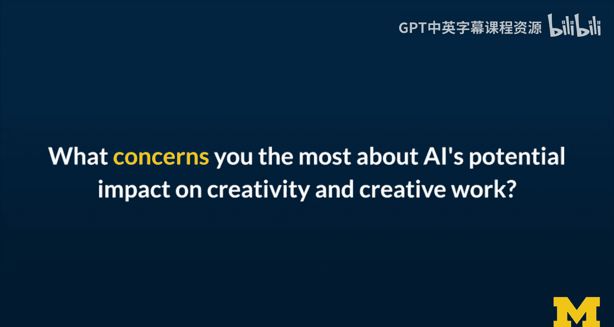
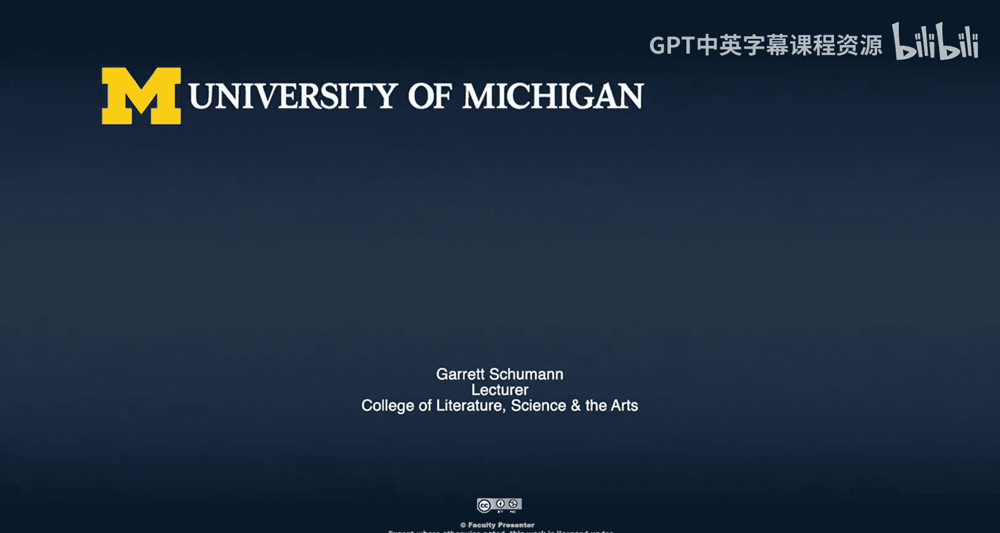

# AI用于创意工作：13：领域之声：加勒特·舒曼

在本节课中，我们将聆听来自领域专家加勒特·舒曼的观点，探讨人工智能作为一项技术所承载的意义、其发展过程中的潜在问题，以及我们对未来的担忧。我们将深入理解AI工具的本质、开发模式、社会影响及其可持续性挑战。

## AI作为技术工具的本质

上一节我们探讨了AI的多种应用，本节中我们来看看AI作为一项技术工具的根本属性。

AI是一项技术。因此，如同任何其他工具一样，它所承载的意义仅限于我们作为使用者所赋予它的意义。

## 对AI开发模式的担忧

理解了AI的工具属性后，我们转向其开发过程。当前的开发模式引发了一些特定的忧虑。

我担心的是，我们并不确切知道目前AI程序（尤其是生成式AI）的开发方式会带来什么后果。这种开发方式通常很少考虑数据来源和安全性。

以下是当前开发模式中值得关注的两个方面：
*   对数据来源的考量不足。
*   对数据安全性的考量不足。

## AI对社会结构的潜在影响

除了开发过程，AI的应用方式也至关重要。我们来看看它可能如何影响现有的社会结构。

此外，我对那些大规模强化现有权力与资源结构的AI应用感到沮丧。这些应用没有利用该技术所具有的变革潜力去改变现状。

**核心问题可以表述为：AI应用 ≈ 强化现状，而非 AI应用 ≈ 利用变革潜力。**

## 对AI产业可持续性的质疑

探讨了社会影响后，我们需要审视支撑这项技术本身的产业是否健康。本节关注AI产业的长期生存能力。

我的另一个担忧是，发展AI的产业本身不够强大，难以维持这项技术的长远发展。

当前的商业报告指出，那些掌控着当前AI工具所需资源的公司，对于它们自身以及这项技术的长期性和可持续性，几乎没有任何规划。

## 监管缺位的现状

最后，我们考察外部监管是否可能弥补产业规划的不足。特别是在某些地区，这种可能性似乎很低。

至少在像美国这样的地方，似乎不太可能有政府监管介入，来激励这种具有前瞻性的规划。

---

本节课中我们一起学习了加勒特·舒曼对AI的多维度思考。我们认识到AI的意义由使用者赋予，但其开发过程在数据来源和安全上存在隐患。我们看到AI可能被用于固化而非革新社会结构，并且整个AI产业在长期可持续性方面缺乏规划，而外部监管在当前也难以推动改变。这些观点提醒我们，在拥抱AI潜力的同时，必须审慎思考其发展路径与社会责任。