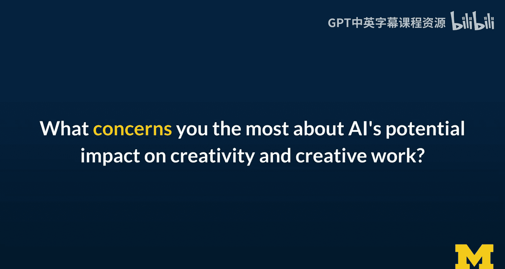
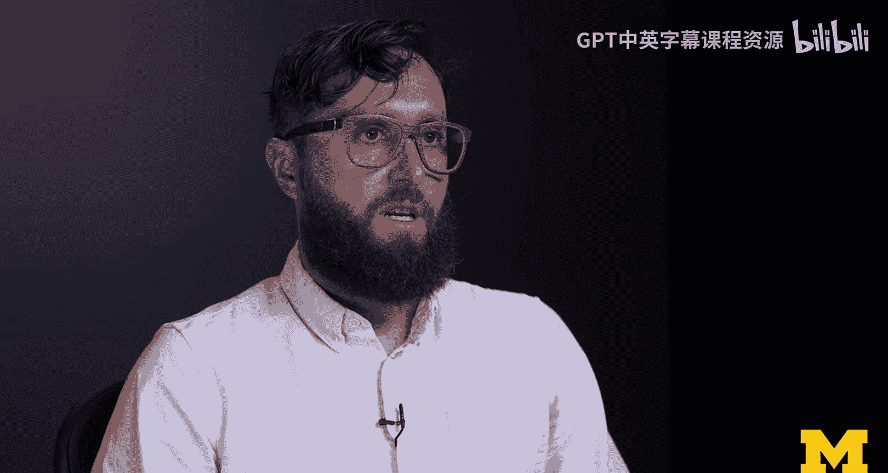
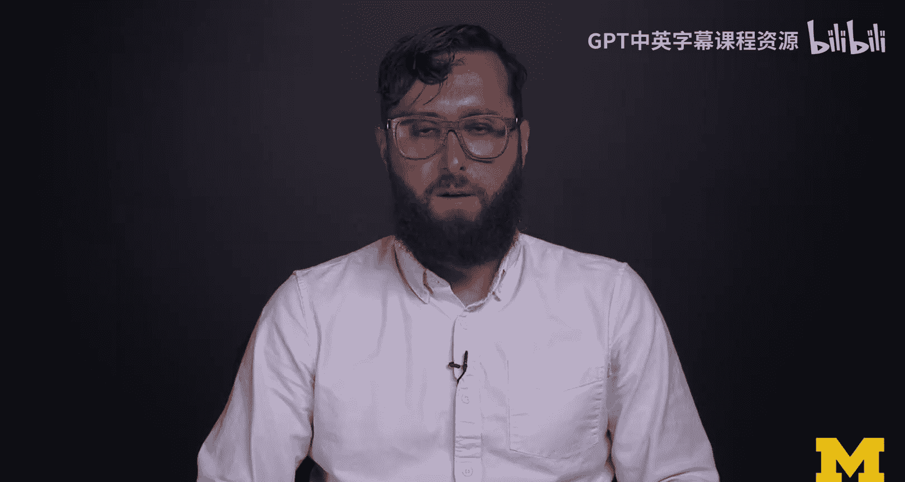
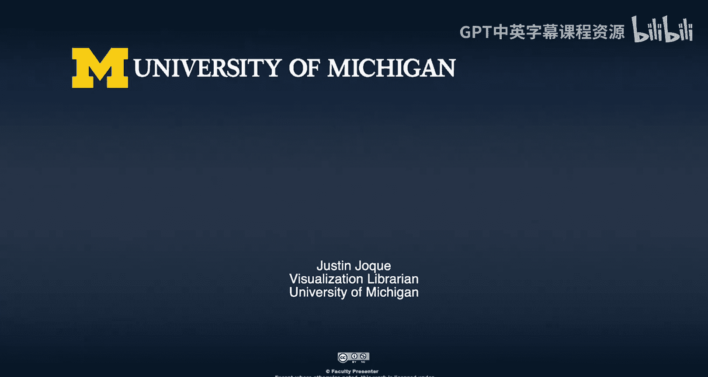

# AI用于创意工作：P26：领域之声：贾斯汀 🎨

在本节课中，我们将聆听来自创意领域的从业者贾斯汀的观点，探讨人工智能在创意工作中应用时可能引发的担忧，特别是关于内容质量与创意劳动价值的问题。

上一节我们讨论了AI在创意领域的潜力，本节中我们来看看从业者贾斯汀提出的具体关切。

贾斯汀最大的担忧是，人工智能将被用于创意工作的具体情境中，但其产出的艺术作品质量不佳。这种情况之所以会发生，是因为相较于人类，使用AI的成本更低。AI不会组织工会，也不会要求加薪。

他担心，AI将被广泛用作一种内容生产工具，其根本原因在于，这种工具可能进一步贬低和剥削创意劳动的价值。

---

本节课中我们一起聆听了贾斯汀的观点，他提醒我们关注AI在创意应用中对作品质量与劳动者价值的潜在影响。这促使我们思考，在拥抱技术效率的同时，如何维护创意产出的标准与创意工作者的权益。