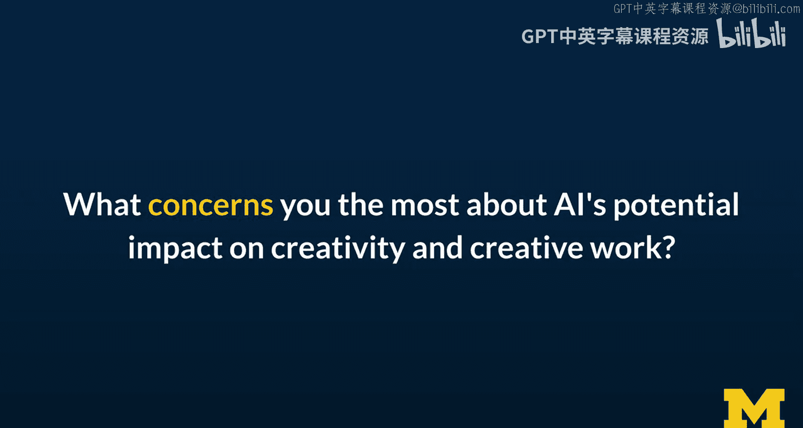
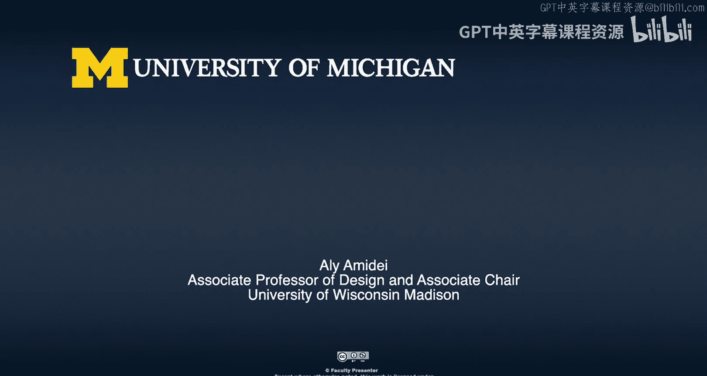

# 密歇根大学《AI用于创意工作｜AI for Creative Work》中英字幕 p27 15_领域之声：艾丽·阿米迪.zh_en -BV1DXNiznEXk_p27-

My biggest concern is the way that AI images are clogging up internet searches。

 not that Pinterest was ever the best platform for me to do my costume research。

 but now it's pretty much just an AI farm， where there is so little reality out there to be found。

 I'm also concerned about the challenges it poses to things like visual literacy。

 like my ability to teach students how to be visually literate。

 and being able to identify and understand what is reality and what is manufactured。

 not to mention the impact on all of the mental health and wellness at being bombarded by impossibly perfect and inaccurate images。

