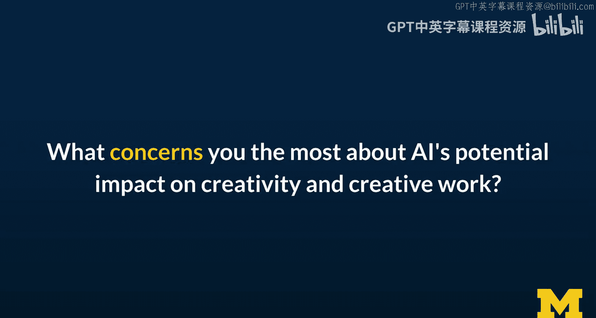

# AI用于创意工作：P28：领域之声：亚当·昆兹 🤖💬


在本节课中，我们将学习密歇根大学课程《AI用于创意工作》第28节的内容。本节由亚当·昆兹分享他对人工智能在职场中应用的见解，特别是关于AI如何影响就业和生产力的问题。我们将探讨AI是提升员工能力还是减少工作岗位，并分析其潜在影响。

---



上一节我们讨论了AI在创意领域的各种应用，本节中我们来看看亚当·昆兹对AI在职场中角色的看法。他认为，当前AI的应用趋势可能引发一些担忧。


亚当·昆兹指出，AI的应用并不总是以提升员工工作水平为目标。相反，一些公司可能试图利用AI来减少工作岗位，同时要求更少的员工完成相同甚至更多的工作量。这可以用一个简单的**公式**来描述：

**公司目标 = 减少员工数量 + 维持或增加产出**

他认为，如果AI被用来普遍提高工作标准和效率，那将是积极的。例如，AI可以帮助员工处理重复性任务，从而专注于更高价值的创意工作，其**代码**逻辑可能如下：

```python
# 理想情况：AI辅助提升效率
def ai_assist_employee(employee_skill, ai_tool):
    enhanced_output = employee_skill * ai_tool
    return enhanced_output
# 输出：员工在AI辅助下产出更高质量的工作
```

然而，如果AI的应用仅仅是为了用更少的人完成相同的项目，并减少薪酬支出，这就令人担忧了。这种情况可以概括为：

**潜在问题 = 相同产出 / 更少员工 & 更低薪酬**


---

以下是亚当·昆兹核心观点的总结列表：

*   **AI的双重角色**：AI既可以是提升个人能力的工具，也可能成为减少人力成本的途径。
*   **积极应用**：当AI用于帮助员工达到更高水平时，它能推动整体行业标准的提升。
*   **消极风险**：如果公司仅用AI来缩减团队规模和薪酬，可能导致就业市场收缩和员工福利下降。
*   **关键区别**：区分AI是“增强人力”还是“替代人力”至关重要，这决定了其对社会和经济的最终影响。


---

本节课中我们一起学习了亚当·昆兹对AI在职场中应用的深刻见解。我们了解到，AI技术本身并无好坏，但其应用方式决定了它是推动进步还是带来隐患。关键在于社会和企业如何引导AI的发展，确保其服务于提升人类潜能，而非仅仅削减成本。在创意工作中，平衡效率与伦理将是持续面临的挑战。