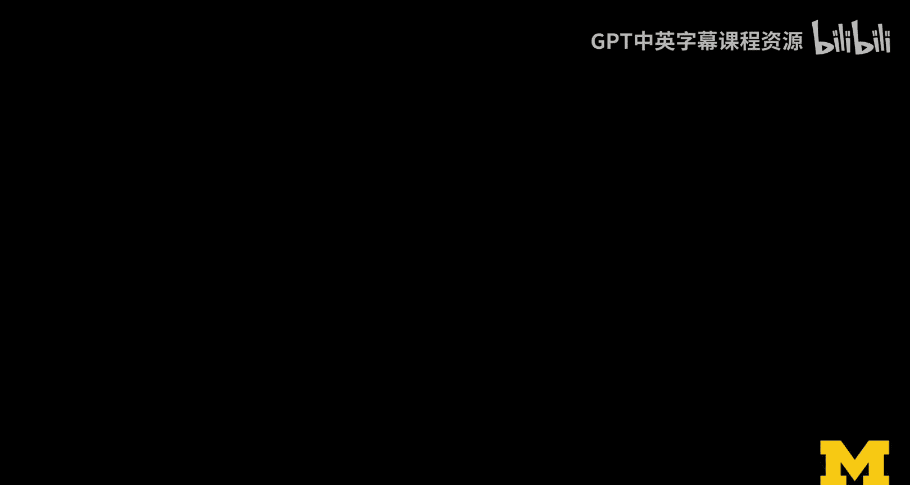
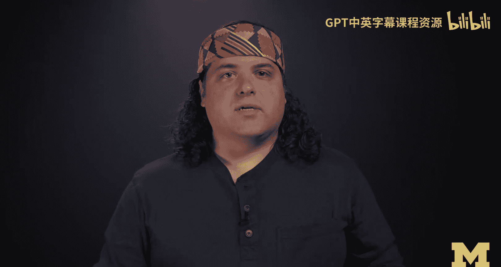
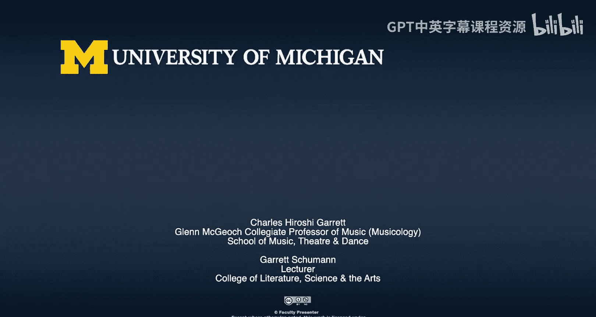

# AI用于创意工作：课程3：AI与深度思维

## 概述

在本节课中，我们将要学习如何超越将AI视为单纯的生产力工具，转而探索它如何能深化我们的创造性思维，并从根本上改变我们的创意实践方式。

## 从采纳到深化

前两门课程介绍了生成式AI支持创意工作的不同方式，以及确保个人、团队或组织负责任且可持续地实施AI技术的方法。到目前为止，我们的重点主要集中在AI的初步采纳行为及其直接影响上。本节课程将挑战你进行更深入的思考：你选择加入工作流程的工具，将如何转变你的创意实践并强化你的个人风格。

## 超越生产力倍增器

我们常看到AI被描绘成生产力倍增器，一种通过消除耗时、重复或抽象困难的任务来最大化工人效率的工具。但这种视角是有限的。诚然，生成式AI技术可以节省时间，让人们做更多事情。然而，这个“更多”可以且应该超越单纯的数量。毕竟，当AI简化了某人的工作流程时，它也创造了进行更高层次思考的空间。

## 深度思维的价值

以下内容结合讲座和阅读材料，探讨深度思维的好处，并展示专家和实践者的演示，以说明AI在现实世界中的强大功能。通过当代和历史案例，我们将看到各种创意专业人士如何以令人印象深刻的方式使用AI来扩展他们的创造力，放大其影响力和反思性，并磨练他们的工作方法。

## 创意领域的AI实验

AI一直是各学科创意专业人士数十年实验的焦点。当你以新方式接触这项技术时，这些先例可以构成宝贵的基础。超越生产力去思考。想象一下，如果你的创意工作能够超越现状的局限，包括许多你以前可能从未考虑过的事情，那将会是怎样的景象。

## AI作为创意之镜

当然，AI可以节省时间，但它也可以是一面镜子，为你提供审视创造性思维和过程的新视角，将你的倾向反射给你，并为你提供一个“合唱团”般的声音，而不仅仅是一个声音，来将你的创意工作推向终点。

## 总结

本节课中，我们一起学习了生成式AI不仅是效率工具，更是深化创意实践、激发反思和扩展可能性的强大伙伴。关键在于转变视角，利用AI创造的空间进行更高层次的思考，从而让创意工作实现质的飞跃。