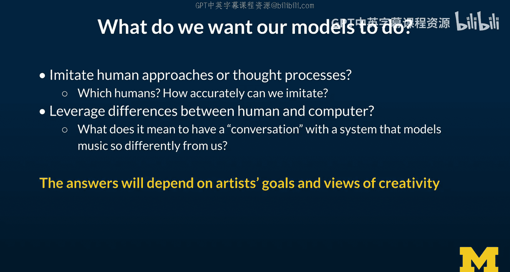
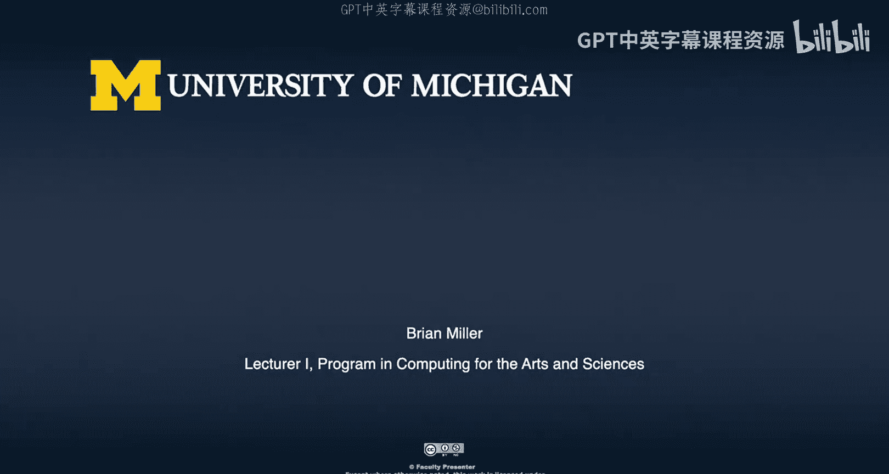

# 密歇根大学《AI用于创意工作｜AI for Creative Work》中英字幕 p33 4_机器爵士：AI即兴演奏研究.zh_en -BV1DXNiznEXk_p33-

Yeah。

You may have heard someone say that jazz improvisation is a kind of conversation。

 Each player expressing themselves through their instrument。

 but also listening to the ensemble and coming forward or stepping back at the appropriate time。

This is a cliche， but there's a certain truth to it。

 The idea that a musical improvisation is a microcosm or a special case of everyday human interaction。

This has made improvisation a sort of holy grail for some computer music researchers。

 If we can get a computer to improvise in real time with a human being。

 that suggests that we've come to some real insight about what human interaction is。

 This is such a compelling idea that DARPpa， the Defense Advanced Research Projects Agency。

 which is the research wing of the US Defense Department has actually invested in a project that aims to create computer systems that improvise and play jazz with humans。

Now， the DARPA project doesn't seem to have gotten very far。

 but a research group at Georgia Tech has actually developed a real jazz playing robot。

 which they call Shimo。Shimon is fascinating， not necessarily because it's the most convincing jazz performer。

 but because it brings together a lot of key computational techniques and addresses a lot of really difficult challenges involved in getting a robot to play music。

Shiimmon plays the Miimba， so it has multiple arms that can all move independently and hit different keys with mallets。

 But the really striking thing about it is that it has what looks like a giant eye on a robot arm that moves around as it performs as if it's watching the people it's playing with。

This is because Shi's creators thought that the embodied aspect of playing with an ensemble is actually one of the keys to a good musical interaction。

 When humans play together， they tend to make all kinds of movements with their bodies and their instruments to communicate and coordinate。

Watch in the video how the robot's head bobs and sways and seems to be looking at some of the other performers。

🎼的啦。🎼，🎼。🎼The。🎼，Of course， Shimon doesn't really understand what it feels like to move to music。

 but it's programmed to move in ways that make sense to the humans around it。

 And that seems to produce a better performance， even if it's a little uncanny to watch。

You may have heard criticisms of newer AI systems like chat GT。

 suggesting that their ability to really understand anything is limited because they only model language and don't have any contact with the physical world。

This actually aligns with a long standing critique of AI from roboticists like Rodney Brooks。

 and Chimon helps show how meaningful， even a limited form of embodiment can be in human computer interaction。

When it comes to modeling the actual musical notes， Shiimmon uses a combination of techniques。

 A lot of what it plays like the overall form of a song and the chord changes that it follows are handled with rule based processes similar to what you would find in earlier computer music like David Cope's E I system。

But when Shimon is playing a solo， it uses a machine learning model that's been trained on many examples of solos from real jazz musicians。

This is before the current Gen AI era。 so instead of a neural network。

 Shiimmoone uses something called a hidden Markov model。In general。

 a Markov model is just a system that uses information about the current state of things to predict events in the future。

Think about how an English spell in。 The letter Q is almost always followed by U。

 If we wanted to make a Markov model of English spell in。

 Q would be represented something like this with maybe a 98 per cent chance of moving to U and a 1 per cent chance of moving to a different letter like I or A。

 If we wanted to get the numbers exactly right。 we would go out and analyze a lot of English text to see what the real probabilities are。

Now， instead of English spell in， let's think of those letters as musical notes。

This model is telling us that the note C is most likely to move to E。

 but there's also a chance it will move to G， and that G will most likely move back to C。

 but there's a small chance it will move up to a。And even with just this simple diagram。

 we could actually generate some melodies by choosing a sequence of notes based on these probabilities。

The hidden Markov model that Shiimmoon uses is a much more complex variant of this kind of system。

 but the basic principle is very similar。 It generates one note at a time based on probabilities that it learned from a large collection of jazz solos。

But choosing a computational technique is far from the only decision you have to make if you want to model music as complex as jazz。

 For example， Shimon uses a separate model for each different type of chord in a tune。

 So you could say that its thought process for choosing a note always depends on the specific harmony that's plain。

There's another system called Iroviser that doesn't perform live in the same way as Shimoan。

 but that also generates jazz solos and also uses a hidden Markov model。

But instead of choosing one note at a time like Shimon。

 Iroviser chooses from a collection of longer melodic shapes。

 and its choices don't depend on harmony in the same way。

So we have the same type of computational model， but using a completely different basic musical unit。

 which means the musical results end up being very different too。

These different decisions about how to set up the model are really claims about how a jazz Solo works。

Focus in on what individual notes fit with a chord versus thinking in terms of longer musical gestures or phrases。

So we can ask questions like， does a model that is more similar to how a human thinks about jazz actually produce better music？

Or can we get more interesting results if we program the model to do something totally different from what a human does？

And even though the specific models used in systems like Shion and improviser have started being replaced by things like neural networks。

 these same kinds of questions remain as important as ever for any kind of creative work with AI。

