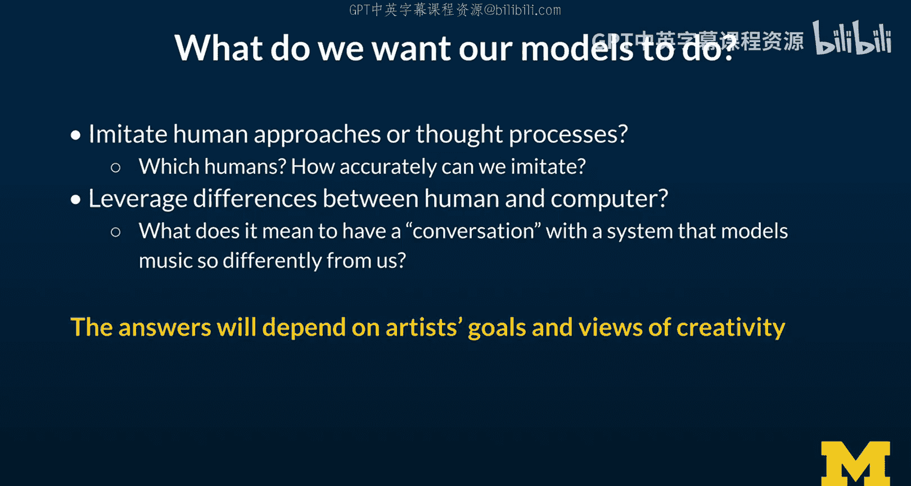
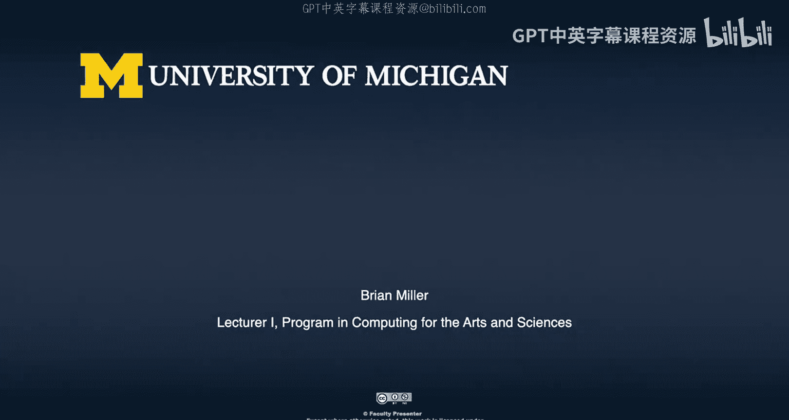

# AI用于创意工作：4：机器爵士：AI即兴演奏研究 🎷

在本节课中，我们将探讨人工智能如何被用于模拟爵士乐即兴演奏这一复杂的创造性过程。我们将了解一个名为Shimon的机器人爵士乐手，并分析其背后结合的计算技术，从而理解让机器参与实时音乐互动所面临的挑战与思考。

---

你可能听过一种说法：爵士乐即兴演奏是一种对话。每位演奏者通过乐器表达自我，同时也倾听乐队的整体声音，并在恰当的时机前进或退让。这虽是老生常谈，但其中蕴含一定道理。音乐即兴可以被视为日常人际互动的一个缩影或特例。

正是这个观点，使得即兴演奏成为一些计算机音乐研究者的“圣杯”。如果我们能让计算机与人类进行实时即兴演奏，那就意味着我们对人类互动的本质有了真正的洞察。这个想法极具吸引力，以至于美国国防部高级研究计划局（DARPA）也投资了一个旨在创建能与人类即兴演奏爵士乐的计算机系统的项目。

上一节我们提到了即兴演奏作为人机交互模型的潜力，本节中我们来看看一个具体的实践案例。虽然DARPA的项目似乎进展有限，但佐治亚理工学院的一个研究小组确实开发出了一个真正的爵士乐演奏机器人，他们称之为Shimon。

Shimon之所以引人入胜，并非因为它是最令人信服的爵士乐表演者，而是因为它集成了许多关键的计算技术，并解决了让机器人演奏音乐所涉及的诸多难题。Shimon演奏马林巴琴，它有多只可以独立移动的手臂，能用琴槌敲击不同的琴键。但真正引人注目的是，它有一个安装在机械臂上的、看起来像巨大眼睛的装置，在表演时会四处移动，仿佛在注视着与它合奏的乐手。

这是因为Shimon的创造者认为，在合奏中具身化的互动是良好音乐互动的关键之一。当人类一起演奏时，他们倾向于用身体和乐器做出各种动作来进行交流和协调。在视频中，你可以看到机器人的头部如何摆动、摇晃，并似乎在看着其他演奏者。当然，Shimon并不真正理解随音乐律动是什么感觉，但它被编程为以让周围人类觉得合理的方式移动，这似乎能产生更好的表演效果，尽管观看时可能有些怪异。

你可能听过对ChatGPT等新型AI系统的批评，认为它们真正理解事物的能力有限，因为它们只建模语言，与物理世界没有接触。这实际上与Rodney Brooks等机器人学家对AI的长期批评不谋而合，而Shimon有助于展示即使是有限形式的具身化，在人机交互中也能多么有意义。

在建模实际音符方面，Shimon结合了多种技术。它所演奏的许多内容，比如歌曲的整体形式和遵循的和弦进行，是通过基于规则的过程处理的，类似于大卫·科普的EMI系统等早期计算机音乐中的技术。

但当Shimon演奏独奏时，它会使用一个机器学习模型，该模型经过了许多真实爵士音乐家独奏范例的训练。这发生在当前生成式AI时代之前，因此Shimon没有使用神经网络，而是使用了一种称为**隐马尔可夫模型**的技术。

以下是隐马尔可夫模型的核心概念：
*   **马尔可夫模型**：一个利用当前状态信息来预测未来事件的系统。
*   **类比**：可以将其类比为英语拼写。字母Q之后几乎总是跟着U。如果我们想建立一个英语拼写的马尔可夫模型，Q的表示可能类似于：有98%的概率转移到U，1%的概率转移到I或A等其他字母。要获得精确的概率，我们需要分析大量英文文本。
*   **应用到音乐**：将字母替换为音符。一个简单的模型可能显示，音符C最有可能移动到E，但也有可能移动到G；而G最有可能移回C，但也有小概率移动到A。即使只有这个简单的图示，我们也可以根据这些概率选择一系列音符来生成一些旋律。

Shimon使用的隐马尔可夫模型是这类系统的一个复杂得多的变体，但基本原理非常相似。它根据从大量爵士乐独奏中学习到的概率，一次生成一个音符。

然而，要想为爵士乐这样复杂的音乐建模，选择计算技术远非唯一需要做的决定。例如，Shimon为曲调中的每种不同类型和弦使用单独的模型。可以说，它选择音符的“思考过程”总是依赖于当前正在演奏的特定和声。

另一个名为“即兴演奏者”（Improviser）的系统，虽然不像Shimon那样进行现场表演，但也能生成爵士乐独奏，并且同样使用隐马尔可夫模型。但与Shimon一次选择一个音符不同，即兴演奏者从一个更长的旋律形态集合中进行选择，并且它的选择并不以同样的方式依赖于和声。

以下是两种建模思路的关键区别：
*   **Shimon的思路**：以**单个音符**为基本单位，选择强烈依赖于当前和弦。
*   **即兴演奏者的思路**：以**更长的旋律乐句**为基本单位，选择和声依赖性较弱。

因此，我们拥有相同类型的计算模型，却使用了完全不同的基本音乐单元，这意味着最终产生的音乐结果也大相径庭。这些关于如何建立模型的不同决策，实际上是对爵士乐独奏如何运作的不同主张：是专注于与和弦匹配的单个音符，还是从更长的音乐姿态或乐句的角度来思考。

由此，我们可以提出一些问题：一个更接近人类思考爵士乐方式的模型，是否真的能产生更好的音乐？或者，如果我们编程让模型做一些与人类完全不同的事情，是否能得到更有趣的结果？尽管像Shimon和即兴演奏者这样的系统中使用的特定模型已经开始被神经网络等技术取代，但对于任何类型的AI创意工作而言，这类问题的重要性依然如故。

---

本节课中我们一起学习了AI在爵士乐即兴演奏领域的应用。我们通过Shimon机器人案例，了解了结合规则系统与隐马尔可夫模型等技术来实现实时音乐交互的方法。更重要的是，我们探讨了在音乐建模中，关于基本单元（单音 vs. 乐句）和上下文依赖（如和声）的不同设计选择，如何反映了对音乐创作本质的不同理解，并最终影响生成结果。这些思考超越了具体的技术，是进行AI创意探索时需要持续面对的核心问题。