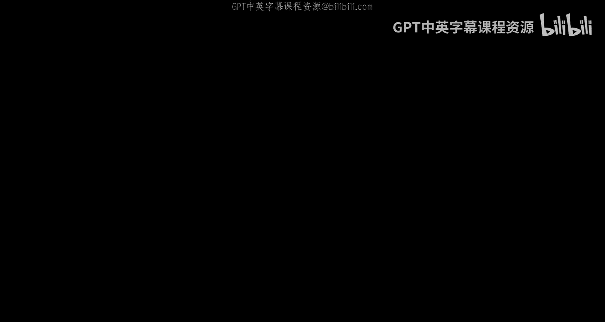
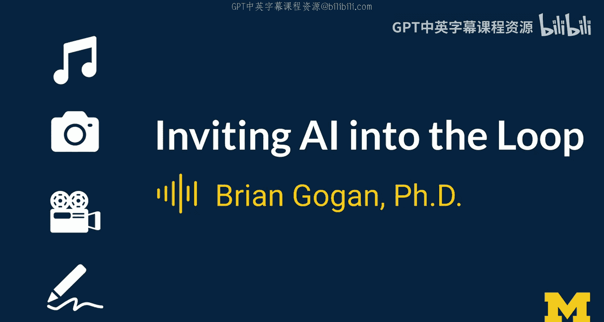
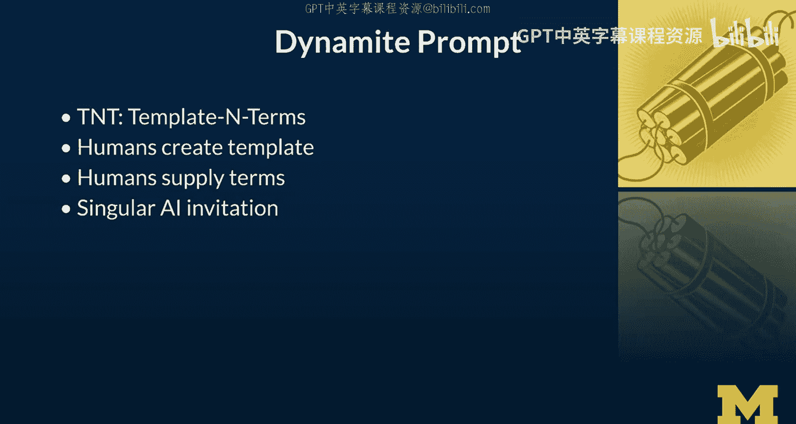
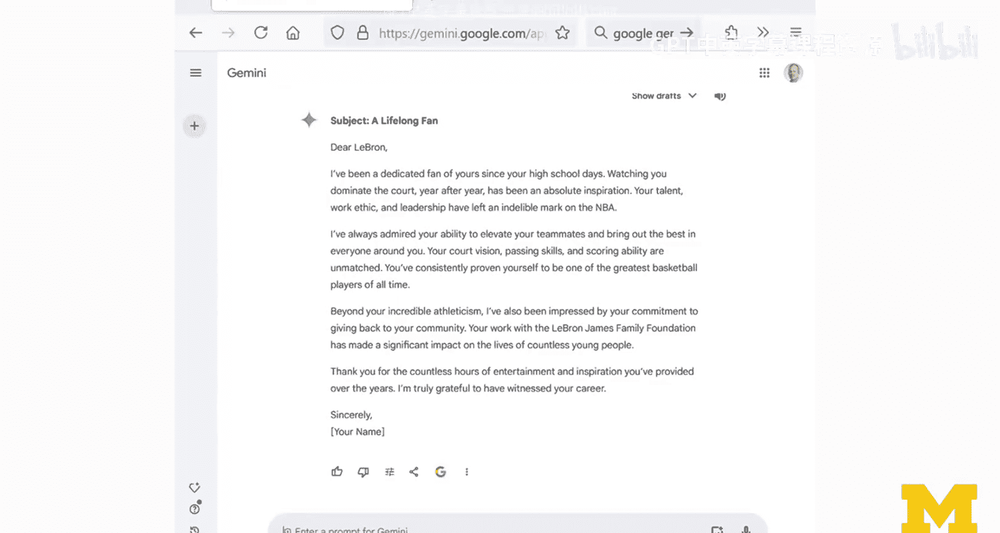
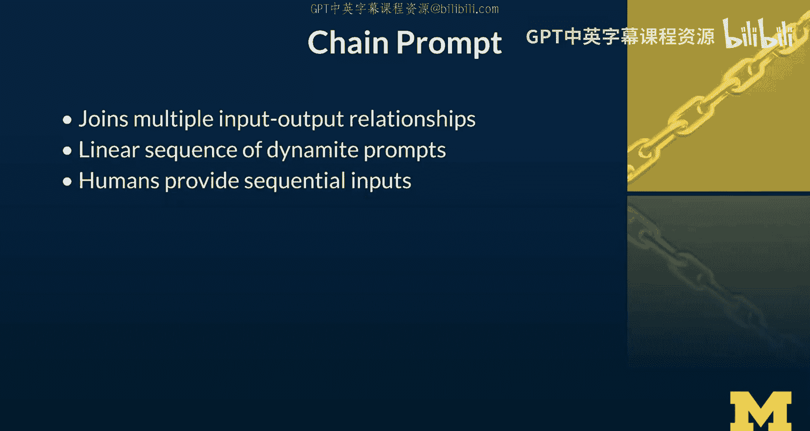
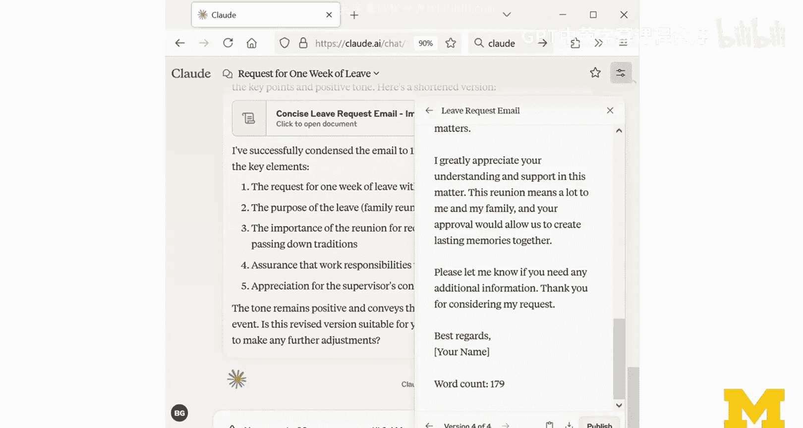
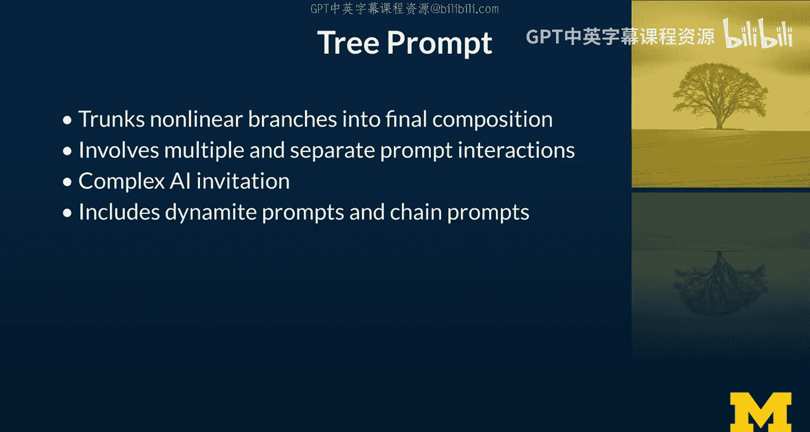
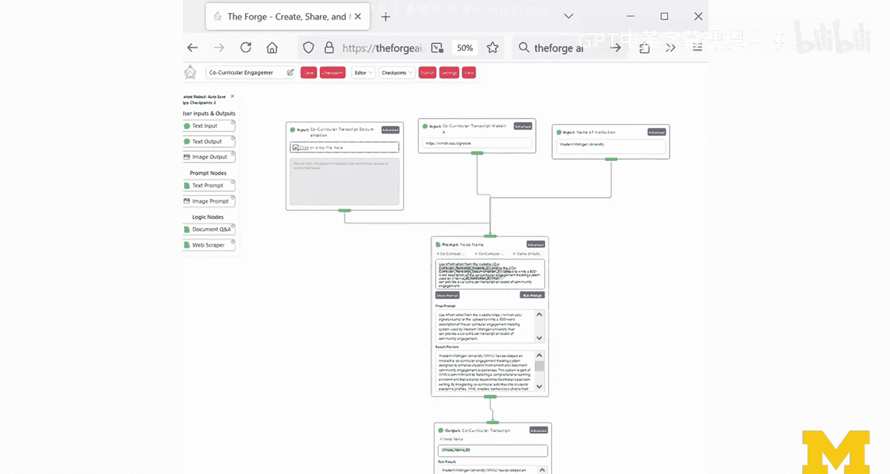
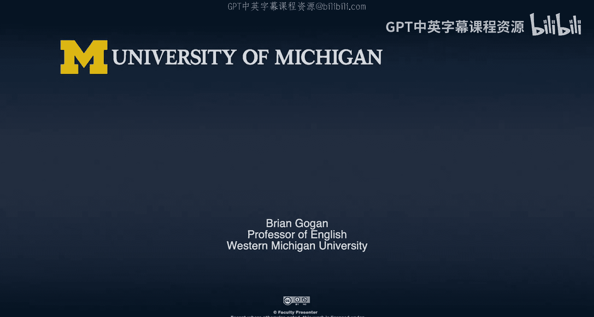

# 密歇根大学《AI用于创意工作｜AI for Creative Work》中英字幕 p34 5_构建AI协作闭环.zh_en -BV1DXNiznEXk_p34-

I'm Brian Gogan， a professor of rhetoric and writing at Western Michigan University。

 and I'm here to discuss some of the ways that AI is expanding writing processes。

AI is being introduced。Into writing processes or what we might call production loops at every imaginable stage of composing from the earliest inventive moments to the last pass of edits。

😊，Regardless of when AI is introduced into a production loop。

A human has to invite the AI platform to enter into that loop， that composing process。

I find this type of invitation fascinating and inherently creative。

 especially when the piece of writing that is being produced can actually  fulfill a purpose in the real world。

😊，When we apply AI to real world problems and situated needs， we open up an expansive potential。

 and all of this potential depends upon the invitation we extend to AI。

These invitations are commonly called prompts， and they are the inputs that we offer AI to receive an output。

These prompts function to instruct and direct AI as it works with us humans。

 as partner and co producer。I'm interested in how humans can extend these invitations to AI in ways that help produce more effective。

More ethical and more equitable pieces of writing or other types of compositions。

Working with a group of students and practitioners。

 I have identified three macro level or large level prompting structures that may be useful to you as you invite AI into your own production loops。

The three macro level structures that I will share with you should be thought of as three different approaches to creating AI prompts。

 They are structures that help us manage our inputs， our instructions， our invitations to AI。

Prompt structure 1 is what I call a dynamite prompt。

The name of this structure is a play on the acronym T and T。

 which in this case stands for template in terms。 As the acronym suggests。

 the dynamite prompt structure uses a template that the human enters into AI。

These templates typically include fill in the blank spots。

 where humans must supply terms in order to complete the prompt with specificity。

In the dynamite prompt structure， humans create the template and supply the terms。

 The dynamite prompt structure is a singular invitation to AI to offer an output。

Humans can steer AI toward different outputs by subtly altering the terms used with the template。

 or more drastically， by changing the template itself。

Now， let's take a look at this structure in action。 I've written a pretty basic template。

Right here with two fill in the blank spots。 Here is my template。

Write a blank page fan letter to blank。 Some of you will note that this prompt resembles the prompt used in a controversial commercial that Google aired during the 2024 Summer Olympics。

 in which a father uses AI to help his daughter write a fan letter to Si Mclaughlin Laroone。

For this case， I will， like the father in that commercial， also use Google's Gemini。

 and I will see what outputs I received with two different set of terms used with the template。

Here is the first prompt。 write a。Two page fan letter 2。Taylor Swift。And the result。

Here is the second prompt。Write a half page fan letter to Lebron James。And the result。

Notice that this prompt structure possesses once and done potential。

 the dynamite prompt structure packs explosive effectiveness for rather straightforward real world purposes。

 Humans can then work to revise the output of the dynamite prompt。

Prompt structure2 is what I call a chain prompt。The name of this structure comes from the fact that this prompt organizes the relationship between human input and AI output into a linear sequence where multiple input output relationships are joined together。

The idea behind the structure of this prompt is that a singular human input is insufficient to obtain an optimal AI output。

Consequently， the chain prompt consists of multiple dynamite prompts strung together。

After receiving one output in response to an initial prompt， chain prompts build upon the output。

 crafting another input that walks towards one final composition。In this way。

 links are established between completed outputs and successive inputs。

Let's take a look at this structure in action。

I start with a dynamite prompt here。 I'm using a prompt that reads。

 write an email to my supervisor Don， requesting one week of leave time。

 and I've decided to use it with Anthropics cloud。Here's the result using the chain prompt structure。

 I invite AI to refine this first output by inputting another prompt。

And I can extend the chain prompt by adding link after link after link。

 successively prompting AI with more inputs such as this one。Now。

 revise the email to explain that I need to use the leave time because of a family reunion that will happen in the United Kingdom。

Also， this one。Keeping a positive tone stressed the importance of this reunion for me。

 because it will give me an opportunity to reconnect with my extended family and teach my children our traditions。

😊，And， finally。This one revise the email so that it is 250 words or less。

The one caution about this prompt structure is that humans must be aware of one weak link for one problematic output on one link of the chain will influence all subsequent links in the prompt。

 so humans must remain diligent to check each output as the chain prompt advances。

Prompt structure 3 is what I call a tree prompt。 This structure gets its name from the way it organizes input output relationships into non linear branches that ultimately trunk together at different junctures to contribute to one final composition。

Since tree prompts involve multiple and often separate prompt interactions。

 the tree prompting structure is the most complex invitation that you can offer AI。

The nonlinear nature of a tree prompt promotes a production process that lends itself to multimodal integration。

Clarification commands， logical operations， and web scraping techniques。

Tree prompts frequently include both dynamite prompt structures and chain prompt structures embedded within them。

Let's take a look at this structure in action。For this example， I am using the 4JI。

 which is an integrated design environment that uses Open AI's chat GT。

You'll see here that I've already mapped out a small tree prompt for a segment of a classification document that institutions like my own might choose to complete。

The tree branches involve an optional document upload， a web scraping function， and a text input。

These branches then trunk together into a prompt that ultimately produces a segment of text that can be used in the draft classification document。

The forge AI actually allows me to launch this tree prompt as an application。

That I could share with other colleagues at different institutions so that we could all generate draft texts for this section of the classification document。

I want to stress again that this tree prompt example is significantly scaled down。

 typical tree prompts。Have handfuls of inputs， three to four main branches and dozens of small prompts that lead to the final composition。

I hope you'll find these three approaches useful as you work creatively to invite AI into your own production loops。

 Thank you。

