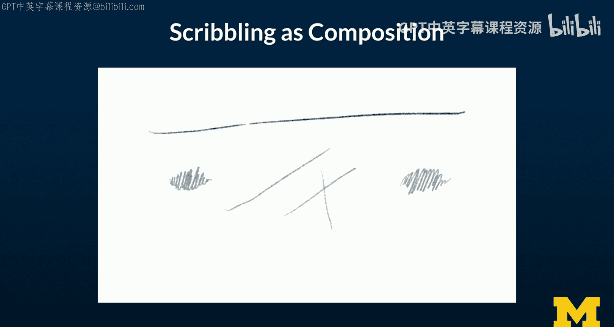
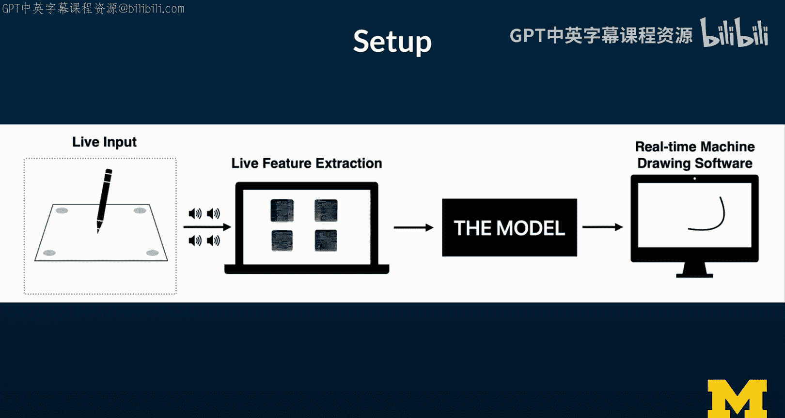
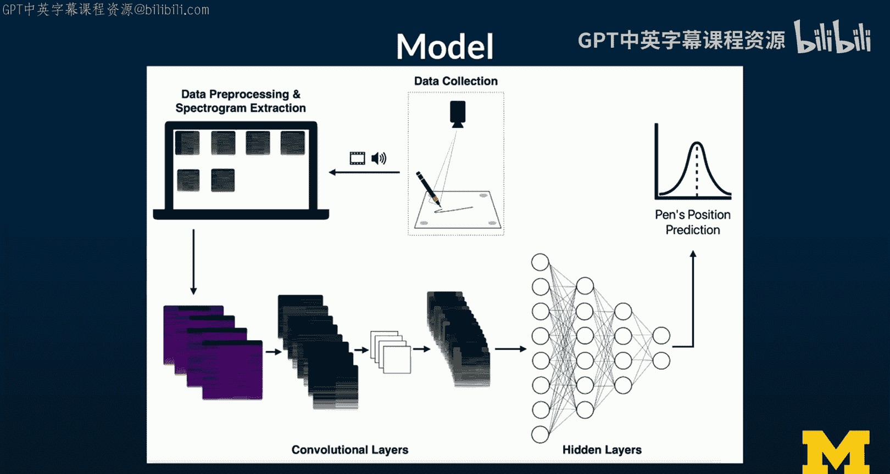
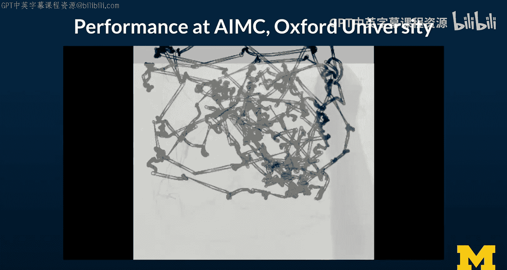
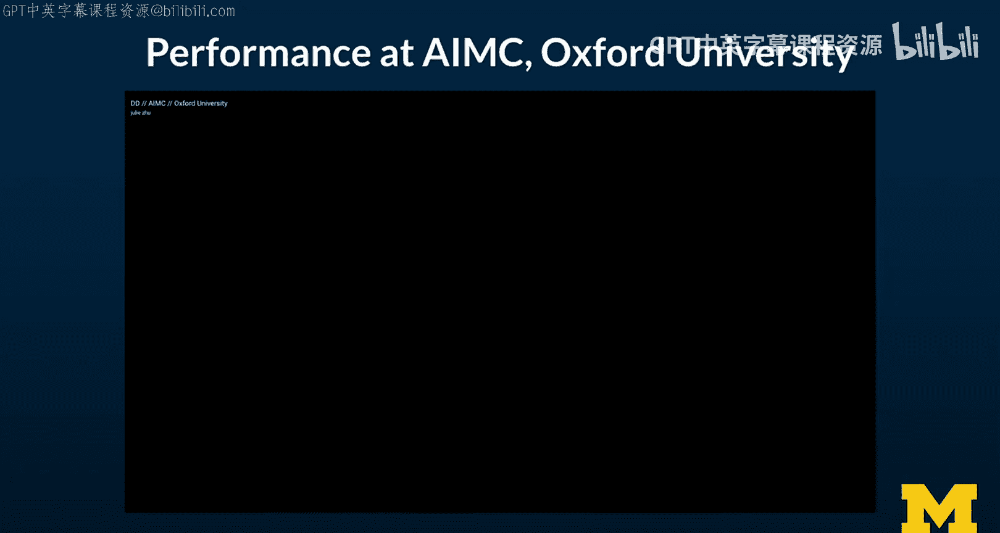
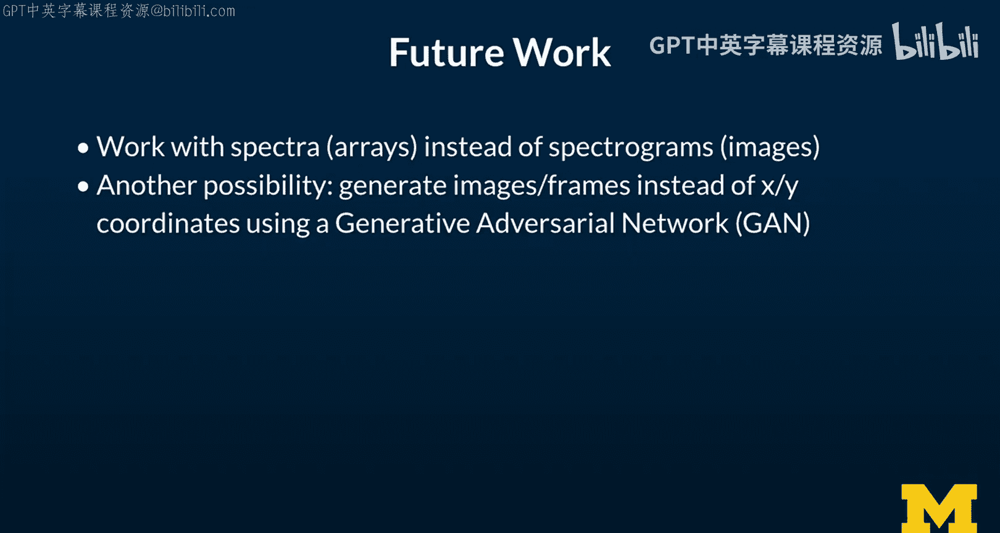
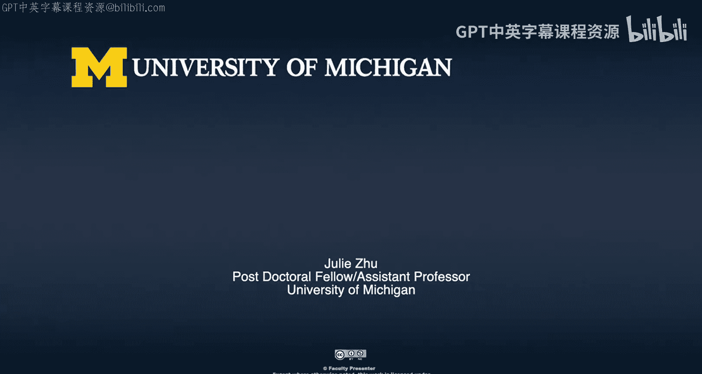

# 密歇根大学《AI用于创意工作｜AI for Creative Work》中英字幕 p36 7_深度绘图技术.zh_en -BV1DXNiznEXk_p36-

My name is Julie Zoo， and I'm a composer and music technologist。

I'm here to talk to you about my in progress project。

 deep drawing that uses AI to generate visuals from sound Before I was in music。 However。

 I was a visual artist living in New York City。 The city has a lot of nice noises。

 hunks and shouting the rumbling of trucks and subway trains。

 by my absolute favorite was a sound of graphite onr grain heavyweight paper。

 or the sound of charcoal layered on a painting with textured breaststrokes like on this one from 2015。

 The last painting I made before devoting myself to sound art and music composition。😊，Over the years。

 I created many performances and compositions about the sound of drawing。

 Here's an excerpt of a digital score from 2021 for a percussionist drawing inside an amplified wooden box。

😊。

This digital score was only meant for the performer， but it made me realize something。

 The video was not only orally interesting， but also visually satisfying with the explosion of a machine learning tools。

 I wondered if I could create a visual co improviser that would predict what I was drawing just from the sound。

😊，With my team， Doctor John Grzll， Airf Aley and Alex Zang。

 we set out to create a deep learning model that would take input from four contact mics placed in the corners of a 2 ft square and quarter" thick piece of plywood。

 and output a visual representation of what was drawn。Essentially， a localization problem。

 not unlike how your cell phone triangulates your position using cell towers and public w Fi points。

 However， sound travels much faster through wooden surface than through air。

 and that signal is very noisy， which justifies a machine learning model instead of a fixed calculation。

The setup of our visual co performer is as follows with live drawing input from the four contact mics。

 We want to extract audio features from these four audio channels that are then fed into the machine learning model。

 which predicts the X， Y coordinates of the pen tipip at 30 frames per second and sends that to jascript front end application that visualizes the coordinates as drawn gestures。

The key to this AI co performer is a trained model。

 There are many types of deep learning neural networks。

 and one of them is convolutional neural networks， or CNN Ns。

This feed forward neural network is often used in image processing and is good at prediction。

For real time audio to pen position mapping， we first recorded synchronous audio and video of drawing。

 The X Y position in the video is determined by color tracking。

 There is a blue sticker at the end of the pen for training。

 and the audio goes through pre processing， which extracts spectrograms through the CNN N N。

 the machine can translate the nuances and variations in the audio into corresponding coordinates。

 and thus， visual marks on a digital canvas。😊。

Our first run through of this model was a 10 minute performance at the AI Music Civity Conference at Oxford University in 2024。

😊，I was making drawings on a wooden surface， exploring tambber and rhythm。

 Priitizing interesting sound and the real drawing via an overhead camera and the predictive drawing were superimposed to highlight the successes and the failures of the machine。

 Here's an excerpt。

As you can see， the co performer is not accurate to my drawing。 There's also a lag。

 This was not an unwalted result at all。 It's part of the research process。 And in addition。

 an aspect of the exploration of deep drawing is an understanding of the granular details of developing a model from scratch。

 which is rare in machine learning。We are also using only data that we have generated。

 which is important to me as a practicing artist not to use other people's data。

One improvement we are already pursuing is using spectra instead of spectrograms。

 Another way to transmit audio data。 But with spectra， we have strings of numbers instead of images。

 which makes our model lighter and more real time。Another potential model is to generate whole images instead of X。

 Y coordinates， which would utilize a generative adversarial network G for audio induced visual synthesis。

 There's so much more to explore。

