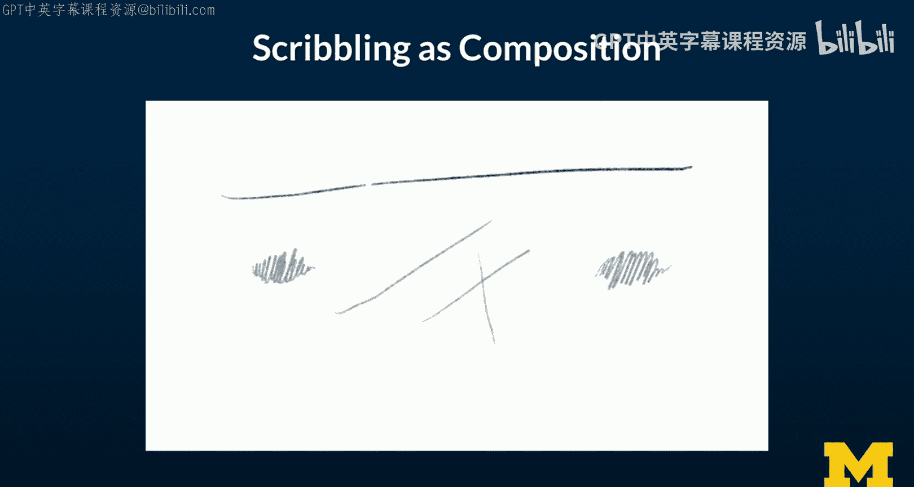
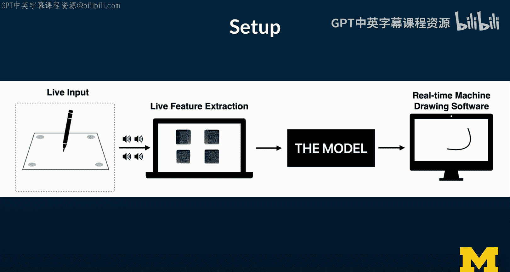
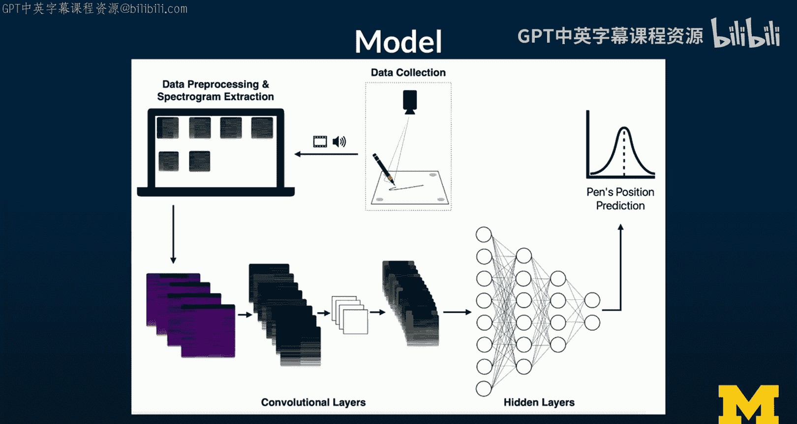
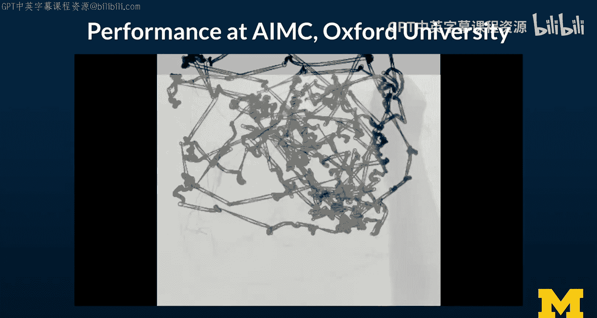
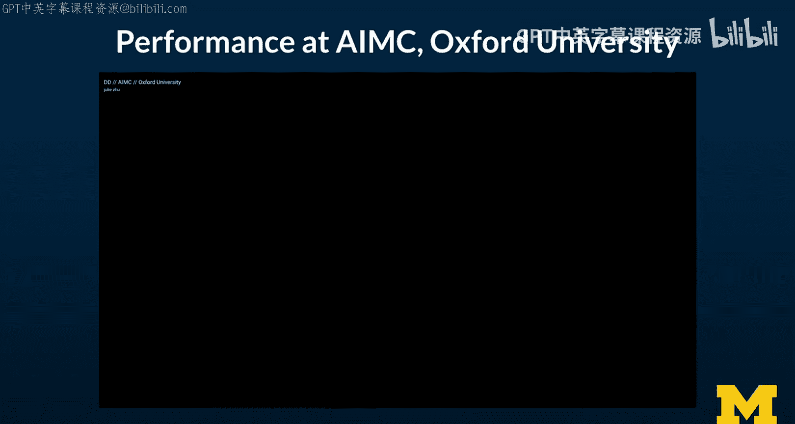
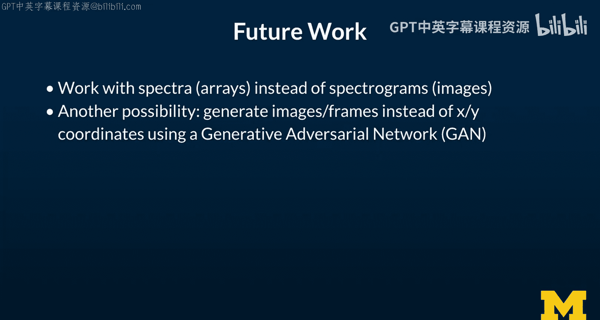
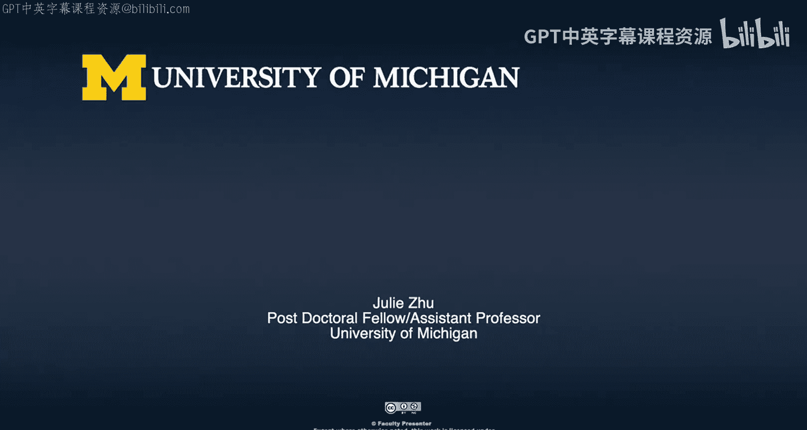

# AI用于创意工作：第7章：深度绘图技术 🎨

在本节课中，我们将学习一个名为“深度绘图”的创意项目。该项目利用人工智能技术，将绘画时产生的声音实时转化为视觉图像。我们将了解其背后的原理、技术实现过程以及未来的探索方向。

## 项目背景与灵感 🎵

我的名字是朱莉·祖，我是一名作曲家和音乐技术专家。在这里，我想与大家分享我正在进行中的项目——“深度绘图”。这个项目利用人工智能从声音生成视觉图像。

在投身音乐领域之前，我是一名生活在纽约市的视觉艺术家。这座城市充满了各种有趣的声音，例如鸣笛声、叫喊声、卡车和地铁的隆隆声。然而，我最喜欢的声音是石墨在重磅纹理纸上的摩擦声，或者是炭笔在有纹理的笔触画作上层层叠加的声音，就像这幅2015年的作品。这是我投身声音艺术和音乐创作之前完成的最后一幅画。

多年来，我创作了许多关于绘画声音的表演和作品。这是2021年为一位打击乐手创作的数字乐谱片段，他在一个扩音的木质盒子内部进行绘画。

这份数字乐谱原本仅供表演者使用，但它让我意识到一些事情。这段视频不仅在听觉上很有趣，在视觉上也令人满意。随着机器学习工具的爆发式发展，我开始思考，能否创造一个视觉上的“共同即兴表演者”，仅凭声音就能预测我正在画什么。

## 技术实现方案 🤖

带着这个想法，我和我的团队——约翰·格兹尔博士、艾尔夫·阿利和亚历克斯·赞——着手创建一个深度学习模型。该模型从放置在2英尺见方、四分之一英寸厚的胶合板四个角落的四个接触式麦克风获取输入，并输出所绘制内容的视觉表现。

这本质上是一个**定位问题**，类似于你的手机通过蜂窝基站和公共Wi-Fi点进行三角定位。然而，声音在木质表面的传播速度比在空气中快得多，并且信号噪声很大，这证明了使用机器学习模型而非固定计算方法的合理性。

我们的视觉共同表演者的设置如下：通过四个接触式麦克风获取实时绘画输入。我们需要从这四个音频通道中提取音频特征，然后将其输入机器学习模型。该模型以每秒30帧的速度预测笔尖的X、Y坐标，并将这些坐标发送到一个JavaScript前端应用程序，该程序将坐标可视化为绘制的手势。

## 核心：卷积神经网络模型 🧠

这个AI共同表演者的核心是一个训练好的模型。深度学习神经网络有多种类型，其中一种是**卷积神经网络**。

这种前馈神经网络常用于图像处理，并且擅长预测任务。为了实现实时的音频到笔尖位置的映射，我们首先录制了同步的绘画音频和视频。视频中的X、Y位置通过颜色追踪确定（训练时在笔的末端贴有蓝色贴纸）。音频经过预处理，提取出频谱图，然后输入CNN。通过CNN，机器能够将音频中的细微差别和变化转化为相应的坐标，从而在数字画布上生成视觉标记。

## 首次实践与反思 ✍️

我们模型的首次实践是2024年在牛津大学AI音乐创造力会议上进行的10分钟表演。

我在一个木质表面上进行绘画，探索音色和节奏，优先考虑有趣的声音。通过头顶摄像头的实时绘画与AI的预测绘画被叠加在一起，以突出机器的成功与失败。以下是一个片段。

正如你所见，这位共同表演者的预测与我的实际绘画并不完全吻合，并且存在延迟。但这完全不是一个不受欢迎的结果，它是研究过程的一部分。此外，“深度绘图”探索的一个方面是从零开始开发模型，并理解其细节，这在机器学习中是罕见的。我们只使用自己生成的数据，这对于我作为一名实践艺术家来说很重要，即不使用他人的数据。

## 未来改进方向 🚀

我们已经在追求的一项改进是使用**频谱**而非频谱图来传输音频数据。使用频谱，我们得到的是数字串而非图像，这会使我们的模型更轻量、更实时。

另一个潜在的模型方向是生成完整的图像，而不是X、Y坐标，这将利用**生成对抗网络**来实现音频诱导的视觉合成。未来还有更多值得探索的空间。

## 总结 📝

本节课中，我们一起学习了“深度绘图”项目。该项目通过四个接触式麦克风捕捉绘画声音，利用卷积神经网络模型将音频特征实时转化为笔尖的坐标位置，从而生成视觉图像。我们看到了该技术的首次实践应用，并探讨了其当前存在的延迟与误差，以及未来向使用频谱数据和生成对抗网络等方向的改进可能。这个项目展示了AI在跨媒介创意表达中的独特潜力。