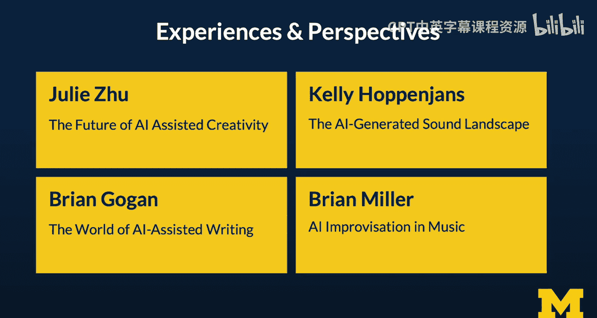
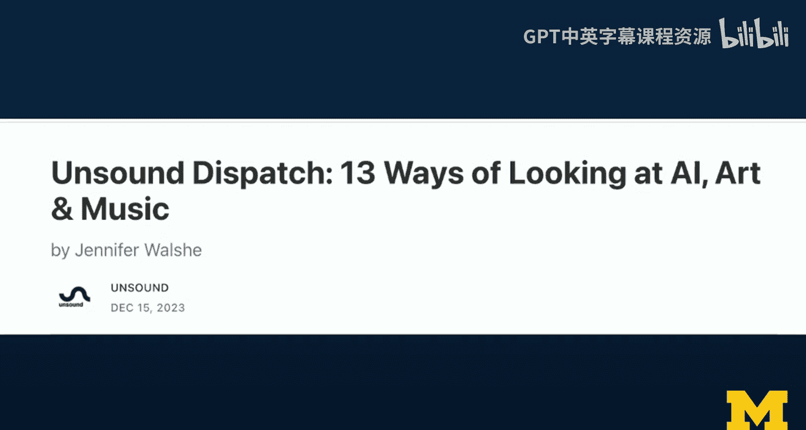
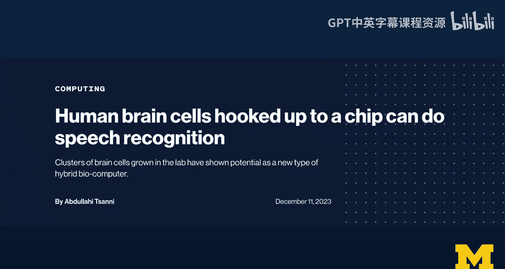
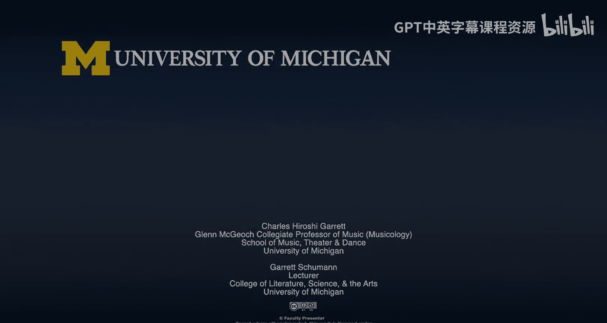

# 密歇根大学《AI用于创意工作｜AI for Creative Work》中英字幕 p37 8_人机表达关系反思.zh_en -BV1DXNiznEXk_p37-

We just heard from four guest experts who shared their experience and perspectives on AI's relationship to the essential humanity of creative expression。

Julie Zhu used her own experimental work to show us a glimpse into the future of AI assisted creativity。

Kelly Hpenigns showed us examples of AI vocal models based on her own voice。

 as well as those of musicians Grimees and Holly Herndon。

 to discuss a fascinating corner of the AI generated sound and music landscape。

Brian Gogan brought us into the world of AI assisted writing。

 and Brian Miller began the series of guest lectures with a highlight on AI improvisation in music with a special focus on the robot percussionist Chamon developed at Georgia Tech University。

In the following reflection， I want to focus on a burgeoning implication of AI's application in creative work that multiple of these guest experts touched on in their video essays。

As AI technology develops， particularly in the creative spaces you have just learned about。

 we can observe increasing overlaps with the human body。

This is clear in the performances of the robot Chamon。

 whose physicality and corporeality offers a new frontier of human computer exchange that is not possible with computer based tools。

Similarly， the potential for AI powered vocal models to embody either fictive or real individuals carries a staggering impact on the human experience。

Writing in 2023， the technologist and musician Jennifer Walsh describes multiple implications of this aspect of AI development。

One is AI assisted Fantdom， which Walsh describes via AsIS。

 a project initiated and celebrated by fans of the British Alt rock band Oasis that uses AI powered vocal models and music generators to allow fans to prompt the creation of new songs。

 displaying the band's distinctive style。Unlike the AI vocal models created by Holly Herndon and Grimees that Kelly Hpenigns just discussed。

AEis was not produced consensually with the members of Oasis。

 creating a fraught situation of potentially unwanted bodily possession via AI vocal avatar。

Brian Gogan's emphasis on the need for writers who incorporate AI into their practice to quote。

Inte the technology in， Signs a related focus on personal agency as creative workers engage with this technology more and more。

This is particularly important as AI tools come to overlap with human physicality。

 as with Chamon or other sophisticated robots that use AI to interact with the world around them。

 or rely on the human body in their modeling or other operations。

As a 2023 article published in the MIT technology Review illustrates。

 another frontier for advanced computing and artificial intelligence is the use of brain organoids。

 quote Clumps of human brain cells grown in a dish to perform computational tasks。"。

Although this is only an experiment， its potential serves as an important reminder that as much as we like to think of computers and sophisticated information technology as something decidedly separate from the physical world。

Advanced computing， like artificial intelligence is deeply connected to human bodies and our corporeal experience。

This idea obviously carries weight as we consider AI's relationship to human creativity。

Perhaps AI technologies， particularly new innovations in Gen AI。

 do not represent a discovery in the traditional sense and do not make available new parts of humanity's creativity。

 rather it may be more accurate to say， because artificial intelligence has had and continues to grow its deep relationship to the human body。

 that AI helps us access part of human creativity that has always been there and possibly underutilized in earlier times。

