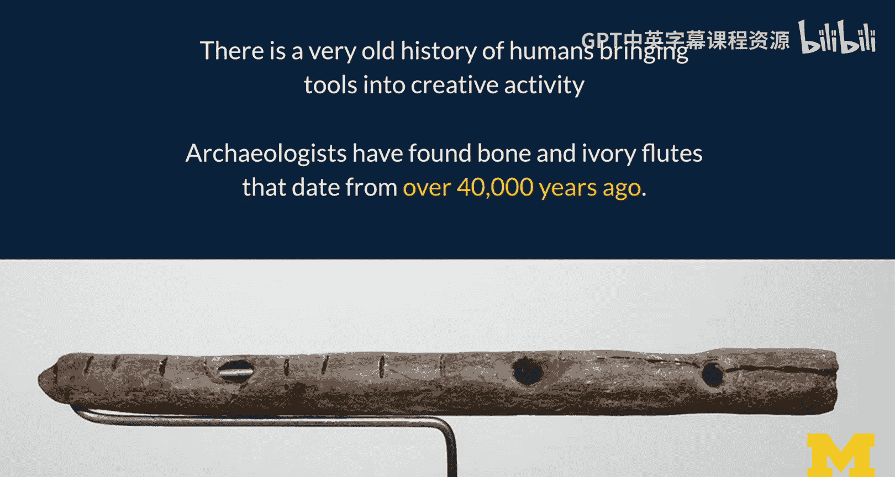
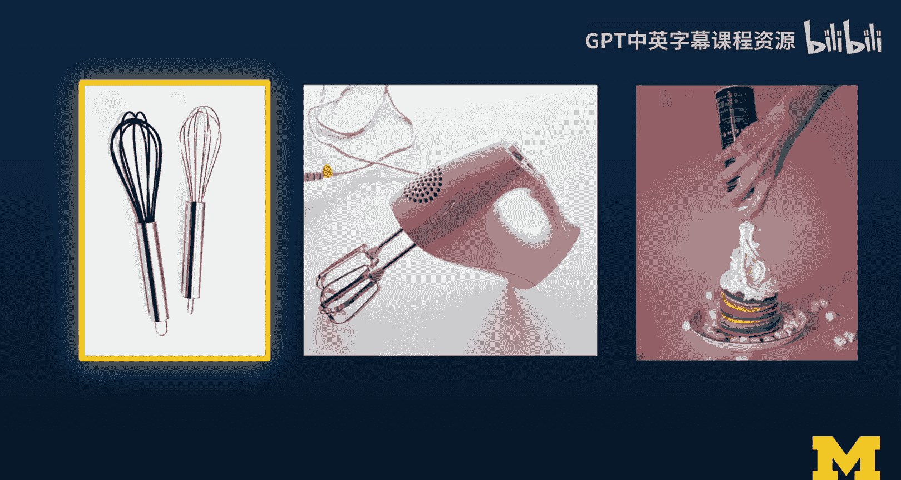
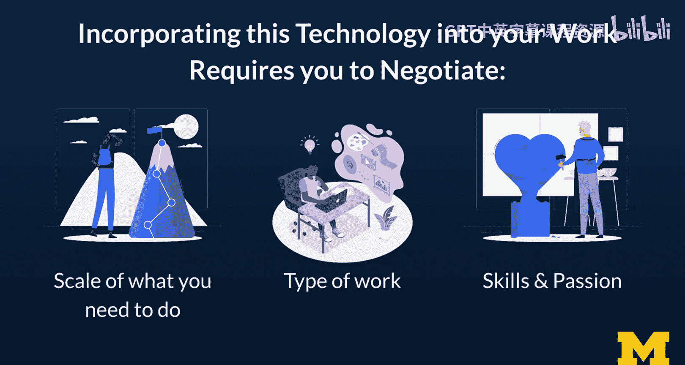
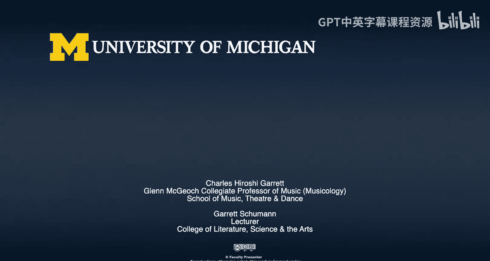

# 密歇根大学《AI用于创意工作｜AI for Creative Work》中英字幕 p39 10_技术对艺术实践的影响.zh_en -BV1DXNiznEXk_p39-

When you move on from this course and begin to further apply the concepts and skills you've learned to your engagement with Gen AI and other artificial intelligence tools。

 It is important to see this technology within the broader context of historical practice。

 methods like the Sift process。 The ideas you have encountered in this course series and the various insights of our guest experts can help you gain a grounding as you approach this novel technology with seemingly unlimited potential。

 We come to the current moment of advances in Gen AI with the knowledge that there is a very old history of humans bringing tools into creative activity。

😊，Archaeologists have found bone and ivory flutes that date from over 40000 years ago。

 and there are countless historical examples of new technological developments impacting creative practice。

Even when they are not intended for creative use。It is important to acknowledge that new tools unavoidably change artistic practice and artistic products。

 ideally with a beneficial， acceptable trade off。

Imagine yourself in your home kitchen。 and you need whipped cream for a recipe。

You have three options。Make the whipped cream by hand with a whisk。 Whi the cream with a hand mixer。

 or use whipped cream from a can。Here we have three methods。

 three technologies for acquiring the ingredient we need， but each is different。

 not only in terms of the process， but also in terms of the result。

It may seem that the choice in this situation is a matter of time and convenience。

 but it is also one of individual expression and customization。

 Using a whisk is slowest and takes the most effort。

 But you also have the most control over your tool。

You can feel the texture of the cream change as it aerateates and adjust the intensity of your work very easily and seamlessly。

😊。

An electric hand mixer allows you to work faster and control the process to an extent。

 but not in the same way as a whisk。And， of course。

 you have no control over a can of whip cream outside of when you open it and deploy it。

If in this metaphor， the home cook is a creative worker and the whip cream is the output of their creative work。

 We should first acknowledge that every method requires some kind of tool。

 You already use technology to create things， but you probably strive to use the right technology。

 depending on your priorities and needs。The current moment revolving around Gen AI may leave you feeling like there is little or no space for the values that drive your creative work。

It may help to think of image， text and music generators driven by large bodies of data like the can of whip cream。

 These ready to use tools are there for you to use immediately whenever you need it。

 but the product you get is not customized and maybe feels prepackaged and less authentic。

 Perhaps you only use this kind of Gen A I tool in a specific way so that the limitations of what it offers do not dominate the outcome of your creative project。

Incorporating this technology into your work requires you to negotiate the scale of what you need to do。

 the type of work you are offering or asked to do， your skills and your passions。

 to continue with the cooking metaphor。 if you make exceptionally delicate whipped cream by hand。

 if you virtuosically adjust the speed of your whisk based on the aireration of the cream。

 if you customize the flavor more imaginatively than anyone else。

 then may be the best place for supportive AI technology does not appear in the creative process。

 but in other work that makes your creativity possible。

The point is not that you must make these choices。 It is that you have the power to choose your relationship to this technology。

One of the defining characteristics of the current era of Gen AI tools is that they seem dominating and unstoppable。

 But as we have discussed throughout the series， these products are not magic。

It is possible these tools can't even deliver the equivalent of what you can get from a can of whipped cream。

 but in some cases， and after the right kind of consideration。

 it could be that like an electric hand mixer， AI tools's specific capabilities create benefits at a cost with respect to personal touch that is not very noticeable to you or your clients。

The skills and concepts you've learned in this course series will help you make the necessary judgments when it comes to using AI in your creative work。

 But your voice and the creative priorities you care about the most is。

 in many respects more important。 Asting those values will help make sure you are in control of your creative practices relationship to technology。

