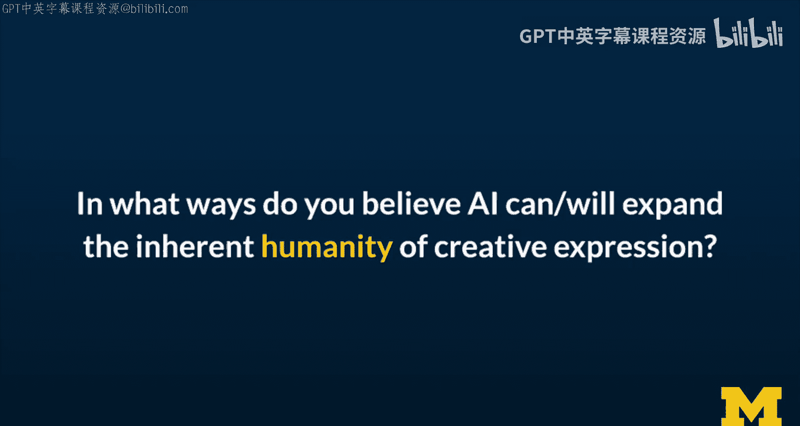
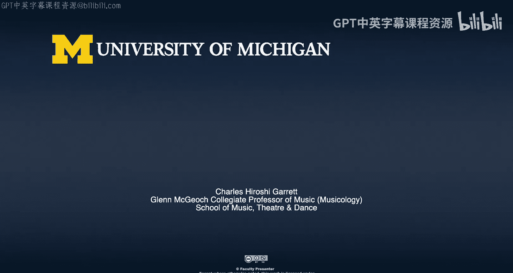

# 密歇根大学《AI用于创意工作｜AI for Creative Work》中英字幕 p40 11_领域之声：查尔斯·浩石·加勒特.zh_en -BV1DXNiznEXk_p40-

I do believe that AI has the power to expand the inherent humanity of creative expression。

 but it will be up to us， meaning up to humanity， up to me。

 up to you to determine how whether and to what degree AI will shape creative expression。

This is related to how I think about broader questions regarding the impact of AI on society and about the impact of AI on the workplace。

Sometimes people talk about and fret about whether AI will replace us。

 whether AI is coming for our jobs。 And these， of course， are valid concerns。 But， in fact。

 the decision about whether AI will replace us is not being made by rogue AI programs。

 These decisions are being made by people。 People are responsible for choosing whether to adopt AI solutions that can assist with or replace human activities。

It's my hope that this course has proposed strategies and solutions that will help you keep the creative process firmly in your hands and that AI will expand the inherent humanity of your creative expression。

 if that's how you choose to go forward。

