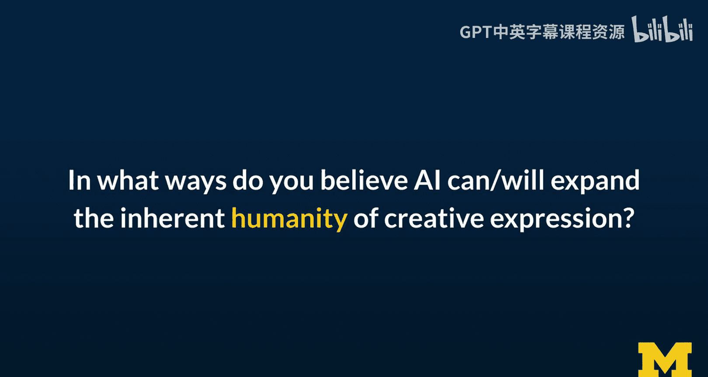
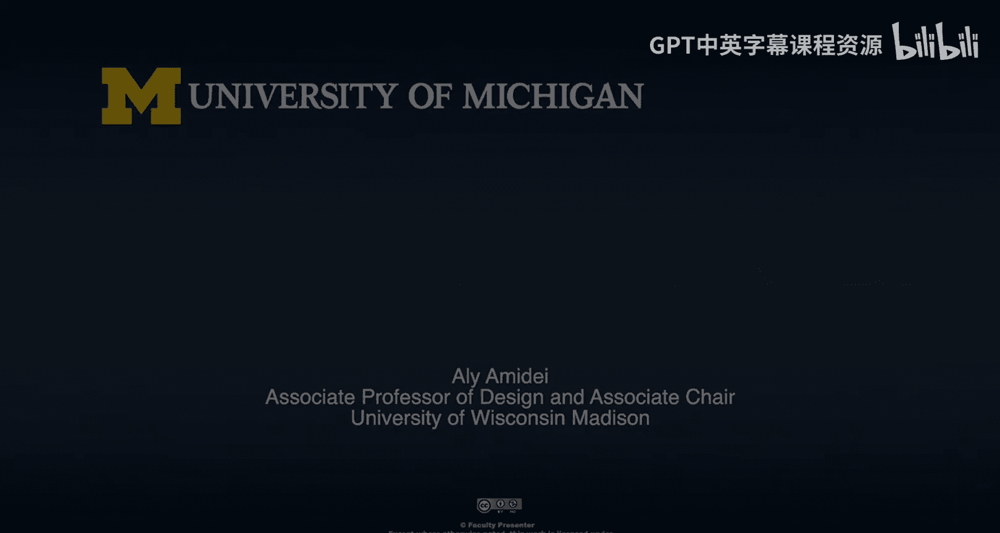

# 密歇根大学《AI用于创意工作｜AI for Creative Work》中英字幕 p43 14_领域之声：艾丽·阿米迪.zh_en -BV1DXNiznEXk_p43-

And how I think it will expand humanity and creative expression。

AI is just yet another tool for us to use to expand our creativity。

 even in the short time that I've been using it， it is helping improve some efficiency and freeing up some more time and creative brain space for me to experiment and do my work。

And the time to be able to experiment and make mistakes is really where the exciting art making can happen。

