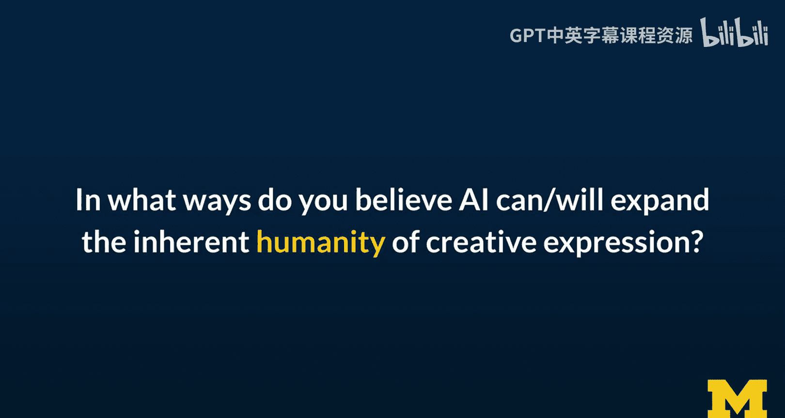
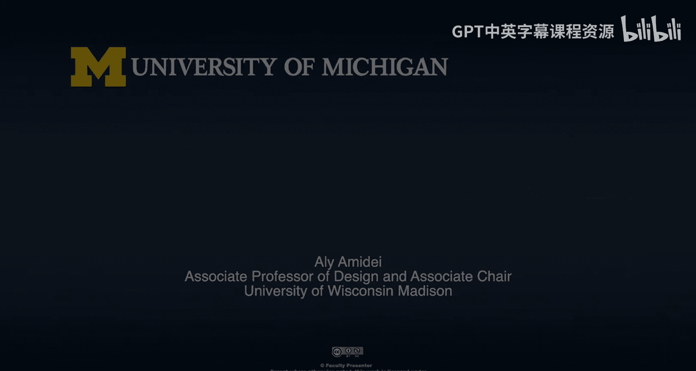

# AI用于创意工作：14：领域之声：艾丽·阿米迪 🎨

在本节课中，我们将学习艺术家艾丽·阿米迪（Allie Amidei）分享的观点，探讨人工智能如何作为一种工具来扩展人类的创造力和艺术表达。我们将了解AI如何帮助提升效率、释放创意空间，并创造更多进行实验和探索的机会。

---

上一节我们讨论了AI在创意领域的潜力，本节中我们来看看艺术家艾丽·阿米迪的具体见解。

艾丽·阿米迪认为，人工智能将成为扩展人类创造力和艺术表达的另一种工具。她强调，即使在短期内使用AI，它也能帮助提升效率，并释放出更多的时间和创意脑力空间。

以下是AI带来的具体益处：

*   **提升效率**：AI工具可以处理一些重复性或技术性的任务。
*   **释放创意空间**：节省下来的时间和精力可以投入到更具创造性的思考中。
*   **创造实验机会**：拥有更多时间进行尝试和犯错，正是激动人心的艺术创作得以发生的关键。

---

本节课中我们一起学习了艺术家艾丽·阿米迪的观点。她将AI视为一个强大的创意辅助工具，它通过提升效率和释放创意空间，为艺术家提供了更多进行实验和深度创作的可能。这让我们看到，AI并非要取代人类创造力，而是为其拓展新的疆域。