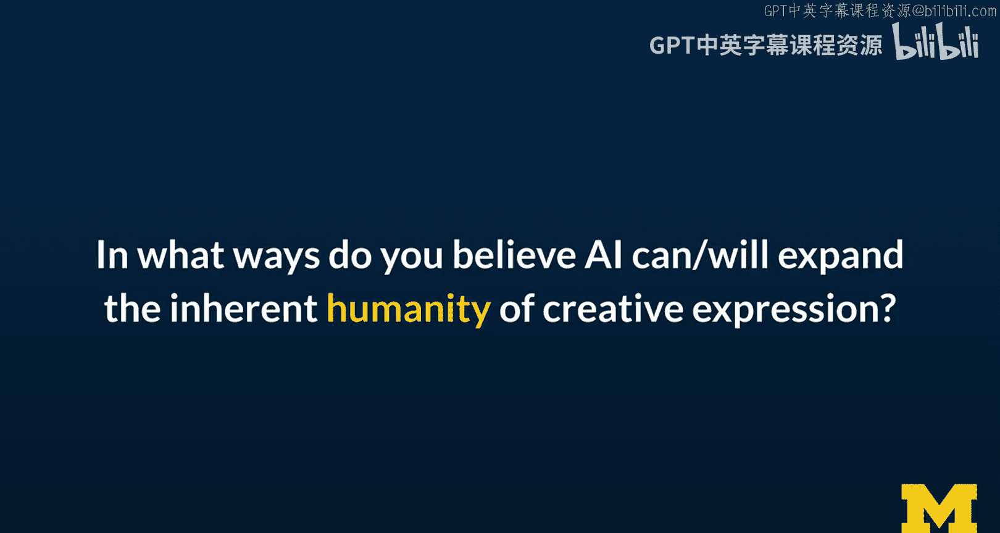
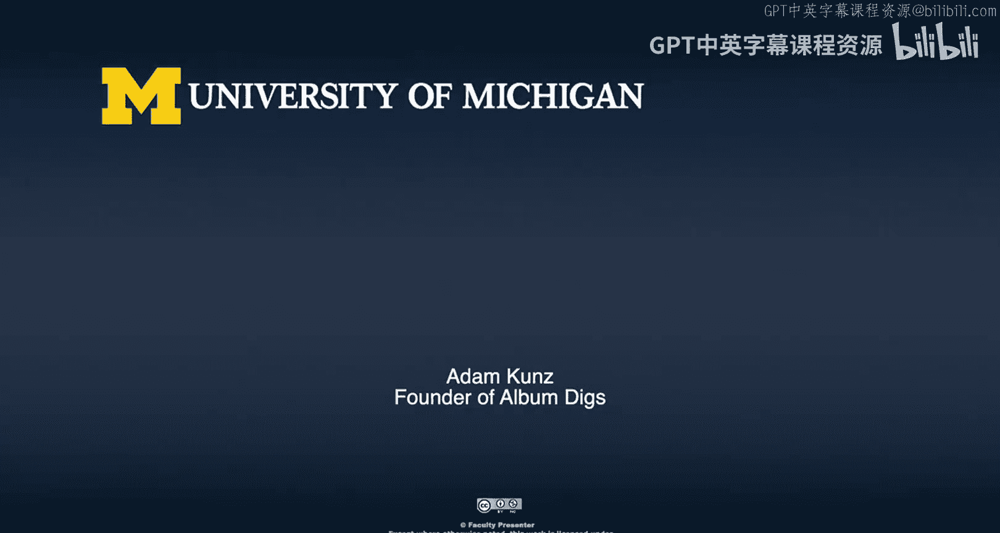

# 密歇根大学《AI用于创意工作｜AI for Creative Work》中英字幕 p44 15_领域之声：亚当·昆兹.zh_en -BV1DXNiznEXk_p44-

I think this is really falls in line with the other two answers and that we can create a level of content that's so much higher and we can distribute it in a way we never could before。

 so given social media， a person can create a piece of content and they can go straight to the masses with whatever it is they want to create typically I think part of that process before that really hindered the humanity of creative expression was the corporate involvement in the distribution of say for example。

 a television show concept if you come up with a television show concept you as an individual may not be able to get that out to everyone and you may go through so many changes for what is potentially marketable or what a lot of other people's ideas around or this around this or what corporate agendas are around this as it goes through production companies studios。

 network streaming services here now instead if you use social media can immediately distribute the。

Assets to a larger audience， but until now you couldn't create a high level of content with those same ideas。

 so if you use AI as an individual contributor or a small team to make really polished interesting assets and then you can immediately distribute that content to a larger group online through social media you've now been able to create the exact vision you had as an individual whereas previously you were really hindered in that process。

