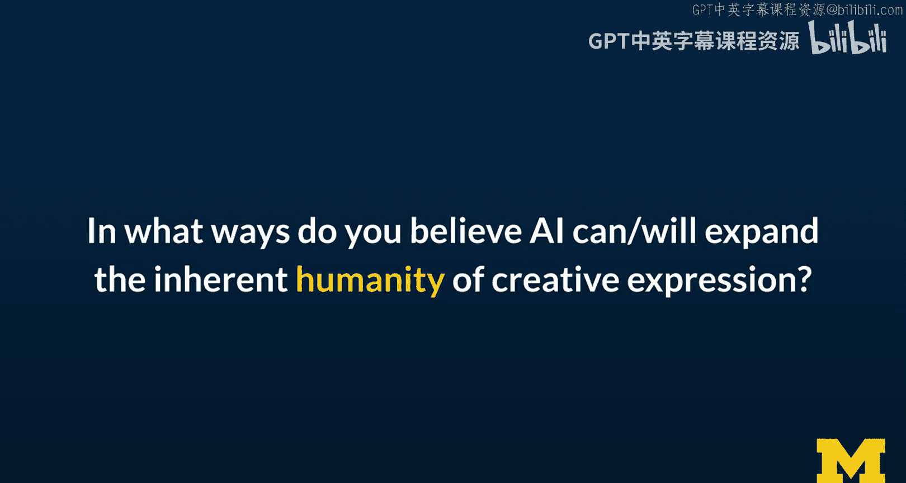
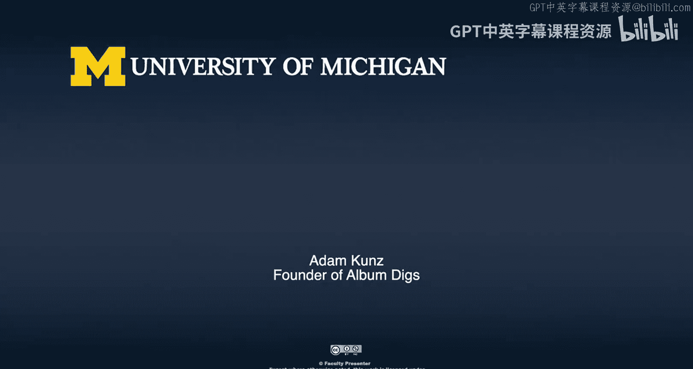

# AI用于创意工作：15：领域之声：亚当·昆兹 🎤

在本节课中，我们将学习亚当·昆兹关于AI如何赋能个体创作者的观点。他认为，AI与社交媒体的结合，正在打破传统创意内容制作与分发的壁垒，让个人能够更自由地实现自己的创意愿景。

---

上一节我们讨论了AI在创意领域的潜力，本节中我们来看看亚当·昆兹如何具体阐述这一观点。

亚当·昆兹认为，这一观点与之前的回答一脉相承。他指出，我们现在能够创造出质量**远高于以往**的内容，并且能以**前所未有的方式**进行分发。

以下是亚当·昆兹分析的传统创意流程中的障碍：

*   **核心障碍：公司介入**。他认为，过去阻碍创意表达人性化的部分原因，在于公司对分发渠道的介入。
*   **具体例子：电视剧概念**。他以电视剧概念为例进行说明：
    *   一个个体想出一个电视剧概念。
    *   他/她可能无法将其直接呈现给所有观众。
    *   这个概念在通过制作公司、工作室、电视网或流媒体服务的过程中，会经历诸多修改。
    *   这些修改通常是为了迎合**市场潜力**、**他人的想法**或**公司的议程**。

---

那么，情况发生了怎样的变化呢？关键在于两个现代工具的结合。

社交媒体已经改变了分发环节。现在，个人可以创作内容并**直接面向大众**进行传播。

然而，直到最近，个人创作者仍面临一个挑战：他们虽然能直接分发，却难以凭借一己之力制作出**高质量、精良的**内容资产。

AI的出现弥补了这一短板。以下是AI与社交媒体结合带来的新范式：

*   **创作端**：个人贡献者或小团队可以利用AI工具，制作出**非常精良、有趣的**内容资产。
*   **公式/代码描述核心概念**：`个人创意 + AI工具 = 高质量内容资产`
*   **分发端**：随后，他们可以立即通过社交媒体，将这些内容在线分发给更广泛的群体。

---

通过以上分析，我们可以总结亚当·昆兹的核心论点。

本节课中我们一起学习了亚当·昆兹的观点。他总结道，借助AI和社交媒体，个人现在能够实现自己**最初的、完整的创意愿景**。而在过去，个体在这一过程中受到了极大的限制。这标志着创意民主化进程中的一个重要飞跃。