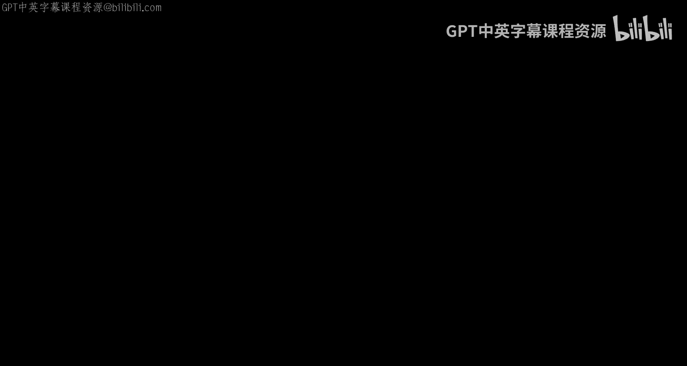
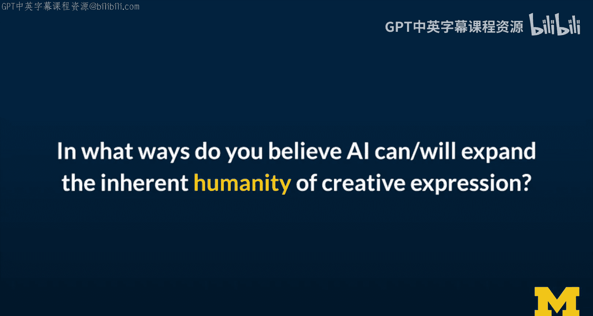
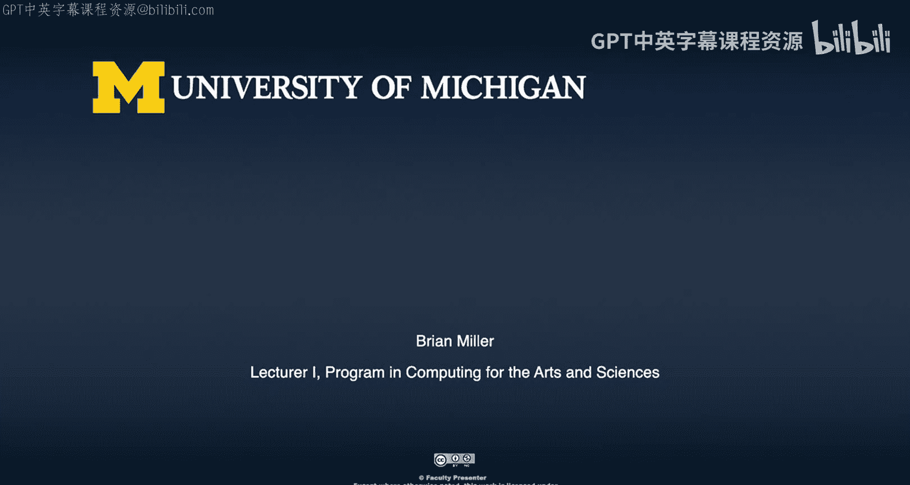

# 密歇根大学《AI用于创意工作｜AI for Creative Work》中英字幕 p45 16_领域之声：布莱恩·米勒.zh_en -BV1DXNiznEXk_p45-

There's a long history of new technologies disrupting the way art is produced and reproduced。

 Things like the printing press， photography and， of course， the computer itself。

Artists have always found compelling ways to engage with new tools when they come along。

 and I have no doubt things will be similar with AI。

Most forms of art are in some way about engaging with your influences with what came before you。

 And in a way， that's exactly what machine learning tools do since they are built on these massive data sets of past work。

 So I think there's a lot of potential there。But at the same time。

 all the technologies I've mentioned are also forms of automation， so along with new possibilities。

 they also come with the possibility of limiting the amount of work and money available to artists。

So for me， one of the necessary conditions for AI to enhance human creativity。

 rather than suppress it is that we hold onto and even expand the opportunity for artists to do their work。

