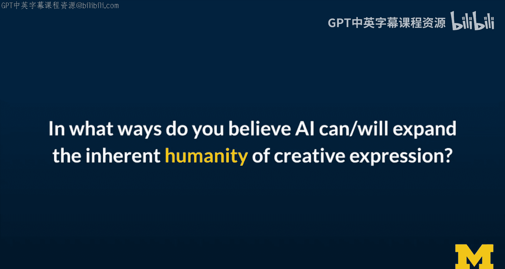
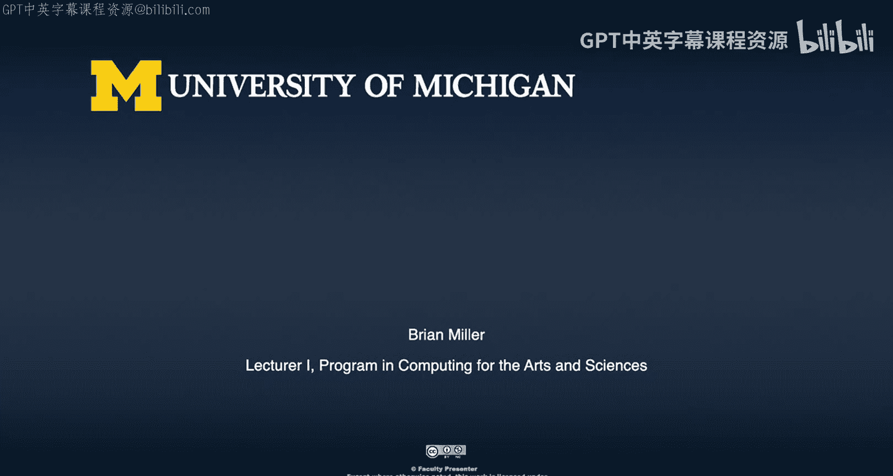

# AI用于创意工作：P45：领域之声：布莱恩·米勒 🎨🤖

在本节课中，我们将探讨布莱恩·米勒关于人工智能与艺术创作关系的观点。我们将回顾技术革新如何影响艺术史，分析AI作为新工具的潜力与挑战，并思考如何确保AI能真正增强而非抑制人类的创造力。

## 技术革新与艺术生产 📜

历史上有许多新技术颠覆了艺术的生产与复制方式。

例如印刷机、摄影术，当然还有计算机本身。

## 艺术家与新工具的互动 🛠️

上一节我们回顾了技术对艺术的影响，本节中我们来看看艺术家如何应对新工具。

当新工具出现时，艺术家总能找到引人入胜的方式与之互动。

我毫不怀疑，人工智能的情况也将类似。

## 艺术、影响与机器学习 🔄

大多数艺术形式在某种程度上都涉及与前辈影响进行互动。

在某种程度上，这正是机器学习工具所做的事，因为它们建立在对过去作品海量数据集的学习之上。

因此，我认为这其中存在巨大潜力。

## 自动化的双刃剑 ⚖️

然而，同时需要指出的是，我提到的所有技术也都是自动化的形式。

以下是自动化带来的双重影响：

*   新的可能性。
*   可能限制艺术家可获得的工作量和收入。

## 增强创造力的必要条件 ✅

因此，对我而言，人工智能要增强而非抑制人类创造力，一个必要条件是：

我们坚持甚至扩大艺术家从事其工作的机会。

---

本节课中我们一起学习了布莱恩·米勒的核心观点。我们认识到技术革新是艺术发展的恒常动力，AI作为基于历史数据学习的工具，与艺术创作的本质有相通之处，潜力巨大。但同时，我们必须警惕其作为自动化技术可能对艺术生态造成的挤压。关键在于社会能否保障并拓展艺术家的创作空间与机会，这是确保AI赋能而非取代人类创造力的基石。