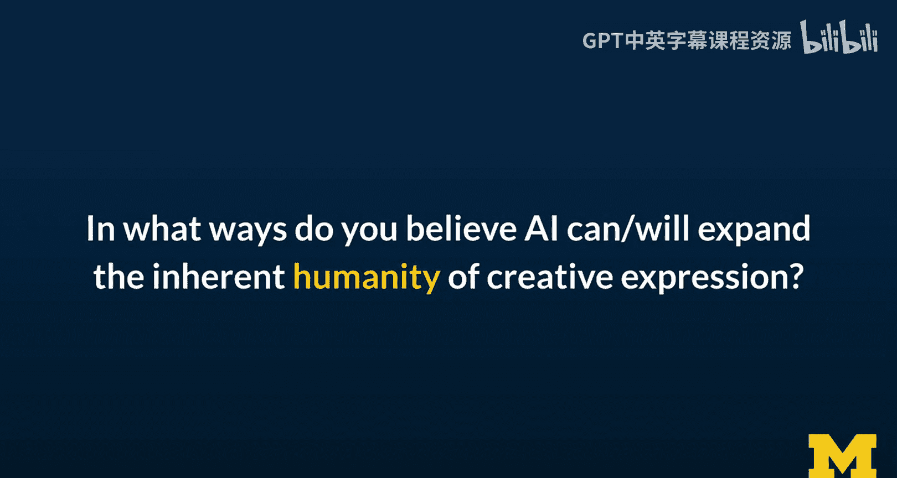
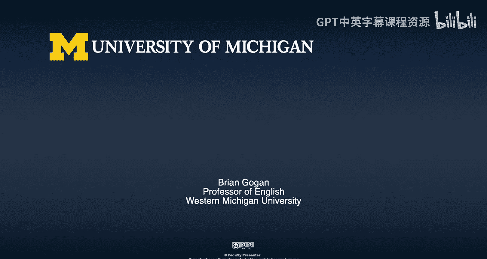

# 密歇根大学《AI用于创意工作｜AI for Creative Work》中英字幕 p46 17_领域之声：布莱恩·高根.zh_en -BV1DXNiznEXk_p46-

AI is expanding our repertoiires of production， breaking boundaries that formerly limited types and modes of expression。

 In this respect， AI has the potential to democratize expression。

 If you are unfamiliar with a certain type of writing， for instance。

 or if you feel that you are unskilled at writing， AI might provide you with access to express yourself in ways previously impossible。

At the same time， AI is elevating human intentionality。

 compelling us to better communicate about our patterns of expression and the goals of our expressions in ways that have been largely overlooked。

To use AI effectively， humans must not only be aware of their expressive goals。

 but they must also be able to communicate about those goals with a fine。

 grained level of detail connected to both the mode and type of their expression。

