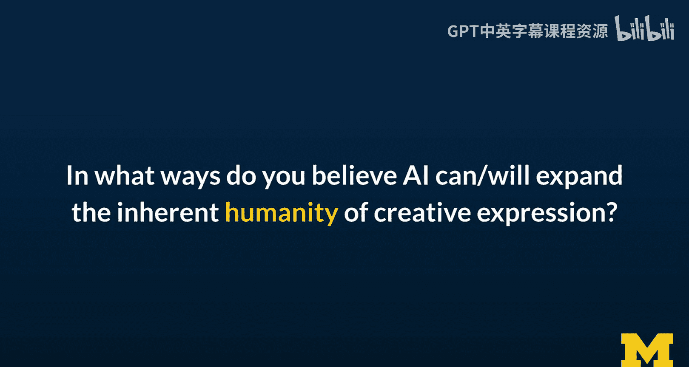
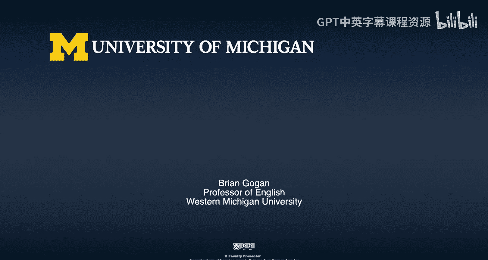

# AI用于创意工作：P46：领域之声：布莱恩·高根 🎤

在本节课中，我们将学习布莱恩·高根关于人工智能如何扩展人类表达方式、提升人类意图性，以及有效使用AI所需的关键技能的观点。

---

## 扩展表达的可能性 🌈

AI正在扩展我们的创作手段，打破了以往限制表达类型和模式的边界。

从这个角度看，AI有潜力**民主化表达**。

例如，如果你不熟悉某种写作类型，或者你觉得自己不擅长写作，AI可能会为你提供途径，让你以以前不可能的方式表达自己。

---

## 提升人类的意图性 🎯

与此同时，AI正在提升人类的意图性。

它促使我们更好地沟通我们的表达模式和目标，而这些方面在很大程度上曾被忽视。

为了有效使用AI，人类不仅需要意识到自己的表达目标。

还必须能够以精细的、与表达模式和类型相关的细节水平来沟通这些目标。

---

## 有效使用AI的关键 🔑

上一节我们介绍了AI如何提升意图性，本节中我们来看看有效使用AI所需的具体能力。

以下是使用AI进行创意工作时需要掌握的核心技能：

*   **明确表达目标**：清晰地知道自己想要通过创作实现什么。
*   **精细沟通意图**：能够向AI工具详细描述你的想法、风格和具体要求。
*   **理解表达模式与类型**：了解不同媒介（如文本、图像、音乐）和体裁（如诗歌、报告、广告）的特点，以便给出精准指令。

---

## 总结 📝

本节课中我们一起学习了布莱恩·高根的核心观点。AI不仅是工具，更是创意伙伴。它通过打破技术壁垒来**扩展表达的可能性**，同时通过要求我们更清晰地定义和沟通目标来**提升人类的意图性**。最终，有效利用AI的关键在于我们自身：**明确的目标**和**精细的沟通能力**。