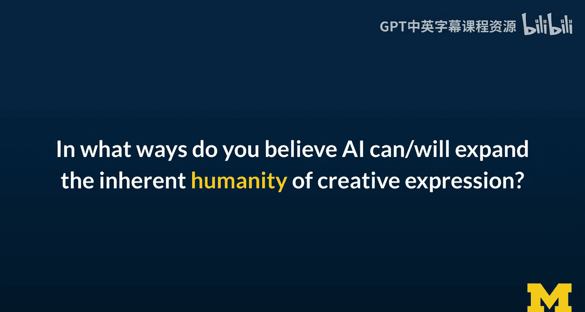
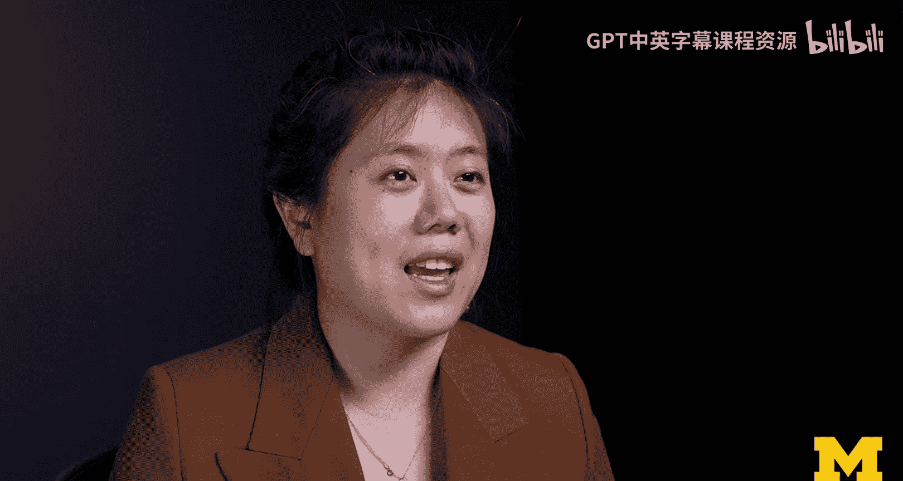
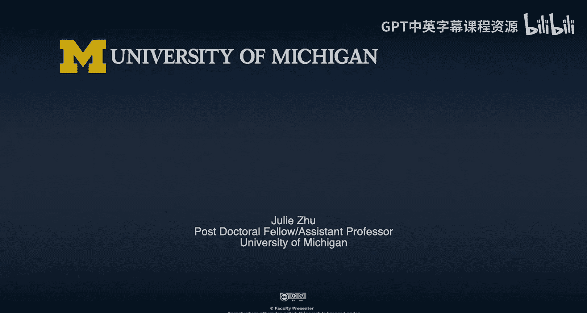

# 密歇根大学《AI用于创意工作｜AI for Creative Work》中英字幕 p48 19_领域之声：朱莉·朱.zh_en -BV1DXNiznEXk_p48-

AI sees data differently than humans can， which means it's better at some things and worse at others。

 I have hope that artists will be able to stand firm on what they want to create。

 letting their imaginations drive what a machine can do。

Rather than leaning into what the machine is good at。

