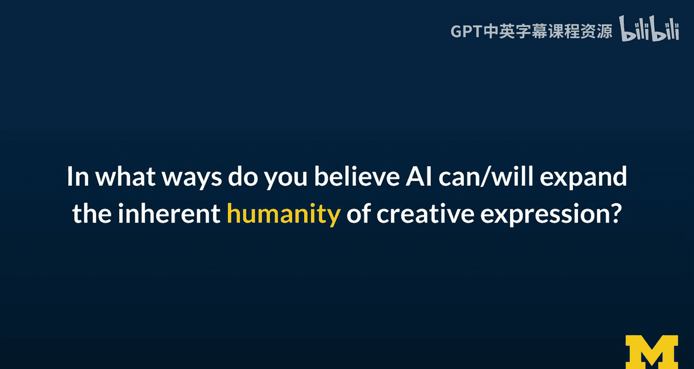
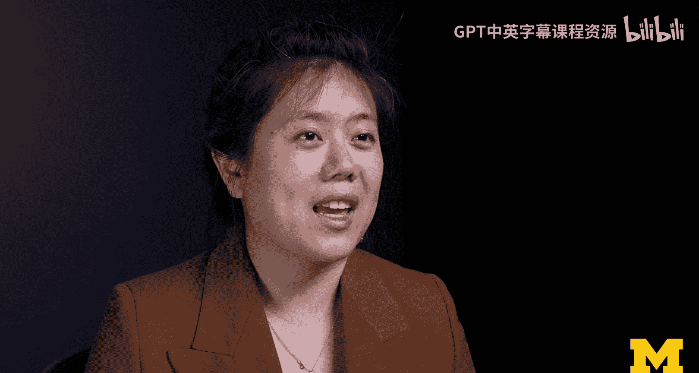
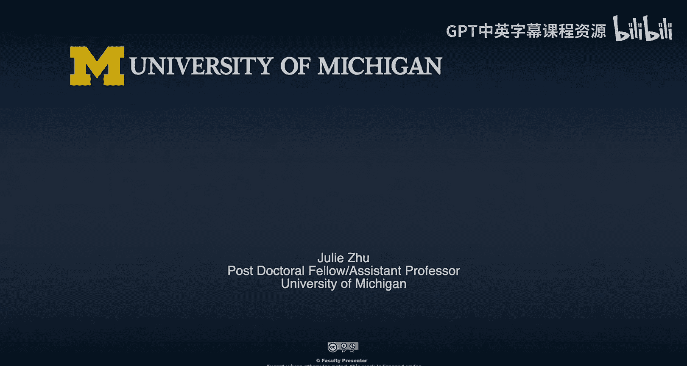

# AI用于创意工作：19：领域之声：朱莉·朱 🎨

在本节课中，我们将学习艺术家朱莉·朱关于AI与人类在数据处理和创意工作方面差异的见解。我们将探讨AI的独特视角，以及艺术家如何利用自身想象力来主导创作过程，而非仅仅依赖机器的优势。

## AI与人类的数据视角差异

上一节我们介绍了AI在创意领域的应用潜力，本节中我们来看看AI处理数据的基本方式与人类有何不同。

AI看待数据的方式与人类不同。这意味着它在某些方面表现更优，而在另一些方面则有所不足。

这种差异的核心在于，AI基于**算法**和**统计模式**处理信息，其过程可以抽象为：
`输出 = 模型(输入数据)`
而人类则更多地依赖**感官体验**、**情感**和**直觉认知**。

## 艺术家的核心立场：以想象力驱动

理解了AI的运作特点后，一个关键问题随之而来：艺术家应如何定位自己与AI工具的关系？

艺术家应坚定立足于自身想要创作的内容。让他们的想象力驱动机器所能实现的效果。

以下是实现这一点的关键思路：

*   **主导创意方向**：艺术家应首先明确自己的艺术构想和情感表达，再将AI作为实现构想的工具之一。
*   **探索未知可能**：利用想象力去挑战和拓展AI能力的边界，而非局限于其已知的强项。
*   **融合而非依附**：将AI的生成结果视为创作素材，通过人的审美和判断进行筛选、编辑与再创作。

## 避免陷入机器的能力陷阱

承接上文，要真正做到以人为主导，就需要警惕一个常见的误区。

而非倾向于机器所擅长的事情。

简单追求AI当前能轻松生成的效果（如某些特定风格），可能会限制艺术表达的多样性和原创性。真正的创意突破往往发生在人与机器能力的交汇与碰撞之处。

---

本节课中我们一起学习了朱莉·朱的观点：AI与人类拥有不同的数据视角，各有优劣。在创意工作中，艺术家应坚守自身的想象力与创作意图，以此为核心去驾驭AI工具，探索新的艺术可能，避免被机器的现有能力所限制。这强调了人在人机协作中的不可替代的主导地位。