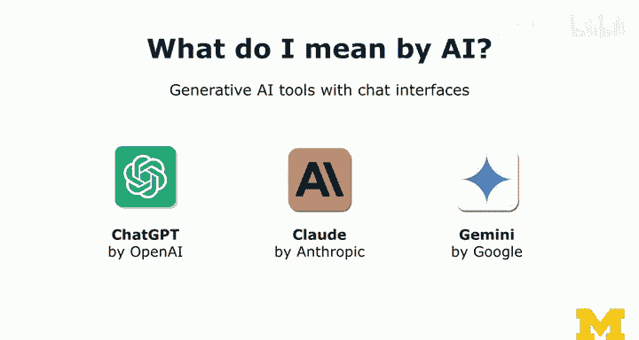
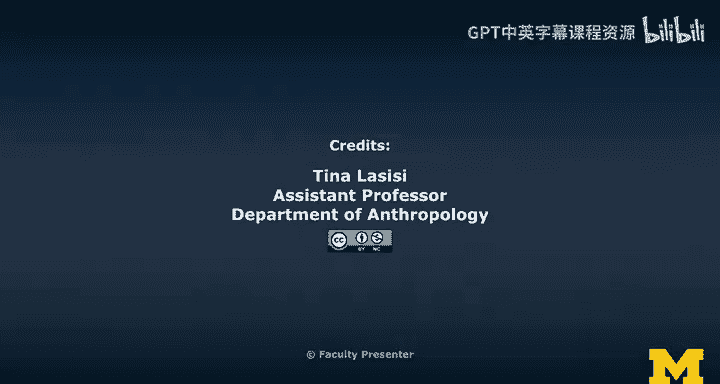

# 密歇根大学《AI驱动的数据分析：实用入门指南》 - P1：0_欢迎学习本课程 👋

在本节课中，我们将一起了解这门课程的核心内容、目标受众以及你将学习到的关键技能。课程由密歇根大学人类学副教授Tina Asisi博士主讲，她将分享自己从零开始学习数据分析，到如今运用AI工具加速研究的亲身经历。

我是Tina Asisi博士，密歇根大学的人类学副教授，也是本课程的讲师。

我大部分的数据分析技能是在攻读博士学位期间获得的，当时我从零开始学习Python，以开发一个用于测量头发形状的图像分析程序。

自那时起，我致力于分析各种数据，包括法医背景下的基因数据、人口统计数据，以及3D面部数据等。

时间快进到2022年底，当OpenAI向公众发布ChatGPT时，一切发生了改变。

从那时起，我开始使用这个工具和许多其他AI工具来加速我的分析，并进行新的、更复杂的分析。

我也一直在教我的研究生如何使用这些工具。

这也是我决定将所有一对一的教学内容整合成一门面向更广泛受众的课程的部分原因。

## 这门课程适合你吗？🎯

现在，这门课程适合你吗？我认为这门课程对两大类人群会有帮助。

第一类是数据分析的**新手**，即完全的初学者。

第二类是**已经做过一些数据分析**，但想知道AI出现后有哪些变化的人。

## 课程结构 📚

本课程的结构旨在让你首先思考数据分析的背景。

然后是分析和可视化数据的具体细节。

最后，再次将视野拉远，思考那些支持数据分析但不一定是其核心组成部分的事情。

## 关于“AI”的定义 🤖

在本课程中，当我提到“AI”时，除非另有说明，我将特指那些具有聊天界面的生成式AI工具。

例如OpenAI的ChatGPT、Anthropic的Claude和Google的Gemini等。

即使在我们归类为AI聊天机器人的这个工具子集中，其功能和性能也存在很多差异，并且这个领域的变化非常迅速。

因此，与其教你如何利用ChatGPT高级版的数据分析等集成功能，我们将只假设使用功能最基础的基本模型。

我们将专注于一项更广泛适用的技能：**知道该问什么**。

任何在这个世界上生活得足够久的人都曾遇到过请别人做事却被误解的情况。

以下场景听起来是否熟悉？

“你为什么那样做？”“你什么意思？我按你的要求做的。”“那不是我的意思！”“我怎么会知道？指令不明确！”

此时此刻，在世界上的某个地方，有人正在对着AI聊天机器人喊叫。不要让那个人是你。

我并不是说AI永远不会出错，或者没有改进的空间。

但至少在本课程结束时，你将能更好地了解在数据分析的每一步中需要考虑的因素。

## 核心思想：学会有效委派 💡

换句话说，AI的普及意味着现在每个人都可以委派任务。你可以成为“老板”。

但成为一个好老板意味着知道如何有效地委派。

这意味着**清楚自己想要什么，并能详细地提出要求**。

---

### 本节课总结

在本节课中，我们一起学习了这门《AI驱动的数据分析：实用入门指南》课程的概况。我们了解到，课程旨在帮助数据分析新手和有一定经验的人士，利用AI工具提升效率。课程的核心不是学习某个特定工具的高级功能，而是掌握与AI协作的通用技能——即如何清晰、准确地提出需求，从而有效地“委派”任务给AI助手，避免沟通误解，共同完成数据分析工作。