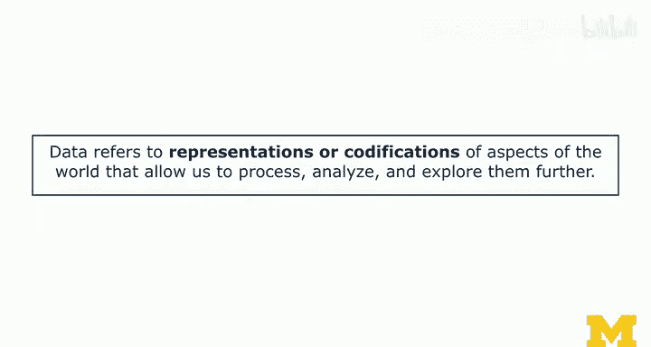
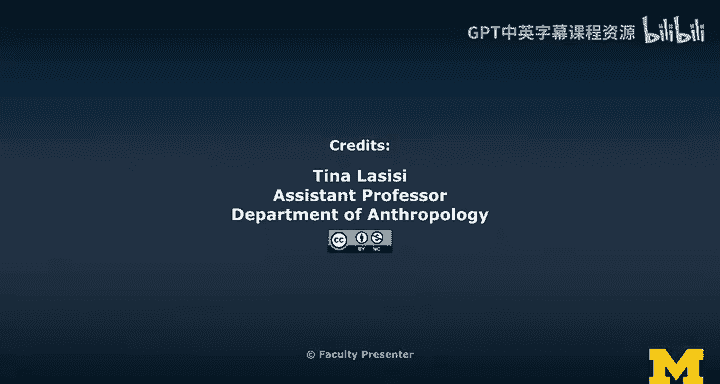

# 2：1_究竟何为数据 📊

在本节课中，我们将要学习“数据”这一核心概念。在开始分析甚至引入生成式AI之前，我们需要对基础知识达成共识。

## 数据的传统定义：DIKW金字塔 🏛️

如果你开始寻找“数据”的定义，你很可能会遇到“数据-信息-知识-智慧”金字塔。这个框架通常被认为是拉塞尔·艾可夫提出的，它将数据定位为金字塔的底层，即完全原始的事实，没有经过任何加工、没有上下文、没有解释。

根据这个金字塔模型，数据经过处理、组织或结构化后成为信息。然后，我们利用这些信息构建知识，并最终将知识转化为智慧。

## 传统模型的局限性 🤔

虽然这个金字塔模型很有名，但必须指出它有其局限性。例如，我们有时会将世界视为包含信息，然后从中提炼出数据。那么，到底是怎么回事？

实际上，“数据”和“信息”这两个词经常被互换使用，这恰恰说明了理解它们试图传达的概念比纠结于字眼更重要。因此，与其严格遵循这个金字塔模型，不如扩展我们对“数据”含义的理解。

## “数据”的词源与演变 📜

“数据”一词来源于拉丁语“datum”，意为“被给予的东西”。这表明数据可以被视为一种“给定”，既可以指一个事实，也可以更广泛地指一个前提或起点。

跳到1946年，我们看到“数据”被用来描述数字环境中的信息，即由计算机处理或存储的信息。此外，我们常听到感官输入（如视觉或嗅觉）被描述为我们大脑处理的数据；在辩论中，要求“数据”意味着需要确凿的证据。

在科学研究中，甚至唾液或头发等物理样本也被视为我们收集的数据。

## 数据的核心概念：信息的基本单元 🔗

将这些例子联系在一起的，是数据作为信息基本单元的概念，无论这些单元是有形的还是抽象的。

我们可以将数据视为任何可记录的东西，无论是观察结果、声音，甚至是抽象的想法。这种灵活性使我们能够创造性地与世界互动，在任何地方识别潜在的数据。

## 数据分析的本质 🧩

数据分析的核心在于收集和解读记录下来的信息，以揭示模式或洞见。人类一直在做这件事，从在脑海中组织经验，到为了分析模式而将事物物理地记录下来。

## 一个实用的定义 ✅

因此，让我们采用一个实用的定义：**数据**指的是对世界某些方面的**表示或编码**，这些表示或编码允许我们对其进行处理、分析和进一步探索。

扩展这个定义，你可以将**数据集**视为**可比较数据的集合**。

## 本课程的重点：数字数据 💻

对于本课程，我希望你专注于**数字数据**，即可以编码为机器可读的二进制格式的数据。

当你思考数据时，请考虑世界的哪些方面可以被捕获和编码，准备好让计算机以0和1的形式进行处理。

## 总结 📝

本节课中，我们一起学习了“数据”这一基础概念。我们从传统的DIKW金字塔模型出发，探讨了其局限性，并追溯了“数据”一词的词源与历史演变。我们认识到，数据的核心是作为**可记录的信息基本单元**，其本质在于对世界的**表示或编码**。最后，我们明确了本课程将聚焦于**数字数据**，即能够被计算机处理的二进制信息。理解这个宽泛而实用的定义，是开启所有后续数据分析工作的第一步。