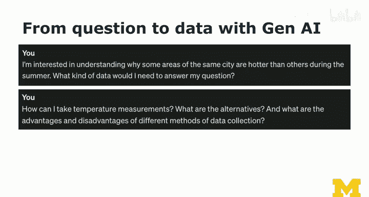
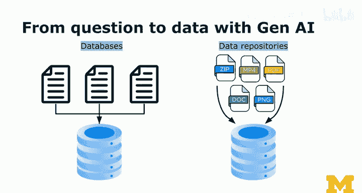

# 密歇根大学《AI驱动的数据分析：实用入门指南》 - P3：数据采集与生成式AI 📊

在本节课中，我们将要学习如何获取或采集数据，以及生成式人工智能如何改进这一过程。我们将探讨数据的不同来源、采集方式，并理解数据背后的记录与编码概念。最后，我们会看到生成式AI如何帮助我们从问题出发，找到或规划所需的数据。

---

## 数据获取的多种方式 🎣

我们获取数据的方式多种多样，有时我们谈论“捕获”数据，如同捕获野生动物；有时谈论“收集”数据，如同收集一篮水果；有时则是“提取”数据，如同开采石油；甚至是“生成”数据，如同发电。我们甚至可能谈论“获得”数据，就像一笔来路不明的钱款落到了我们膝上。

这里需要记住的核心概念是**记录**与**编码**。你通过某种方式记录信息，并将其编码成计算机可处理的格式，从而将你周围的事物转化为数字数据。

记住数据并非以某种原始形态被动获得这一事实，应该提醒你需要批判性地思考数据的来源及其所要代表的意义。

---

## 人类在数据采集中的角色 👥

数据不会自发地出现在我们面前，人类不可避免地参与了这一过程。但我们参与的方式和程度是可变的。

它可以是直接的，例如清点你桌上空杯子的数量；也可以是使用复杂的、具备自动化数据记录过程的工具，例如心率监测仪，甚至是用于测量电离辐射的电子仪器——盖革计数器。

即使是像盖革计数器或心率监测仪这样高度自动化的工具，其内部也嵌入了人们关于“测量什么”的决策。

对你正在记录的内容是什么，以及你所捕获的这种“表征”可能存在哪些局限性产生好奇，将极大地提升你通过数据分析产生有价值见解的能力。

---

## 利用生成式AI从问题到数据 🤖

你可能对某个问题有自己的想法，而生成式AI可以帮助你从问题走向数据。

例如，你可能对“为什么同一座城市的某些区域在夏季比其他区域更热”感兴趣。

你可以使用像ChatGPT或Claude这样的文本生成式AI工具，通过以下提示来集思广益你的问题：

> 我感兴趣的是理解为什么同一座城市的某些区域在夏季比其他区域更热。我需要什么样的数据来回答我的问题？

你可以将此作为起点，然后进一步提示以获取具体信息，例如“我该如何进行温度测量？”，并深入批判性地理解你的选择有哪些。

根据你使用的工具，它可能基于训练数据为你提供在哪里可以找到现有数据集的答案；或者，如果它集成了网络浏览器，你可以通过类似“有哪些公开可用的数据源可以帮助我回答这个问题？”的提示来获取信息。

---

## 数据存储库与数据库 📁

你可能还想尝试使用“数据存储库”和“数据库”这两个术语。两者都是数据集合的术语。

*   **数据库** 通常指更结构化、更具体的集合，例如仓库中使用的、采用非常特定且一致格式的库存系统。
*   **数据存储库** 则可以包含各种类型数据的广泛的结构化和非结构化集合。

例如，研究人员经常将数据保存在像Zenodo这样的网站上，在那里你可以托管图像、电子表格等各种模态和格式的数据。

---

## 模态与格式 📄

上一节我们介绍了数据存储的概念，本节中我们来看看描述数据形态的两个关键术语：模态与格式。

*   **模态** 指的是数据的类型或表现形式，例如文本、图像、音频、视频或传感器读数。
*   **格式** 指的是数据在特定模态下的具体编码或存储方式，例如文本可以是`.txt`或`.pdf`格式，图像可以是`.jpg`或`.png`格式。

理解你处理的数据的模态和格式，对于选择正确的工具和方法进行分析至关重要。

---

## 总结 ✨

本节课中，我们一起学习了数据获取的多种比喻和实际方式，理解了**记录**与**编码**是数据数字化的核心。我们认识到人类在数据采集过程中扮演着关键角色，即使是在自动化工具中。最后，我们探讨了生成式AI如何作为一个强大的助手，帮助我们根据研究问题来规划和寻找数据，并区分了**数据存储库**与**数据库**，以及**数据模态**与**格式**这些基本概念。批判性地思考数据的来源和表征，是进行有效数据分析的第一步。