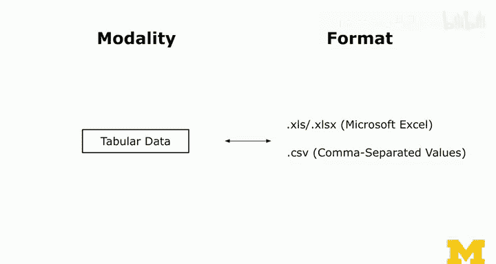

# 密歇根大学《AI驱动的数据分析：实用入门指南》 - P4：数据内容与容器 📁📊

在本节课中，我们将学习数据科学中两个核心概念：**数据内容**与**数据容器**。我们将探讨不同类型的数据（如文本、图像、音频）以及它们是如何被存储和管理的。理解这两者的区别是进行有效数据分析的第一步。

---

## 数据内容与数据容器

数据内容指的是数据所代表的信息本身，即数据的本质。而数据容器则关注数据是如何被存储和管理的，这通常体现在不同的文件格式上。

上一节我们介绍了数据分析的基本概念，本节中我们来看看数据的具体形态和承载方式。

**数据内容** 是关于数据代表什么，即其承载的信息。
**数据容器** 是关于数据如何被存储和管理，即其存在的形式，这可以通过不同的文件类型来实现，也就是你在文件名末尾看到的扩展名。

---

## 常见的数据内容与容器示例

以下是不同类型数据内容及其常见存储格式的示例：

*   **视觉数据**：其格式包括 JPEG、PNG，以及用于视频的 MP4 或 AVI。
*   **音频数据**：以 MP3 或 WAV 等格式编码。
*   **文本数据**：可以存储在纯文本、Microsoft Word 文件或 PDF 等格式中。这些文件当然可以包含图片和数字，但它们通常被视为非结构化的文本文件。

---

## 结构化数据：表格格式

与上述非结构化文本文件相比，表格数据则能以更结构化的方式呈现。

表格数据可以用 Excel 文件或 CSV 文件来表示，它们可以包含结构化数据。这种格式的文件类型的特点是它们是**表格化的**，意味着内容以表格形式组织。

---

## 数据分析的核心：数值化表示

由于大多数数据分析都涉及某种数学推理，因此无论你对哪种类型的数据内容感兴趣，很可能都需要将其转换为某种数值表示。

在这个简短的课程中，我们将重点介绍如何处理那些已经以包含数字和文本的电子表格形式呈现给你的数据。

---

## 课程总结

本节课中我们一起学习了数据内容与数据容器的关键区别。我们了解到，数据内容是信息本身（如文本、图像），而数据容器是存储这些信息的形式（如`.txt`、`.jpg`文件）。同时，我们认识到，为了进行分析，各种数据最终常需转化为数值形式，而结构化数据（如表格）是数据分析中最常见和基础的起点。理解这些概念将帮助我们更好地准备和处理数据，为后续的AI驱动分析打下基础。