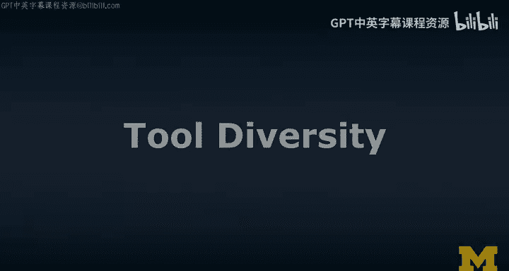
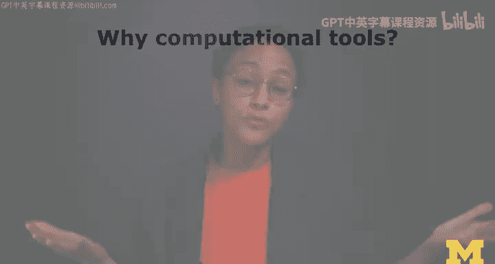
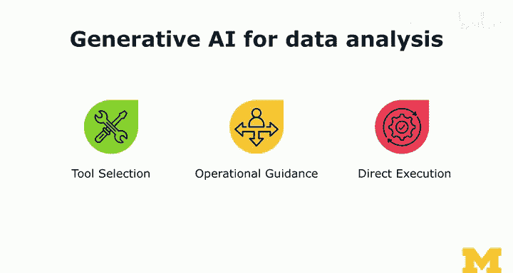

# 6：数据工具的多样性 📊

在本节课中，我们将探讨数据分析所需的各种工具，了解从基础编程语言到现代AI工具的演变，并学习如何利用这些工具来高效地处理数据。

---

## 🛠️ 数据分析为何需要工具？

过去，人们使用纸笔或心算进行数据分析。例如，有人能心算出洗发水和护发素的套装价格其实比单买更贵。

然而，使用计算工具进行数据分析有许多原因。一是**数据量**太大，难以手动处理。二是**分析复杂度**高，非计算方法无法胜任。三是**透明度**，使用计算工具有助于记录过程，使分析清晰且可复现。

此外，还有**可重复性**。计算工具能让你复现自己的工作，并调整和扩展到更大的分析中。

---

## 💻 编程语言：与计算机沟通的基础

除非你能直接接入“矩阵”，否则你需要像我们一样，通过编程语言与计算机沟通。

编程语言是用于编写计算机能理解和执行的指令的复杂系统。所有数字计算的核心都是**二进制代码**，即0和1的组合。这些二进制既代表计算机中存储的数据，也代表处理这些数据的指令。计算机执行的每一个操作都涉及解码这些二进制序列。

在光谱的一端，有**低级编程语言**，如汇编语言。它们与直接的二进制代码或早期计算使用的穿孔卡片仅一步之遥。使用这些语言，你需要做很多非常具体的事情，并给出那些你觉得不言自明或本应内置的指令。

在光谱的另一端，有**高级语言**，如Python。它们离二进制代码更远，更接近人类的交流方式。这种**人类可读**与**机器可读**的区别凸显了计算机编程的一个关键方面：**抽象层次**。

---

## 📚 库、包与集成开发环境

**库和包**就像编程中的快捷方式，提供预先写好的代码块，以节省时间和精力。

然后是**集成开发环境**。可以将IDE想象成一个设备齐全的厨房，所有需要的工具都触手可及。这些工具的设置让你能轻松地编写代码、保存、记录、组织代码。根据所使用的IDE，它们甚至可以捕获代码中的错误，有些甚至内置了AI编程助手。

---

## 📈 专业软件与AI时代的抽象

我们还有像SPSS和SAS这样的**软件包**，它们为统计分析提供了高级的专业工具，不需要太多编码，基本上是指点点击。

在AI时代，理解**抽象**实际上非常有帮助，因为这就是许多AI工具所提供的功能。换句话说，AI工具允许我们直接用人类语言指令来表达我们想做的事情。

---

## 🤖 利用基于文本的生成式AI进行数据分析

接下来，希望你思考以下几种利用基于文本的生成式AI进行数据分析的实用方法。

以下是几种主要方式：

1.  **工具选择**：你可以使用AI来识别最适合你特定需求的软件或编程语言。例如，你可以提问：“我正在尝试做X，对我而言，用什么语言或工具比较好？”AI搜索引擎可以帮助你快速获得答案，助你根据项目需求选择正确的工具。

2.  **操作指导**：AI可以指导你有效使用这些工具的必要步骤。可以提问诸如“如何在R Studio中输入我的数据？”或“如何在Python中计算相关性？”这类问题。这种方法对于流行工具尤其有用，因为它们在AI训练数据中的代表性通常更好。

3.  **直接执行**：使用像ChatGPT这样的工具，你可以直接利用其高级版本内置的数据分析工具进行数据分析。这些AI工具内置了代码解释器，因此它们不仅能处理语言，还能生成代码。

在本课程的剩余部分，我们将重点关注**操作指导**，并使用**Python**作为我们的编程语言，**Jupyter Notebook**作为我们的IDE。

---

## ✅ 课程总结

本节课我们一起学习了数据分析工具的多样性。我们从使用计算工具的必要性开始，探讨了从低级到高级的编程语言、库、IDE以及专业软件。最后，我们重点介绍了在AI时代如何利用生成式AI进行工具选择、操作指导和直接执行分析任务，并明确了本课程后续将使用Python和Jupyter Notebook作为主要工具。理解这些工具及其抽象层次，将为你高效地进行数据分析奠定坚实基础。