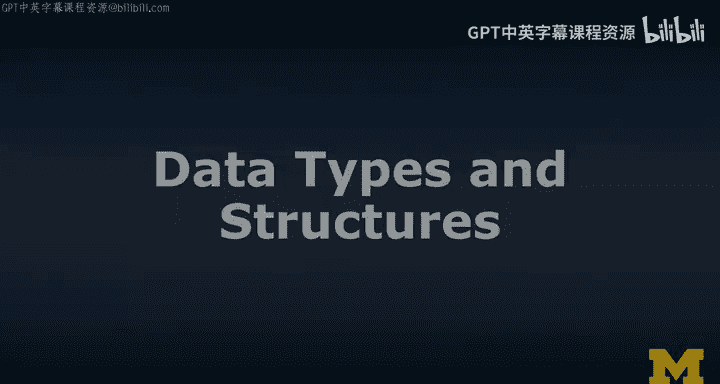
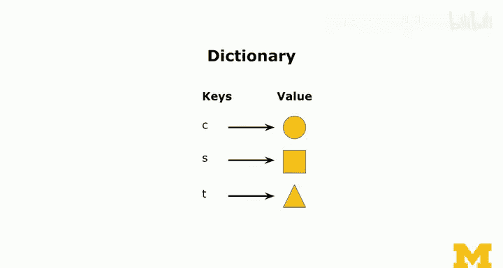

# 7：数据类型与结构体系 📊

在本节课中，我们将学习数据分析的基础概念：数据类型与数据结构。理解这两者是有效组织和处理数据的前提，也是后续使用AI工具进行高效分析的关键。

---

## 概述：内容与容器

上一节我们讨论了数据分析的准备阶段。现在，你已经拥有了数据、问题和工具，接下来该做什么？下一步是思考如何在数据中表示信息，这涉及到数据类型；以及如何为分析准备数据，这涉及到数据结构。本节我们将聚焦于前者。

简单来说，**数据类型**是数据分析过程中的**内容**，而**数据结构**是组织和存储这些内容的**容器**。

---

## 数据类型：数据的“内容” 📝

数据类型是数据的类别，每种类型都有其特定的使用和操作规则。理解数据类型有助于你选择正确的操作，避免错误。

以下是几种常见的数据类型：

*   **字符串数据**：由字符组成的文本，例如姓名。你可以对其进行排序、计算其长度（即字符数），但不能直接进行数学运算。
    *   **示例代码**：`name = "Alice"`
*   **数值数据**：包括整数（如 `42`）和浮点数（如 `3.14`）。这类数据可用于各种计算。
    *   **有效操作**：求平均值、求和等。
    *   **示例公式**：`平均值 = 总和 / 数量`
*   **分类数据**：用于对观测值进行分组和筛选的标签或名称。与字符串的关键区别在于其**用途**——如果某个值被重复用于对事物进行分类，它就是分类数据。
    *   **示例**：性别（男/女）、产品类别（电子产品/服装）。
*   **二进制数据**：也称为布尔值，只有 `True` 或 `False` 两种状态。用于追踪条件或在逻辑运算中使用。
    *   **示例代码**：`is_completed = True`

当然，数据类型远不止这些。根据分析工具和具体需求，你可能还会遇到文件路径、不同精度的浮点数（如 `float32`）、XML、JSON对象等。本质上，任何具有特定操作属性的数据类别都可以视为一种数据类型。

---

## 数据结构：数据的“容器” 🗃️

理解了数据的“内容”后，我们来看看存放它们的“容器”——数据结构。重要的是，这些容器本身也是一种具有特定属性和规则的数据类型。

以下是几种基础的数据结构：

*   **数组**：在固定大小的序列中存储**相同类型**的元素。它允许基于索引的快速访问，但灵活性有限。可以将其想象成一个行列有特定含义的表格。
*   **列表**：比数组更动态，可以增长或缩小，并且能存储**不同类型**的元素。
    *   **示例代码（Python）**：`my_list = [1, "apple", True]`
*   **字典**：以**键值对**的形式组织数据。它非常适合基于唯一标识符（键）进行快速检索，当你需要根据特定属性查找数据时尤其有用。
    *   **类比**：就像根据朋友的名字查找他的电话号码。
    *   **示例代码（Python）**：`phonebook = {"Alice": "123-4567", "Bob": "890-1234"}`

---

## 为什么这些概念至关重要？⚠️

你可能会问，为什么要关心这些？因为在数据分析中，你**不可避免地会遇到错误**。这些错误常常是因为你试图对提供的数据类型执行一个无法执行的操作。

例如，尝试将字符串“100”和数字50直接相加，可能会导致类型错误或非预期的结果（如字符串拼接“10050”而非数字相加150）。理解数据类型能帮助你预见并避免此类问题。

---

## 核心关系：对象与方法 🔄

我们之前介绍了数据类型和结构。现在，引入两个最终的定义来串联所有概念：**对象**与**方法**。

如果把数据类型和数据结构看作是**对象**，那么**方法**就是你可以对它们执行的**操作或指令**。

> 例如，对于一个列表（对象），你可以调用 `.append()` 方法（指令）来向其中添加一个新元素。

理解这种关系对于利用AI辅助数据分析至关重要。它能帮助你提出准确的问题、进行有效的故障排查，并理解AI工具给出的建议。当你尝试不同的AI工具时，不妨将它们视为友好的导师，请教它们哪些数据类型和结构更适合你当前感兴趣的分析任务。

---

## 总结与预告

本节课中，我们一起学习了数据分析的基石：**数据类型**（内容）和**数据结构**（容器）。我们了解了字符串、数值、分类和二进制等常见数据类型，也认识了数组、列表和字典等基础数据结构。最后，我们明确了**对象**与**方法**的关系，这是与AI工具有效交互的关键。

现在我们已经掌握了这些基本术语，在下一个视频中，我们将更深入地探讨**数据整理**的各种方法，学习如何将原始数据塑造成适合分析的形式。