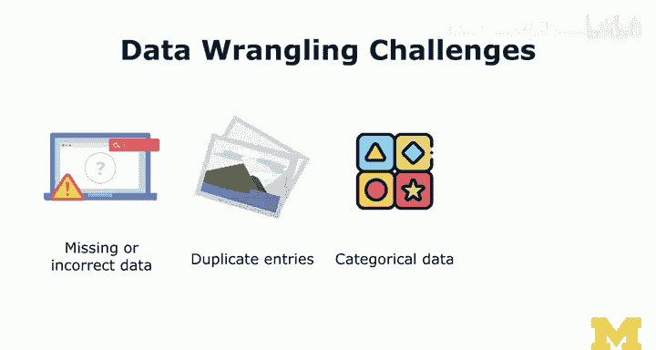

# 密歇根大学《AI驱动的数据分析：实用入门指南》 - P8：数据整理技术 🧹

在本节课中，我们将学习数据整理的核心概念与实用技术。数据整理是数据分析流程中至关重要的一步，它关乎数据的质量与后续分析的准确性。

---

## 什么是数据整理？🧼

将数据整理想象为给你的数据做一次“大改造”。

这并不意味着只是给数据换个“新发型”就称之为约会。不，数据整理的重点并非仅仅让数据看起来更好看，它具备**功能性价值**。

当你初次获得数据时，它可能一团糟，而数据整理就是将这些混乱变得井然有序。

---

## 数据整理面临的常见挑战 🚧

在让数据变得有序的过程中，我们通常会面临几个常见的障碍。

以下是数据整理中需要处理的主要问题类型：

*   **缺失或错误的数据**：我们经常需要处理缺失或不正确的数据条目。
*   **重复条目**：重复的记录可能会干扰你的分析结果。
*   **分类数据问题**：数据中的类别可能存在不一致，例如拼写错误，或用三种不同方式书写同一个类别。
*   **数据重塑需求**：有时，我们需要重塑数据的结构，以更好地适应特定的分析需求。

---

## 数据整理的重要性：垃圾进，垃圾出 ⚠️

正如俗语所说：**垃圾进，垃圾出**。如果输入的数据质量低劣，那么输出的分析结果也必然不可靠。

因此，让我们通过一个小课程来学习如何修复这些常见的数据问题。

---

本节课中，我们一起学习了数据整理的基本概念、常见挑战及其重要性。理解并掌握数据整理技术，是确保后续数据分析工作有效、准确的基础。