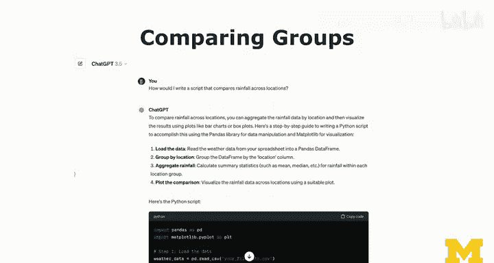
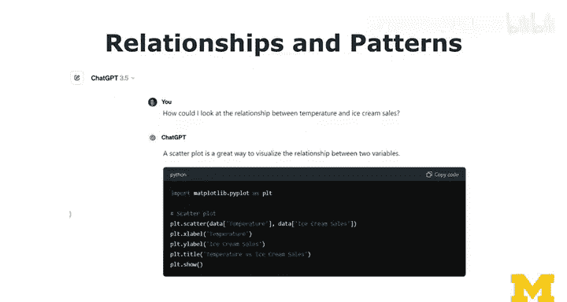

# 9：数据分析实践 📊

在本节课中，我们将学习数据分析的核心实践。我们将探讨统计分析的基础知识，并了解如何利用AI工具作为辅助，指导我们编写分析代码，而不仅仅是替我们完成分析。

我们已经思考过数据，收集过数据，甚至处理过数据，现在终于到了关键时刻：分析。

在数据分析领域，世界是你的舞台。但为了确保你不会在众多选择中迷失方向，我们需要先掌握一些基础知识。

上一节我们介绍了数据分析的重要性，本节中我们来看看统计分析的基础以及AI如何辅助我们。

## 统计分析基础与AI辅助 🧮

让我们探索统计分析的基础，我将向你展示JenAI如何扮演副驾驶的角色，引导你编写这些分析的代码，而不是直接为你完成。

### 描述性统计

描述性统计能让我们快速了解数据的概况。

以下是获取数据洞察的基本步骤：

*   **核心概念**：描述性统计（如均值、中位数、标准差）用于总结数据集的主要特征。
*   **AI辅助示例**：假设你有一个每周气温的数据集，与其手动计算平均值，你可以询问AI：“你能帮我写一个Python脚本来计算这个数据的平均温度吗？”
*   **代码示意**：AI可能会引导你使用类似 `data['temperature'].mean()` 的Pandas函数。

### 组间比较

比较数据中的不同组别可以揭示组间差异和相似性的重要见解。

上一节我们了解了如何总结数据，本节中我们来看看如何比较不同组别。

以下是进行组间比较的方法：

*   **核心概念**：通过统计检验（如t检验）比较两个或多个组的均值是否存在显著差异。
*   **应用场景**：比较不同营销策略下的销售额，或不同地区产品的用户满意度。
*   **AI辅助思路**：你可以询问AI：“如何用Python检验A组和B组的平均成绩是否有显著差异？”

### 识别模式与关系

识别数据中的模式或关系也能揭示大量信息。

在掌握了数据总结和比较后，我们可以进一步探索变量之间的关系。

以下是探索数据关系的途径：

*   **核心场景**：假设你好奇更高的温度是否会影响冰淇淋销量。以JenAI为副驾驶，你可能会问：“使用Python检查温度和冰淇淋销量之间相关性的最佳方法是什么？”
*   **核心方法**：在这里，JenAI会引导你使用相关性函数。
*   **公式/代码示意**：例如，使用Pandas的 `data['temperature'].corr(data['ice_cream_sales'])` 来计算皮尔逊相关系数。

## 迈向高级分析 🚀

当你对基础统计知识掌握牢固后，探索高级统计建模（如回归分析或预测建模）就成为下一个前沿领域。

Gen AI可以指导你如何进行。你可能会说：“我想根据历史数据预测下个月的销售额。你能指导我在Python中建立线性回归模型吗？”

这样你就获得了一个个性化的教程。在进入下一个关于数据可视化的视频之前，我再给大家举几个例子。

本节课中我们一起学习了数据分析的核心实践。我们从描述性统计开始，了解了如何快速总结数据；接着探讨了如何比较不同组别以发现差异；然后学习了如何识别变量间的模式和关系，例如相关性分析；最后，我们展望了在基础稳固后，如何利用AI辅助进入回归分析等高级建模领域。记住，AI在这里的角色是引导和教学，帮助你理解并亲手编写分析代码，从而真正掌握数据分析的技能。