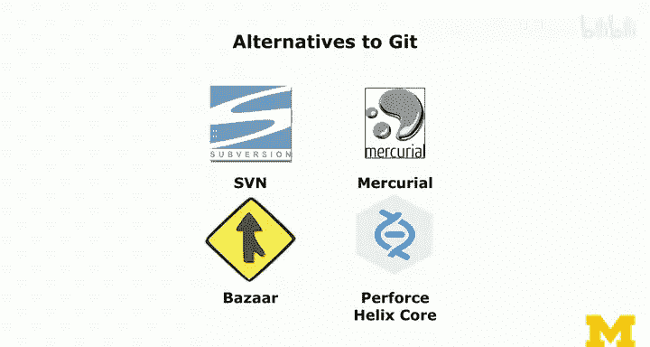

# 11：辅助性技能培养 📚

在本节课中，我们将学习数据分析工作中至关重要的辅助性技能：如何妥善保存和分享你的工作成果。掌握这些技能能有效提升你的工作效率和协作能力。

---

现在，我们已经来到了最后一个模块。你已经完成了大量的学习。

你学会了如何识别数据并获取数据。

你也学会了如何分析数据并将其可视化。现在，在这个最终的模块中，我将教你一些实用的辅助技能。

我指的是保存和分享你的工作成果。我无法过分强调正确保存工作的重要性。

你可能会想，我知道我知道，点击保存按钮，备份你的数据。但这并不是我要说的重点。是的，那些事情也很重要。

但人们常常忘记，仅仅保存工作是不够的。你如何保存它同样关键。

你如何记录你所创建的不同版本。

我指的是那种常见的混乱情况：开始一个项目，保存一个草稿，然后制作最终版本，但实际上它又不是最终版本，因为有人给了你更多修改意见。

然后你又做了一些修改，现在看看你的文件夹。

解决这些令人头疼的问题的方法是一个叫做“版本控制”的概念。从技术上讲，当你手动为文档的不同版本命名时，你就在进行版本控制。

但如果我告诉你，有更好的方法呢？存在自动化的版本控制方式。

像谷歌文档这样能自动保存进度并允许你回溯到先前版本的工具就是一个例子。

对于数据分析，你可以使用名为 **Git** 的工具轻松跟踪项目的变更。

**Git** 是用于此目的最常用的软件程序。

但也存在其他版本控制的替代选项，如 **SVN**、**Mercurial**、**Bazaar** 和 **Perforce Helix Core**。

我们工具箱中的另一个辅助工具是 **GitHub**。GitHub 是一个在线平台，你可以在其中托管你的版本控制项目。

GitHub 也为编程和数据分析领域的人们提供了一个在线社区和作品集展示平台。

接下来，让我们为你配置这些工具。

---

本节课中，我们一起学习了数据分析中保存和分享工作的核心辅助技能。我们探讨了版本控制的重要性，介绍了 **Git** 这一自动化版本控制工具及其替代品，并了解了 **GitHub** 作为项目托管和社区平台的作用。掌握这些工具将帮助你更高效、更专业地管理数据分析项目。