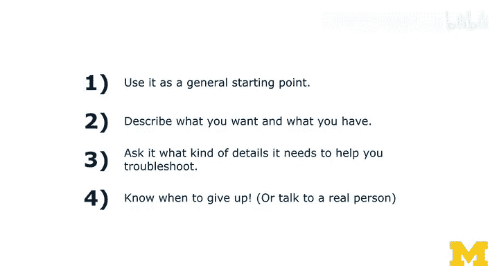

# 12：生成式AI技术助手 🛠️

在本节课中，我们将学习如何利用生成式AI作为个人技术助手，以高效解决软件使用、环境配置等常见技术问题。我们将探讨其优势、适用场景、局限性以及最佳实践方法。

---

## 概述：AI成为你的个人技术专家

AI现在可以充当你的个人技术专家。许多过去需要花费大量时间学习的事情，现在借助合适的AI助手，你都可以自行解决。

实际上，在我筹备这门课程之前，我从未使用过Jupyter Notebooks。这或许令人惊讶，因为我是一名R语言用户，所有经验都基于RStudio。但现在，借助生成式AI，学习使用新软件变得相当容易。

## 生成式AI：新一代的“让我帮你谷歌一下”

使用生成式AI基本上就是新一代的“让我帮你谷歌一下”。这是目前最高效的解决问题的方式。

回想一下过去搜索如何设置Python开发环境时的挫败感。你通常会找到大量通用指南，并希望其中有一份恰好符合你的具体配置。而有了生成式AI，这个过程变得轻松许多。

## 具体应用：以配置Jupyter Notebook为例

例如，假设你正在设置Jupyter Notebook。你现在可以直接提问：“如何在macOS上配置Jupyter Notebook？”

正如课程开头所说，本课程侧重于使用普遍可用的基础AI聊天机器人。但将AI直接集成到编码环境中的技术也取得了巨大进展。

## 集成开发环境中的AI助手

像GitHub Copilot这样的工具可以轻松集成到Visual Studio Code等环境中。几乎每隔几个月，这个领域就会出现新的进展。

现在，许多公司都在使用自己的文档来训练类似GPT的模型。这意味着你不再需要翻阅大量文档页面，或四处点击搜索，寄希望于找到所需内容。

## 重要提醒：AI工具的局限性

现在请记住，生成式AI工具并非先知。无法保证它们总能给出正确答案。

有多种因素会影响它们的表现。特别是当你询问非常小众或罕见的问题时，其训练数据集中可能没有足够的参考资料来提供优质答案。

## 最佳实践指南

我的建议是，将其作为一个通用的起点。

以下是使用AI助手时可以参考的步骤：

1.  **描述目标与现状**：清晰说明你想要实现什么，以及你目前拥有什么条件。
2.  **主动提供细节**：考虑主动询问AI需要哪些细节信息来帮助你解决问题。
3.  **验证与求助**：如果所有方法都失败，不要放弃，或者去咨询真正的专家。

---

## 总结

本节课中，我们一起学习了如何将生成式AI作为强大的技术助手。我们了解了它如何简化学习新工具和配置环境的过程，认识了其在集成开发环境中的发展趋势，同时也明确了它的局限性。关键在于将其作为高效的问题解决起点，并在必要时结合人类专家的智慧。