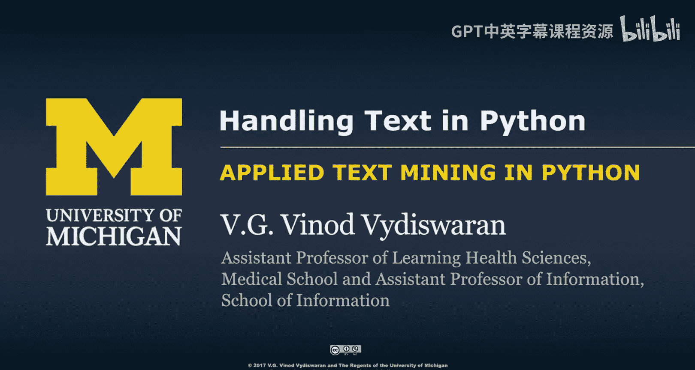
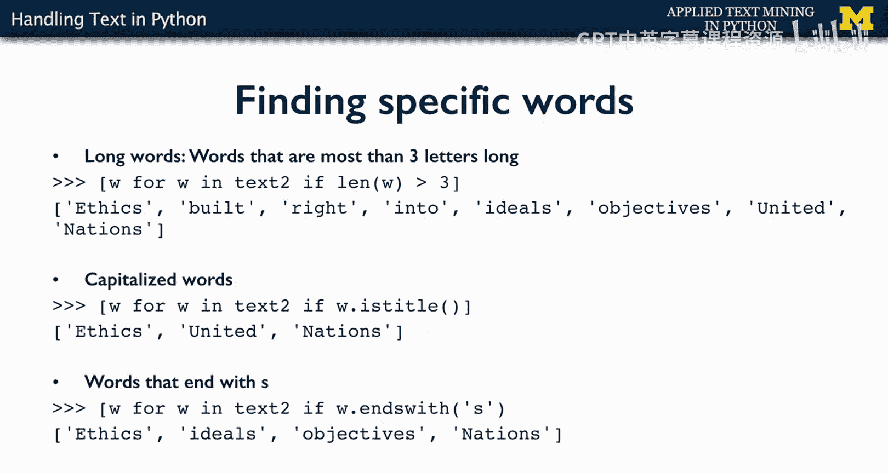
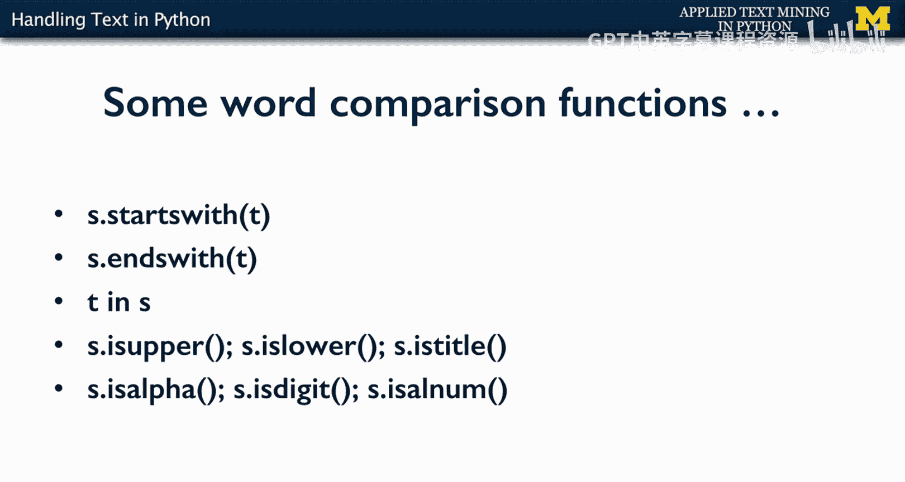
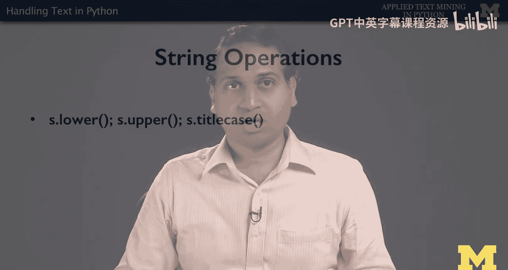
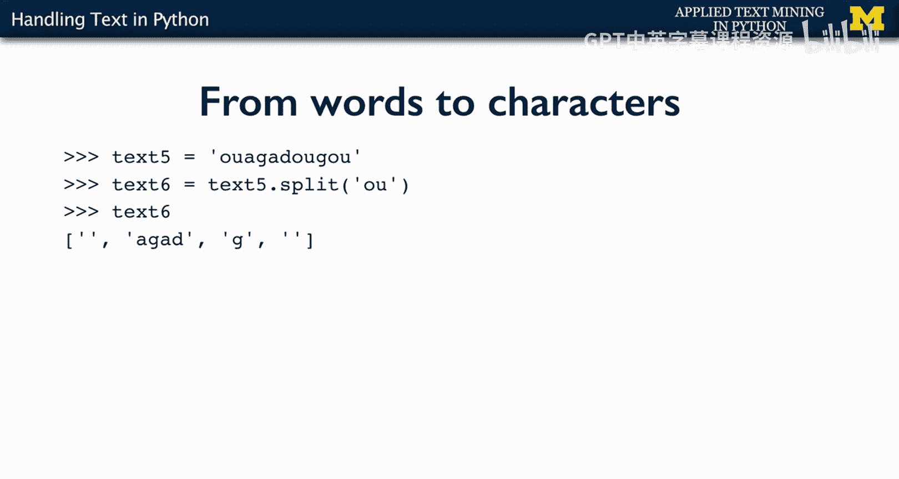
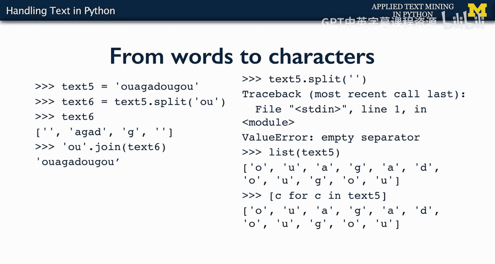
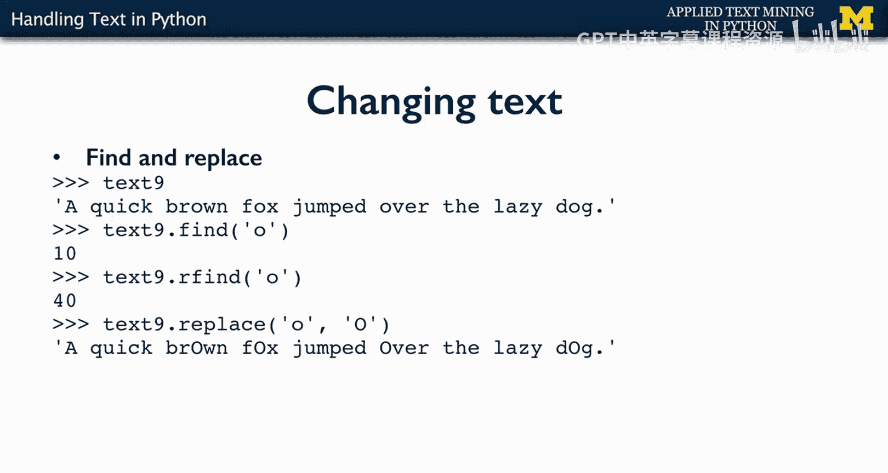
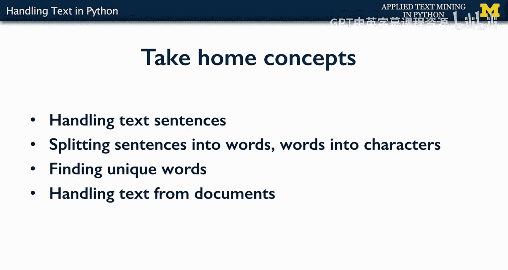

# 2：Python文本处理





## 概述
在本节课中，我们将学习如何在Python中处理文本数据。我们将从文本的基本构成单位开始，逐步学习如何操作字符串、单词和字符，并了解如何从文件中读取和处理较大的文本。

## 文本的基本构成

上一节我们介绍了课程的整体目标，本节中我们来看看文本的基本构成单位。

文本由句子或字符串构成。句子由单词或标记构成。单词由字符构成。另一方面，我们还有文档和更大的文件。我们将讨论所有这些结构及其属性。

让我们尝试一下。我们从联合国发言人的个人资料中提取一句话，并将其命名为`text1`。

```python
text1 = "ethics are built right into the ideals and objectives of the United Nations"
```

如果你找出`text1`的长度，它会告诉你这个字符串中有多少个字符，结果是76。

如果你想找出单词，你需要分割这个文本。假设我们以空格进行分割，这是我们最基础的标记化方法。因此，你通过空格分割这个句子来找出单词或标记。

```python
text2 = text1.split()
len(text2) # 结果是13
```

这个句子中有13个标记。这些标记是：ethics, are, built, right, into, the, ideals, and, objectives, of, the, United, Nations。这些看起来都是有效的单词，所以这种分割方法效果很好。

## 查找特定单词

上一节我们学习了如何分割文本得到单词，本节中我们来看看如何根据条件查找特定的单词。

以下是查找特定类型单词的方法：

*   **查找长单词**：要查找长度超过3个字符的单词，可以使用列表推导式。
    ```python
    [w for w in text2 if len(w) > 3]
    ```
    这将返回`text2`中所有长度超过3个字符的单词，例如：ethics, built, right, into等。



*   **查找首字母大写的单词**：首字母大写的单词是指以大写字母A到Z开头的单词。你可以使用`.istitle()`函数，它会检查第一个字符是否大写而其余字符小写。
    ```python
    [w for w in text2 if w.istitle()]
    ```
    这将告诉你哪些单词的`.istitle()`为真，例如：Ethics, United, Nations，否则为假。

*   **查找以特定字母结尾的单词**：要查找以`s`结尾的单词，可以使用`.endswith()`方法。
    ```python
    [w for w in text2 if w.endswith('s')]
    ```
    这将返回：ethics, ideals, objectives, nations。


## 查找唯一单词

上一节我们学习了如何查找单词，本节中我们来看看如何找出文本中不重复的唯一单词。

我们需要使用`set`函数来实现这个功能。让我们看另一个例子，`text3`，这是一句著名的短语。

```python
text3 = "To be or not to be"
```

如果你用空格分割它，你会得到6个单词：`['To', 'be', 'or', 'not', 'to', 'be']`。

现在，如果你使用`set`函数，它会找出这个列表中的所有唯一单词。

```python
text4 = text3.split()
set(text4) # 结果是 {'be', 'To', 'or', 'to', 'not'}
len(set(text4)) # 结果是 5
```

我们期望得到4个唯一单词，但答案是5，发生了什么？如果你查看`set(text4)`，你会看到确实有`to`, `be`, `or`, `not`，但`to`出现了两次，一次是大写`T`，另一次是小写`t`。

这是一个问题，因为你不会希望仅仅因为一个单词是首字母大写就产生两个变体。

为了解决这个问题，我们应该将文本转换为小写。

```python
set(w.lower() for w in text4) # 结果是 {'be', 'or', 'not', 'to'}
len(set(w.lower() for w in text4)) # 结果是 4
```



如果你打印整个集合，它确实是`to`, `be`, `or`, `not`（以某种顺序）。




## 字符串检查方法

上一节我们使用了`.istitle()`和`.endswith()`等方法，本节中我们更详细地了解一些其他的字符串检查函数。

我们有以下用于检查字符串属性的方法：

*   **`.startswith(prefix)`**：检查字符串是否以指定前缀开头。
*   **`.endswith(suffix)`**：检查字符串是否以指定后缀结尾，我们之前用`endswith('s')`演示过。
*   **`substring in string`**：使用`in`操作符来查找一个子字符串是否存在于一个更大的字符串中。
*   **`.isupper()`**：检查字符串中所有字符是否都是大写。
*   **`.islower()`**：检查字符串中所有字符是否都是小写。
*   **`.istitle()`**：检查字符串是否为首字母大写形式（第一个字符大写，其余小写）。
*   **`.isalpha()`**：检查字符串是否仅由字母组成。
*   **`.isdigit()`**：检查字符串是否仅由数字（0-9）组成。
*   **`.isalnum()`**：检查字符串是否仅由字母和数字组成。

## 字符串操作

上一节我们介绍了字符串的检查方法，本节中我们来看看更多可以对字符串本身进行的操作。

我们有以下常用的字符串操作方法：

*   **`.lower()`**：接收一个字符串`s`，返回其小写版本。
*   **`.upper()`**：将字符串转换为大写。
*   **`.title()`**：将字符串转换为标题格式（每个单词首字母大写）。
*   **`.split(sep)`**：在指定的分隔符`sep`处分割句子`s`。例如，在空格处分割（`sep`为单个空格字符），我们将得到单词列表。
*   **`.splitlines()`**：在换行符（`\n`）处分割字符串。
*   **`.join(iterable)`**：与`.split()`相反。它接受一个由字符串组成的可迭代对象（如列表或集合），并使用调用该方法的字符串`s`作为连接符将它们连接起来。
*   **`.strip()`**：移除字符串开头和结尾的所有空白字符（包括空格和制表符）。
*   **`.rstrip()`**：仅移除字符串结尾的空白字符。
*   **`.find(sub)`**：从字符串开头查找子字符串`sub`，返回其首次出现的索引位置。
*   **`.rfind(sub)`**：从字符串末尾开始查找子字符串`sub`，返回其首次出现的索引位置。
*   **`.replace(old, new)`**：接受两个参数`old`和`new`，将字符串`s`中所有出现的子字符串`old`替换为`new`。

## 操作示例：分割与连接

让我们通过例子来看看这些操作如何工作。首先看从单词到字符的转换。

```python
text5 = "Ouagadougou" # 布基纳法索的首都
```

你在这个单词`text5`上以`"Ou"`进行分割。你期望看到什么？

```python
text6 = text5.split("Ou")
print(text6) # 输出：['', 'agad', 'g', 'ou']
```

在`text5`中，当你用`"Ou"`分割时，会得到4个部分。第一个是空字符串，因为字符串`text5`以`"Ou"`开头，所以在那之前没有任何内容。然后在第一个`"Ou"`和第二个`"Ou"`之间，你有`"agad"`，这是集合中的第二个元素。接着是`"g"`，第三个。最后，`"ou"`是单词的最后一部分，所以之后也没有内容，因此第四个也是空字符串。

所以，当一个特定字符串（本例中是`"Ou"`）在文本中出现三次时，分割后会得到四个部分：第一次出现之前、第一次和第二次之间、第二次和第三次之间、第三次之后。

现在，如果你用字符串`"Ou"`来连接`text6`（这个包含四个元素的数组）：

```python
joined_text = "Ou".join(text6)
print(joined_text) # 输出：'Ouagadougou'
```



你将得到`Ouagadougou`，这正是我们开始分割的单词。分割和连接是互逆操作。

## 获取单词中的字符


假设我们想获取一个单词中的所有字符。

我们可能会想通过分割来获取，比如在空字符串上分割。

```python
# text5.split("") # 这会报错：ValueError: empty separator
```

实际上，这会得到一个错误，提示是空分隔符。所以这行不通。

正确的方法是使用`list()`函数。

```python
list(text5) # 输出：['O', 'u', 'a', 'g', 'a', 'd', 'o', 'u', 'g', 'o', 'u']
```

另一种方法是使用循环：




```python
[c for c in text5] # 输出：['O', 'u', 'a', 'g', 'a', 'd', 'o', 'u', 'g', 'o', 'u']
```

因此，有两种方法可以从单词中获取字符：一种是使用`list()`函数，另一种是使用`[c for c in text5]`。

## 文本清理示例

现在，让我们看一些清理文本的例子。

```python
text8 = "   A quick brown fox jumped over the lazy dog.   "
```

这个字符串前后有一些空白字符。当你按空格分割时，由于前后有空白字符，你会在开头和结尾得到空字符串。

```python
text8.split(' ') # 开头和结尾会有空字符串元素
```

这不是我们想要的结果。我们应该先使用`.strip()`方法。

```python
cleaned_text = text8.strip()
cleaned_text.split(' ') # 现在会正确地得到单词列表：['A', 'quick', 'brown', 'fox', 'jumped', 'over', 'the', 'lazy', 'dog.']
```

`.strip()`会移除字符串开头和结尾的所有空白字符。然后你再按空格分割，就能正确得到单词。

如果你想进行查找和替换操作：

```python
text9 = "A quick brown fox jumped over the lazy dog."
```

假设我们想查找字符`'o'`。

```python
text9.find('o') # 输出：10
```




`text9.find('o')`会返回它找到的第一个`'o'`的字符偏移量（索引）。在这个字符串中，它是第10个字符（索引从0开始）。

同样，你可以使用`.rfind()`进行反向查找。

```python
text9.rfind('o') # 输出：40
```

这将返回字符索引40，因为从第一个`'A'`（索引0）开始，到`'dog.'`中的`'o'`，是第40个字符。

最后，你可以进行替换，比如将所有小写`'o'`替换为大写`'O'`。

```python
text9.replace('o', 'O') # 输出：'A quick brOwn fOx jumped Over the lazy dOg.'
```

这将给出相同的句子，但其中所有四个出现的`'o'`都被替换成了`'O'`。

这演示了如何使用`.find()`、`.rfind()`和`.replace()`来查找和修改文本。

## 处理大型文本文件

上一节我们处理的是内存中的字符串，本节中我们来看看如何处理存储在文件中的大型文本。

大型文本通常存储在文件中，因此你需要读取文件，例如逐行读取。

我们以名为`UNhdr.txt`的文件为例，这是《世界人权宣言》。

```python
f = open('UNhdr.txt', 'r') # 以读取模式打开文件
first_line = f.readline()
print(first_line) # 输出类似：'Universal Declaration of Human Rights\n'
```

`f.readline()`会读取第一行，其中包括末尾的`\n`来表示行结束。

如果你想读取整个文件，可以循环读取每一行，或者一次性读取。因为我们已经打开并读取了一行，为了重置读取指针到文件开头，我们使用`f.seek(0)`。

```python
f.seek(0) # 重置读取位置到文件开头
text12 = f.read() # 读取整个文件内容
len(text12) # 输出：10891 (字符数)
```

`f.read()`会读取整个文件并将其作为字符串返回。`text12`的长度是10891个字符。

然后，你可以对`text12`使用`.splitlines()`来获取由`\n`分隔的158行。

```python
lines = text12.splitlines()
len(lines) # 输出：158
print(lines[0]) # 输出：'Universal Declaration of Human Rights' (注意没有\n)
```

你会注意到，当你使用`.splitlines()`分割时，`\n`字符消失了，因为你是基于它进行分割的。而之前使用`f.readline()`读取单行时，末尾包含`\n`。

通常，你会使用以下文件操作：

*   **`open(filename, mode)`**：打开文件。模式`'r'`表示读取，`'w'`表示写入。
*   **`f.readline()`**：读取一行。
*   **`f.read()`** 或 **`f.read(N)`**：读取整个文件，或读取接下来的N个字符。
*   **循环读取**：`for line in f:`
*   **`f.seek(0)`**：将读取位置重置回文件开头。
*   **`f.write(message)`**：如果你以写入模式打开文件，可以用此方法写入内容。
*   **`f.close()`**：关闭文件句柄。这是打开文件的反向操作。
*   **`f.closed`**：检查文件句柄是否已关闭。

当你读取文件时，注意到`f.readline()`在末尾给出了`\n`。我们可能不想保留它。如何移除最后一个换行符？你可以使用`.rstrip()`。

```python
first_line_stripped = first_line.rstrip()
print(first_line_stripped) # 输出：'Universal Declaration of Human Rights'
```

`.rstrip()`用于从字符串末尾移除空白字符，而`\n`就是其中之一。这个`.rstrip()`方法适用于各种换行符（如`\r`或`\r\n`），因此它是一个通用函数，比直接查找`\n`更好，因为后者可能因编码不同而有所变化。

## 总结

本节课中我们一起学习了如何处理文本句子。我们看到了如何将句子分割成单词，以及将单词分割成字符的两种方法。我们学习了如何查找唯一单词，并简要了解了如何处理来自文档或大型文件的文本。



## 下一步


接下来，我们将更详细地探讨如何处理文本，以从中发现一些有趣的概念。